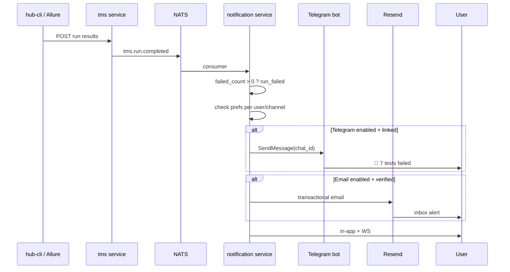

# NOTIF — Telegram Binding + Email Alerts (Спецификация)

> **Статус:** Design · **Milestone:** v2.5–v2.6  
> **Связано:** US-S05, `notification` module, Resend (magic link), Telegram bot (auth)

---

## 1. Проблема

| Сценарий | Сейчас | Боль |
|----------|--------|------|
| User вошёл через **Magic Link** | `telegram_id` пустой | Telegram-канал в настройках **не работает** — некуда слать |
| User вошёл через **Telegram** | `telegram_id` есть | Уведомления в TG ✅, но нет явного «привязано/отвязано» |
| **Тесты упали** в CI-прогоне | `run_completed` generic | QA не получает **целевой** алерт «N failed» на email/TG |
| Email для алертов | Только Magic Link (Resend) | **Scope constraint** — см. §7 |

**Запрос:** привязка бота для уведомлений + email-рассылка по событиям (прогон упал и т.д.).

---

## 2. Важно: что НЕ делаем

| Запрос | Решение |
|--------|---------|
| «Пароль для входа» | ❌ **Запрещено** — auth только **Magic Link** (ADR-AUTH-01) |
| «Пароль SMTP пользователя» | ❌ Admin настраивает hub-mail / Resend |
| Email marketing | ✅ v2.6 Mailchimp-lite (admin-only) — ADR-TZ-REWRITE |
| Email transactional | ✅ opt-in alerts — ADR-NOTIF-01 |

**«Почта» в UI** = подтверждённый **email получателя** (из профиля), не пароль.

---

## 3. Telegram — привязка бота для уведомлений

### 3.1 Текущее состояние (код)

```106:112:backend/internal/notification/service.go
	// Отправляем в Telegram если канал включён и у пользователя есть telegram_id.
	telegramEnabled, err := s.repo.IsEnabled(ctx, evt.UserID, evt.Type, ChannelTelegram, evt.ProjectID)
	// ...
		s.sendTelegram(ctx, evt.UserID, evt.Title, evt.Body)
```

- Бот (`TelegramBotAuth`) сейчас только **код входа** (`/login`), не привязка.
- Magic-link пользователи **не могут** получать TG-уведомления без доработки.

### 3.2 Целевой UX

**Settings → Уведомления → блок «Telegram»**

1. Статус: `Не привязан` | `Привязан @username` | `Ошибка доставки`
2. Кнопка **«Привязать Telegram»** → показывает:
   - Deep link: `https://t.me/HubNotifyBot?start=bind_<token>`
   - Или 6-значный код + инструкция «Отправьте боту `/link`»
3. Кнопка **«Отвязать»** (с подтверждением)
4. **«Отправить тест»** — ping «Hub notifications OK»

### 3.3 Flow привязки (рекомендуемый — dual)

```
┌──────────┐    POST /notifications/telegram/bind     ┌───────┐
│ Frontend │ ──► token UUID, TTL 10 min, Redis         │ Redis │
└──────────┘                                         └───┬───┘
       │ deep link /start bind_<token>                   │
       ▼                                                 │
┌──────────┐    /start bind_<token>                      │
│ TG Bot   │ ──► verify token → set user.telegram_id ───┘
└──────────┘         + telegram_username (optional)
       │
       ▼
 WS / poll → UI «Привязано ✅»
```

**Альтернатива (код):** как login — `/link` в боте → код → `POST /notifications/telegram/confirm { code }` (JWT required).

**Почему dual:** deep link удобнее на mobile; код — fallback на desktop без Telegram app.

### 3.4 Bot commands (notification bot = тот же bot token)

| Command | Действие |
|---------|----------|
| `/start bind_<token>` | Привязка по deep link |
| `/link` | Выдать 6-digit код для ввода в Hub |
| `/unlink` | Отвязать (только если chat == bound user) |
| `/status` | Показать привязанный Hub email (masked) |
| `/test` | Тестовое уведомление |
| `/login` | **Existing** — не смешивать с bind token prefix |

**Redis keys:**
- `tg:bind:<token>` → `user_id` (TTL 10m)
- `tg:linkcode:<code>` → `user_id` (TTL 5m) — отдельный prefix от auth `tg:code:`

### 3.5 Schema (minimal)

```go
// user schema — уже есть telegram_id; добавить:
field.String("telegram_username").Optional().Nillable()
field.Time("telegram_linked_at").Optional().Nillable()
field.Bool("telegram_notify_enabled").Default(true) // master switch
```

Опционально v2.6.1: `telegram_chat_id` если позже — алерты в групповой QA-чат.

### 3.6 API

| Method | Path | Auth | Description |
|--------|------|------|-------------|
| POST | `/api/notifications/telegram/bind` | JWT | Создать bind token + deep link |
| POST | `/api/notifications/telegram/confirm` | JWT | `{ "code": "123456" }` |
| DELETE | `/api/notifications/telegram` | JWT | Отвязать |
| POST | `/api/notifications/telegram/test` | JWT | Тестовое сообщение |
| GET | `/api/notifications/telegram/status` | JWT | `{ linked, username, linked_at }` |

### 3.7 Security

- Bind token one-time, привязан к `user_id` из JWT (создание) — bot callback не доверяет chat без token/code
- Нельзя привязать `telegram_id` уже занятый другим user → 409
- Rate limit: 5 bind attempts / 10 min / user
- Audit: `telegram.linked`, `telegram.unlinked`

---

## 4. Email — transactional alerts

### 4.1 Scope decision (ADR требуется)

**Текущее правило:** «Email-уведомления ❌ (кроме Magic Link через Resend)».

**Предлагаемое расширение (ADR-NOTIF-01):**

> Resend разрешён также для **transactional alerts**, если:
> - пользователь **opt-in** канал `email` в notification preferences;
> - email **verified** (verified_at not null);
> - шаблоны только системные (run failed, security, assignment urgent);
> - без marketing / digest email (digest → in-app + Telegram).

Без ADR — email-алерты **не ship**.

### 4.2 «Почта» пользователя — без пароля

1. Email берётся из `user.email`
2. Если `telegram_*@hub.local` placeholder → UI просит **добавить реальный email** в профиле
3. **Верификация:** Magic Link micro-flow — «Отправить код на email» → 6 digits → `email_verified_at`
4. В настройках уведомлений колонка **Email** активна только при verified email

**Admin не вводит пароль пользователя.** Admin настраивает только:

```env
RESEND_API_KEY=...
RESEND_FROM=Hub Alerts <alerts@company.com>
# Optional v2.6 enterprise:
SMTP_HOST= SMTP_USER= SMTP_PASSWORD= (encrypted in config)
```

### 4.3 EmailSender (new)

```go
// internal/notification/email.go
type EmailSender interface {
    SendAlert(ctx context.Context, to, subject, htmlBody, textBody string) error
}

// ResendEmailSender — reuse auth/resend.go pattern, separate templates
```

- HTML шаблоны: `templates/email/run_failed.html`
- `List-Unsubscribe` header → link to `/settings/notifications` (one-click opt-out per type)
- Rate limit: 20 emails/user/day (configurable Admin)

### 4.4 Канал в preferences

Расширить `ChannelEmail = "email"` в `events.go` + UI колонка «Email» в `notification-settings.tsx`.

Default **off** для email (opt-in), except `new_login` security — optional always-on with ADR.

---

## 5. TMS — «тесты упали в прогоне»

### 5.1 Новые типы событий

| Type | Когда | Urgent |
|------|-------|--------|
| `run_completed` | Прогон завершён (existing) | false |
| **`run_failed`** | `failed_count > 0` | **true** if >50% failed |
| **`run_regression`** | failed cases ∩ previous run passed | true |
| `run_flaky_suspect` | v2.6 flaky detector | false |

### 5.2 NATS / pipeline

```
tms.run.completed (existing)
    │
    ▼
notification/consumer OR tms service hook
    │
    ├─ if failed_count == 0 → run_completed (info)
    └─ if failed_count > 0  → run_failed (urgent bypass quiet hours)
           │
           ▼
    Recipients:
    - run.assignees
    - project role Tester + QA Lead
    - users with pref run_failed + channel enabled
```

### 5.3 Payload пример

**Telegram (MarkdownV2):**

```
🔴 Прогон MOB-R12 failed

Проект: Mobile App
Failed: 7 / 120 (5.8%)
Окружение: staging

[Открыть прогон](https://hub.company/tms/runs/uuid)
```

**Email (HTML):**

- Subject: `[MOB] Прогон R12 — 7 тестов failed`
- Body: таблица top 10 failed cases + CTA button

### 5.4 Project-level overrides

`/projects/:id/settings/notifications`:

- «Всегда слать run_failed в #hub-ci» (system message — reuse PROD-01)
- «Email дублировать QA Lead»

---

## 6. Матрица каналов (рекомендуемые defaults)

| Event | In-app | Telegram | Push | Email |
|-------|--------|----------|------|-------|
| run_failed | ✅ on | ✅ on (if linked) | ✅ on | opt-in |
| run_completed (pass) | ✅ | off | off | off |
| assigned | ✅ | opt-in | opt-in | off |
| new_login | ✅ | ✅ | off | opt-in security |
| mentioned | ✅ | opt-in | opt-in | off |

**Quiet hours:** `run_failed` + `new_login` **пробивают** quiet hours (уже есть `IsUrgent`).

---

## 7. Frontend changes

| File | Change |
|------|--------|
| `notification-settings.tsx` | + Email column; + TelegramLinkCard |
| `TelegramLinkCard.tsx` | **new** — bind/unlink/test/deep link QR |
| `profile.lazy.tsx` | Verify email block if placeholder |
| `i18n/.../notifications.json` | Keys for bind flow |
| `routes/.../settings/notifications.tsx` | Compose cards |

---

## 8. Backend tasks (backlog IDs)

| ID | Task | Effort |
|----|------|--------|
| NOTIF-01 | ADR-NOTIF-01 email transactional scope | S |
| NOTIF-02 | Telegram bind API + bot `/start bind_` | M |
| NOTIF-03 | Telegram `/link` code confirm | S |
| NOTIF-04 | `GET/DELETE telegram/status` + audit | S |
| NOTIF-05 | EmailSender + Resend alert templates | M |
| NOTIF-06 | `ChannelEmail` + preferences migration | S |
| NOTIF-07 | Email verify flow (profile) | M |
| NOTIF-08 | `run_failed` event + consumer logic | M |
| NOTIF-09 | UI TelegramLinkCard + email column | M |
| NOTIF-10 | E2E: bind TG mock + run_failed notification | M |

**Wave:** NOTIF-01..04 (TG bind) → v2.5 · NOTIF-05..08 (email+TMS) → v2.6

---

## 8.1 Альтернатива без email (если ADR отклонят)

- Telegram bind **must-have**
- Push + in-app для run_failed
- Email только magic link forever

---

## 9. Диаграмма end-to-end



---

## 10. Открытые вопросы для PO

1. **ADR-NOTIF-01** — разрешаем email alerts через Resend? (рекомендация: **да**, narrow scope)
2. Один bot или два (HubAuthBot vs HubNotifyBot)? (рекомендация: **один token**, разные command handlers)
3. Алерт в **групповой** TG-чат проекта (#qa-alerts) — v2.6 или v2.5?
4. SMTP fallback для air-gap без Resend — enterprise only?

---

*Добавить в FEATURE-BACKLOG: NOTIF-01..10 · Зависит от: Resend config, existing Telegram bot token*
