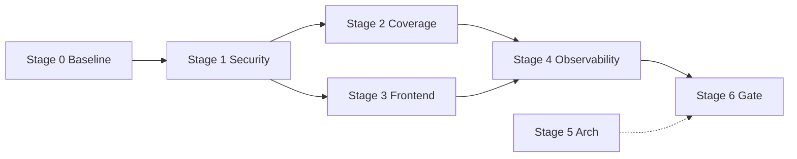

# PLAN — Закрытие всех пробелов (v2.0.1 → v2.5 Gate)

> Создан: 2026-06-17. Цель: production-ready gate (security + coverage + e2e + docs).
> Управление: 12 агентов регламента + devops/refactor/security.

---

## Success Criteria (exit gate)

| Критерий | Target | Проверка |
|----------|--------|----------|
| SEC-PROD | 0 CRITICAL/HIGH open | `security-auditor` + `docs/security_guidelines.md` |
| COV-01 | ≥50% stmt / ≥80% security-critical | `go test -coverprofile` |
| FE-TEST | ≥10 Vitest smoke tests | `npx vitest run` |
| E2E-01 | 5 Playwright critical paths | `npx playwright test` |
| NFR-16 | a11y baseline (axe on 3 pages) | QA gate |
| REGRESSION | build + test -race + tsc | `/qa-gate` |

---

## Стадия 0 — Baseline (1h) ✅ частично

| # | Задача | Агент | Артефакт |
|---|--------|-------|----------|
| 0.1 | Reconcile COVERAGE vs код | `sa` + `sa-ver` | `.planning/COVERAGE.md` |
| 0.2 | Formal security re-audit | `security-auditor` | `docs/security_guidelines.md` |
| 0.3 | Обновить STATE.md | orchestrator | `.planning/STATE.md` |

---

## Стадия 1 — Security & Critical Fixes (Wave 1, ~4h)

| # | Задача | Агент | Файлы |
|---|--------|-------|-------|
| 1.1 | BE-H1..H7 reverification + fixes | `be` + `be-ver` | gitlab, dashboard, health, backup, gdpr |
| 1.2 | Тесты security-critical paths | `qa` + `qa-ver` | auth, ws, rbac, calls, audit |
| 1.3 | INF-01/03 prod compose verify | `devops-engineer` | `deployments/` |
| 1.4 | Secret hygiene checklist | `security-auditor` | `docs/security_guidelines.md` |

**Wave 1 parallel:** `be`, `qa`, `security-auditor`, `devops-engineer`

---

## Стадия 2 — Test Coverage Phase 18 (Wave 2, ~8h)

| # | Задача | Агент | Target coverage |
|---|--------|-------|-----------------|
| 2.1 | auth refresh/ban/magiclink | `qa` | 80% |
| 2.2 | audit ban + HTTP middleware | `qa` | 80% |
| 2.3 | ws hub + authorizer | `qa` | 80% |
| 2.4 | rbac resolver | `qa` | 80% |
| 2.5 | messenger rate limit fan-out | `qa` | 60% |
| 2.6 | platform middleware | `qa` | 70% |

**Wave 2 parallel:** `qa` (6 packages sequential batches of 2)

---

## Стадия 3 — Frontend Quality (Wave 3, ~6h)

| # | Задача | Агент | Артефакт |
|---|--------|-------|----------|
| 3.1 | Vitest smoke: auth, admin audit, ban | `fe` + `fe-ver` | `*.test.tsx` |
| 3.2 | Playwright 5 paths | `qa` | `frontend/e2e/` |
| 3.3 | ErrorBoundary per module | `fe` | calls, tracker, tms, dashboard |
| 3.4 | Biome critical fixes (top 50) | `fe` | lint baseline |
| 3.5 | a11y axe on login/admin/settings | `qa` | test report |

**Wave 3 parallel:** `fe`, `qa`

---

## Стадия 4 — Observability & Best Practices (Wave 4, ~4h)

| # | Задача | Агент | Артефакт |
|---|--------|-------|----------|
| 4.1 | `Timed()` на top-10 service methods | `be` | auth, audit, tracker, messenger |
| 4.2 | Audit retention cron (90d) | `be` + `arch` | audit service |
| 4.3 | Slow query admin widget | `fe` + `be` | `/admin/audit?slow=1` |
| 4.4 | API.md sync (+15 routes) | `docs-writer` | `docs/wiki/API.md` |

**Wave 4 parallel:** `be`, `fe`, `docs-writer`

---

## Стадия 5 — Architecture Debt (Wave 5, optional v2.6)

| # | Задача | Агент |
|---|--------|-------|
| 5.1 | Repository pattern pilot (auth) | `refactor-specialist` |
| 5.2 | main.go cron extraction | `be` + `devops-engineer` |
| 5.3 | ARCH debt register update | `arch` + `arch-ver` |

---

## Стадия 6 — Final Gate (Wave 5) ✅ COMPLETE 2026-06-20

| # | Задача | Агент |
|---|--------|-------|
| 6.1 | Full `/qa-gate` | orchestrator |
| 6.2 | code-reviewer on diff | `code-reviewer` |
| 6.3 | verifier acceptance | `verifier` |
| 6.4 | handoff-sync STATE/ROADMAP | orchestrator |

---

## Стадия 7 — Prod Cutover + UX-0 (Wave 6) ✅ 2026-06-20

| # | Задача | Агент | Артефакт |
|---|--------|-------|----------|
| 7.1 | Dockerfile `-tags release` | `devops-engineer` | `backend/Dockerfile` |
| 7.2 | CI hardening (race timeout, release build) | `devops-engineer` | `.github/workflows/ci.yml` |
| 7.3 | Deploy gated on CI success | `devops-engineer` | `.github/workflows/deploy.yml` |
| 7.4 | Prod compose secrets/CORS/Mongo authSource | `devops-engineer` | `deployments/docker-compose.prod.yml` |
| 7.5 | PG-01 calls coverage 80% | `qa` | `calls/chat_mongo.go`, mock tests |
| 7.6 | US-M07 global Ctrl+K | `fe` | `command-palette.tsx`, `command-store.ts` |
| 7.7 | Docs sync + rule 55-docs-sync | orchestrator | `.cursor/rules/55-docs-sync.mdc` |

**Next:** v2.0.2 tag after commit; PG-03 secret rotation; UX backlog (UserPicker, validation).

---

## Agent Schedule (max parallel)

```
Wave 1 (NOW):  be | qa | security-auditor | devops-engineer
Wave 2:        qa (batch tests)
Wave 3:        fe | qa (e2e)
Wave 4:        be | fe | docs-writer
Wave 5:        refactor (if time)
Wave 6:        verifier + code-reviewer  ✅ 2026-06-20
Wave 7:        devops + fe (prod + Ctrl+K)  ✅ 2026-06-20
```

## Dependency Graph



---

*Orchestrator: запуск Wave 1 немедленно.*
