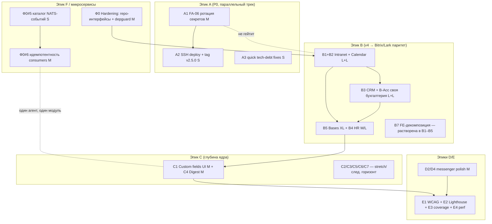

# PLAN: Волновое расписание бэклога расширения (эпики A–F)

> **Дата:** 2026-07-02 · **Автор:** team-lead (A/B-вариант Fable 5, max effort) · **Режим:** read-only планирование
> **Вход:** `.planning/EXPANSION-ANALYSIS-2026-07-02.md` (эпики A–F, оценки S/M/L/XL) ·
> `.cursor/playbooks/team-workflow.md` (волны ≤4, границы файлов, ворота) · `.cursor/playbooks/README.md` (ростер 30) ·
> `.planning/ab-microservices/PLAN-team-lead-opus.md` (Фаза 0 hardening)
> **Горизонт:** ~2.5–3 месяца (12 волн ≈ 52 рабочих дня + буфер)

---

## 1. Зафиксированные решения пользователя (входные ограничения)

| # | Решение | Следствие для расписания |
|---|---------|--------------------------|
| U1 | **Релиз НЕ гейтим**: FA-06 (ротация секретов) идёт параллельно | A1/A2 — фоновый ops-трек в W1 (devops + security-auditor + ручные шаги пользователя). Волны W2+ **не ждут** деплоя; тег v2.5.0 ставится как только A1 закрыт |
| U2 | **Паритет Bitrix/Lark для v4** | Эпик B — главный объём горизонта: intranet «Mighty-lite», calendar first-class, CRM с компаниями/активностями, Bases с формулами/relations/views |
| U3 | **Своя бухгалтерия** (не только 1C-коннектор) | B-Acc расширяется с M до **L/XL**: PDF-инвойсы, мультивалюта, баланс, cash flow, AR aging, НДФЛ. Требует ADR `arch` (W5) + product sign-off на границы |
| U4 | **Направление на микросервисы** | **Фаза 0 hardening** из микросервис-плана вставляется **рано (W2)**: repository-интерфейсы (TD-02), depguard/package-facades, каталог NATS-событий (W5), идемпотентность consumers (W10). Сам split — за горизонтом, только по ADR-триггеру нагрузки |

---

## 2. Граф зависимостей (эпики → крупные планы)

Ключевые рёбра:

- **Ф0 → B**: depguard и repository-рефактор делаем **до** углубления v4, иначе lint-правила ломают свежую работу постфактум, а новый код пишется по старым паттернам.
- **B1+B2 → B4 (HR)**: org chart/leave balance зависят от calendar (availability) и intranet (handbook-wiki).
- **B-Acc → B3 (CRM)**: won→invoice hook углубляется после расширения accounting; поэтому CRM и Accounting идут одной волной (разные модули, один контракт invoice).
- **Ф0#6 и C4** оба трогают `internal/notification` → выполняются **одним агентом (be2) в одной волне (W10)** — конфликт устранён по построению.
- **A ни с чем не связан** (решение U1): релизный трек течёт параллельно.

---

## 3. Принципы расписания

1. **Конвейер**: аналитика (ba→sa→arch→designer) идёт на 1–2 волны впереди реализации; QA — на 1 волну позади. Ни одна волна не простаивает в ожидании спеки.
2. **≤4 параллельных исполнителя на волну** (team-workflow §4). Верификаторы (`*-ver`) и `code-reviewer` работают в **sync-окне** после волны и слоты не занимают.
3. **Границы = модули**: be1/be2 и fe1/fe2 никогда не трогают один `internal/`-пакет или один каталог `modules/` в одной волне. Общие контракты (types.ts, API) — первым коммитом волны (выход sa предыдущей волны).
4. **B7 (FE-декомпозиция) растворяется**: каждый fe-агент, углубляя v4-модуль, обязан разложить его из 1 файла в `components/hooks/stores` — отдельная волна не нужна.
5. **Wiring (`cmd/server/main.go`, роуты)** — всегда у **одного** агента волны (антипаттерн §12.13); в плане ниже это be1.

---

## 4. Волновое расписание

Длительности из оценок эпиков (S≈1–2д, M≈3–5д, L≈1–2нед) с учётом параллелизма. Даты — рабочие дни от старта.

### W1 — Разблокировка релиза + старт аналитики v4 (дни 1–3)

| Агент | Задача | Границы файлов |
|---|---|---|
| devops-engineer | **A1**: FA-06 (scripts/fa06.sh, ротация RESEND/TELEGRAM/livekit, BFG purge) + **A2**: SSH deploy, tag v2.5.0 | `deployments/*`, `scripts/fa06.sh`, GitHub Secrets (вне repo) |
| security-auditor | Верификация A1 (git history чист, secrets scan) + спека фиксов **E5** (FA-02-03 constant-time, FA-02-04 fail-open) | отчёт, без кода |
| be1 | **A3**: GIPHY key → env (`gif-picker.tsx`), magic-link `utf8.RuneCountInString` (`auth/handler.go`), N+1 (`audit/service.go`) + E5-фиксы по спеке security | ровно 4 файла + их тесты |
| ba2 | **B1+B2 US/AC**: intranet «Mighty-lite» (polls, pin/reactions, модерация, onboarding paths), calendar (room booking, availability, recurring, 2-way sync) — с оглядкой на Bitrix/Lark паритет | `docs/vision_and_scope.md` |

- **Вход:** EXPANSION-ANALYSIS §5, TECH-DEBT-AUDIT, competitive_analysis_2026.
- **Выход:** тег v2.5.0 (как только A1 готов — **не блокирует W2**), 4 tech-debt фикса в master, US/AC B1/B2.
- **Ворота:** регрессия backend (A3) + `/qa-gate`; `ba-ver`; security-scan diff. Docs-sync: STATE, security_guidelines.
- **Риск-примечание:** `gif-picker.tsx`, `auth/handler.go`, `audit/repository.go` уже в git status как изменённые — be1 стартует с ревизии текущего diff, не поверх.

### W2 — Ф0 Monolith Hardening + спека/дизайн Intranet+Calendar (дни 4–8)

| Агент | Задача | Границы файлов |
|---|---|---|
| be1 | Ф0: `*ent.Client` за repository-интерфейс в `auth`, `backup`, `imex` | `internal/{auth,backup,imex}/*repository*.go` |
| be2 | Ф0: то же для `dashboard`, `storage`, `rbac`, `apigateway` + **depguard** (warn-mode) + package-facades `internal/*/api.go` | соотв. пакеты + CI lint config |
| sa2 | API-контракты + ERD B1/B2 (poll, room_booking, recurring_event, availability_block; UUID/version/UTC по tz_constraints) | `docs/system_specification.md`, `docs/wiki/API.md` |
| designer | DESIGN-SPEC intranet + calendar (токены `--hub-*`, 5 состояний, a11y) | `DESIGN-SPEC-intranet.md`, `DESIGN-SPEC-calendar.md` |

- **Ворота:** `be-ver` (0 `*ent.Client` в service/handler затронутых пакетов), `sa-ver`, `designer-ver`, полная backend-регрессия (рефактор без изменения поведения), `/qa-gate`.
- **Критерий перехода:** depguard включён в warn; контракты B1/B2 зафиксированы (первый коммит W3).

### W3 — Реализация Intranet + Calendar (дни 9–13)

| Агент | Задача | Границы файлов |
|---|---|---|
| be1 | Intranet BE: polls, pin/reactions, модерация, onboarding paths + wiring роутов **обоих** модулей | `internal/intranet/**`, `ent/schema/poll*.go`, `cmd/server/*` (только be1) |
| be2 | Calendar BE: room booking, team availability, recurring, iCal/Google 2-way | `internal/calendar/**`, `ent/schema/{room_booking,recurring}*.go` |
| fe1 | Intranet FE: декомпозиция (5 файлов → полный модуль) + новые экраны + skeleton/empty states (D1 локально) | `frontend/src/modules/intranet/**` |
| fe2 | Calendar FE: 1 файл 430 стр → components/hooks + booking/availability UI | `frontend/src/modules/calendar/**` |

- **Вход:** контракты sa2 + DESIGN-SPEC (W2). **Выход:** intranet/calendar «Mighty/Lark-lite».
- **Ворота:** `be-ver`, `fe-ver`, регрессия обоих слоёв, docs-sync (system_specification, SHORTCUTS/QUICKSTART), `/qa-gate`.

### W4 — QA v4-1 + аналитика CRM/Accounting (дни 14–17)

| Агент | Задача | Границы |
|---|---|---|
| qa-auto1 | Backend testframework intranet/calendar (цель ≥80% на модуль) | `backend/testframework/{intranet,calendar}/` |
| qa-auto2 | e2e Playwright + Vitest intranet/calendar | `testframework/stages/**` |
| qa-manual | TC-* intranet/calendar, трассируемость AC→TC | `docs/test_plan.md` |
| ba2 | **B3 + B-Acc US/AC**: CRM (companies, активности, воронка, импорт) + своя бухгалтерия (PDF, мультивалюта, баланс, cash flow, AR aging, НДФЛ) | `docs/vision_and_scope.md` |

- **Ворота:** `qa-auto-ver`, `qa-manual-ver`, `ba-ver`; COVERAGE.md; test-triage при любом FAIL.
- **Sync-milestone M1:** intranet+calendar приняты team-lead → baseline.

### W5 — Спека/ADR CRM + Accounting + каталог событий (дни 18–21)

| Агент | Задача | Границы |
|---|---|---|
| sa2 | API/ERD CRM (company, activity, funnel) + Accounting (currency, balance sheet, cash flow, tax) | `system_specification.md`, `wiki/API.md` |
| sa1 | **Ф0#5**: каталог текущих NATS subjects как версионированные контракты (задел микросервисов) | `contracts/events/*` (спека) |
| arch | **ADR-ACCOUNTING-OWN**: расширение double-entry (мультивалюта, отчёты, НДФЛ-границы v1) + предварительное направление по formula engine для Bases | `docs/architecture.md`, ADR |
| designer | DESIGN-SPEC CRM + Accounting (kanban-воронка, отчётные таблицы, PDF-превью) | DESIGN-SPEC-файлы |

- **Ворота:** `sa-ver`, `arch-ver` (+ `product` sign-off на границы НДФЛ/мультивалюты — эскалация U3), `designer-ver`.

### W6 — Реализация CRM + Accounting (дни 22–26)

| Агент | Задача | Границы |
|---|---|---|
| be1 | CRM BE: companies, activities, funnel-аналитика, импорт контактов + wiring | `internal/crm/**`, `ent/schema/company*.go`, `cmd/server/*` |
| be2 | Accounting BE: PDF-инвойсы, мультивалюта, баланс, cash flow, AR aging (НДФЛ — по границам ADR) | `internal/accounting/**`, `ent/schema/currency*.go` |
| fe1 | CRM FE: декомпозиция + companies/activities/funnel UI | `frontend/src/modules/crm/**` |
| fe2 | Accounting FE: декомпозиция + отчёты/PDF-превью/мультивалюта | `frontend/src/modules/accounting/**` |

- Общая точка won→invoice: контракт зафиксирован sa2 в W5, invoice-glue правит **только be2**.
- **Ворота:** стандартные + `/qa-gate`.

### W7 — QA v4-2 + аналитика Bases/HR + ADR формул (дни 27–30)

| Агент | Задача | Границы |
|---|---|---|
| qa-auto1 | Backend tests crm/accounting | `backend/testframework/{crm,accounting}/` |
| qa-auto2 | e2e + Vitest crm/accounting | `testframework/stages/**` |
| ba2 | **B5 Bases US/AC** (Lark-паритет: формулы, relations/lookup, views grid/kanban/calendar, sharing) + **B4 HR US/AC** (org chart, handbook, leave balance) | `vision_and_scope.md` |
| arch | **ADR-FORMULA-ENGINE**: парсер выражений, вычисляемые колонки, защита от циклов, scope формул v1 (арифметика/логика/агрегации; cross-base — later) | `architecture.md`, ADR |

- **Sync-milestone M2:** CRM+Accounting приняты. При перегрузе ba2 — подстраховка **ba1** (берёт HR).

### W8 — Спека/дизайн Bases + HR + ручная приёмка v4-2 (дни 31–34)

| Агент | Задача | Границы |
|---|---|---|
| sa2 | API/ERD Bases (formula, relation, view, share) | `system_specification.md`, `wiki/API.md` |
| sa1 | API/ERD HR (org_chart, handbook↔intranet-wiki, leave_balance↔calendar) | те же docs, раздел HR |
| designer | DESIGN-SPEC Bases (grid/kanban/calendar views, formula editor) + HR (org chart) | DESIGN-SPEC-файлы |
| qa-manual | TC crm/accounting + ручная приёмка M2 | `docs/test_plan.md` |

### W9 — Bases часть 1 + HR (дни 35–39)

| Агент | Задача | Границы |
|---|---|---|
| be1 | Bases BE-1: formula engine (по ADR W7) + вычисляемые колонки + wiring | `internal/bases/formula/**`, `internal/bases/service*.go`, `cmd/server/*` |
| be2 | HR BE: org chart, handbook, leave balance + интеграция calendar/intranet | `internal/hr/**` |
| fe1 | Bases FE-1: декомпозиция + grid-редактор + formula editor UI | `frontend/src/modules/bases/**` |
| fe2 | HR FE: декомпозиция + org chart + handbook | `frontend/src/modules/hr/**` |

### W10 — Bases часть 2 + глубина ядра C1/C4 + Ф0#6 (дни 40–44)

| Агент | Задача | Границы |
|---|---|---|
| be1 | Bases BE-2: relations/lookup, views, sharing | `internal/bases/**` (кроме formula — стабилен) |
| be2 | **C4** notification digest + **Ф0#6** идемпотентность consumers (event_id dedup) — один модуль, один агент | `internal/notification/**`, `internal/audit/consumer.go` |
| fe1 | Bases FE-2: kanban/calendar views, фильтры/сортировки, sharing UI | `frontend/src/modules/bases/**` |
| fe2 | **C1** Custom fields builder UI (backend-схема уже есть) | `frontend/src/components/tracker/custom-fields/**`, `routes/settings/*` |

- **Ворота:** стандартные; для Ф0#6 дополнительно `arch-ver` (закрытие микросервисной Фазы 0 целиком).

### W11 — QA хвоста + coverage uplift + перф + messenger polish (дни 45–48)

| Агент | Задача | Границы |
|---|---|---|
| qa-auto1 | Backend tests bases/hr/notification + **E3**: gitlab 68.5→80, ai 78.9→80, bases →80 | `backend/testframework/**` |
| qa-auto2 | e2e bases/hr + custom fields + digest | `testframework/stages/**` |
| be2 | **E4**: GZIP/Brotli (`wiring_fiber.go`), composite-индексы (issue/user/project), messenger-store нормализация — BE-часть | `platform/wiring_fiber.go`, `ent/schema/{issue,user,project}.go` |
| fe1 | **D4+D2**: message-composer декомпозиция + `React.memo` MessageItem + optimistic reactions — один агент на весь messenger-FE | `frontend/src/components/messenger/**`, `stores/messenger-store.ts` |

- **Sync-milestone M3:** Bases/HR приняты; COV overall ≥82%, все модули ≥80%.

### W12 — Compliance + финальная приёмка горизонта (дни 49–52)

| Агент | Задача | Границы |
|---|---|---|
| designer | **E1** WCAG 2.1 AA full audit (dark+light, все страницы) — findings-отчёт | отчёт + мелкие token-фиксы `app.css` |
| qa-manual | E1: ручной a11y-проход по TC + приёмка WCAG | `docs/test_plan.md` |
| devops-engineer | **E2** Lighthouse blocking gate ≥90 (после baseline) + деплой v2.6 | `.github/workflows/*` |
| docs-writer | Bulk docs-sync горизонта: wiki, API.md, QUICKSTART, vision KPI-факт | `docs/**` |

- **Финал:** `code-reviewer` по остаточным diff → **team-lead финальная приёмка** → `/qa-gate` green → тег **v2.6.0**.

---

## 5. Сводная карта границ (кто что трогает — без пересечений)

| Модуль/зона | Владелец в горизонте | Волны |
|---|---|---|
| `cmd/server/*` (wiring) | **только be1** | W3, W6, W9 |
| `internal/{intranet}` / `{calendar}` | be1 / be2 | W3 |
| `internal/{crm}` / `{accounting}` | be1 / be2 | W6 |
| `internal/{bases}` / `{hr}` | be1 / be2 | W9–W10 / W9 |
| `internal/notification` (+consumers) | **только be2** | W10 |
| `modules/{intranet,crm,bases}` FE | fe1 | W3, W6, W9–W10 |
| `modules/{calendar,accounting,hr}` FE + custom fields | fe2 | W3, W6, W9–W10 |
| `components/messenger/**` | **только fe1** | W11 |
| `backend/testframework/**` | qa-auto1 | W4, W7, W11 |
| `testframework/stages/**` (Vitest/e2e) | qa-auto2 | W4, W7, W11 |
| `docs/vision_and_scope.md` | ba2 (ba1 — подстраховка) | W1, W4, W7 |
| `docs/system_specification.md`, `wiki/API.md` | sa2 (sa1 — HR/events) | W2, W5, W8 |
| CI/deploy | devops-engineer | W1, W12 |

---

## 6. Точки синхронизации и критерии перехода

После **каждой** волны — sync point team-lead: сбор артефактов → verified-статусы всех `*-ver` → `/qa-gate` на объединении → squash-merge (фундамент раньше зависимых) → `/handoff-sync` (STATE.md). Переход к W(n+1) только при: 0 CRITICAL/HIGH findings, green gate, контракты следующей волны зафиксированы.

| Milestone-sync | После | Критерий |
|---|---|---|
| **M0** | W1 | v2.5.0 tagged (или A1 эскалирован пользователю — dev-поток продолжает независимо) |
| **M0.5** | W2 | Ф0 hardening: 0 `*ent.Client` в затронутых пакетах, depguard warn-mode on |
| **M1** | W4 | Intranet+Calendar: паритет-чек против Bitrix/Lark чек-листа ba2, cov ≥80% |
| **M2** | W7–W8 | CRM+Accounting: своя бухгалтерия по границам ADR, product-ver sign-off |
| **M3** | W11 | Bases/HR: формулы+relations+views работают e2e; COV overall ≥82% |
| **M4 (финал)** | W12 | Критерий «готово» §9 полностью; тег v2.6.0 |

---

## 7. Загрузка агентов (heatmap)

| Агент | W1 | W2 | W3 | W4 | W5 | W6 | W7 | W8 | W9 | W10 | W11 | W12 | Волн |
|---|---|---|---|---|---|---|---|---|---|---|---|---|---|
| be1 | ● | ● | ● | | | ● | | | ● | ● | | | 6 |
| be2 | | ● | ● | | | ● | | | ● | ● | ● | | 6 |
| fe1 | | | ● | | | ● | | | ● | ● | ● | | 5 |
| fe2 | | | ● | | | ● | | | ● | ● | | | 4 |
| ba2 | ● | | | ● | | | ● | | | | | | 3 |
| sa1 / sa2 | | ○/● | | | ●/● | | | ●/● | | | | | 2/3 |
| arch | | | | | ● | | ● | | | | | | 2 |
| designer | | ● | | | ● | | | ● | | | | ● | 4 |
| qa-auto1/2 | | | | ●● | | | ●● | | | | ●● | | 3/3 |
| qa-manual | | | | ● | | | | ● | | | | ● | 3 |
| devops | ● | | | | | | | | | | | ● | 2 |
| security-auditor | ● | | | | | | | | | | | | 1 + sync-ревью W2/W10 |
| docs-writer | | | | | | | | | | | | ● | 1 + docs-sync в sync-окнах |
| Все `*-ver`, code-reviewer | — в sync-окне каждой волны, вне слотов | | | | | | | | | | | | |

Самые загруженные — be1/be2 (6 волн из 12): это осознанно, бэкенд-глубина и есть суть горизонта; между их волнами стоят QA/аналитика-волны как естественные передышки и буфер доработок по findings.

---

## 8. Риски расписания и митигации

| # | Риск | Вероятность | Влияние | Митигация |
|---|---|---|---|---|
| R1 | **sa2/designer — боттлнек** (все v4-спеки на них) | Высокая | Средн. | Конвейер: спеки на 1–2 волны раньше реализации; sa1 разгружает (events W5, HR W8); дизайн переиспользует систему `--hub-*`, не рисует с нуля |
| R2 | **Перегрузка be1/be2** (6 волн) | Средняя | Высок. | Атомарные планы ≤200–300 строк; QA-волны как буфер доработок; stretch-задачи (§10) не берём в слоты — только при опережении |
| R3 | **Конфликтующие правки** notification (Ф0#6 vs C4) и messenger (D2 vs D4) | Средняя | Средн. | Устранено по построению: один модуль = один агент в одной волне (be2 W10, fe1 W11) |
| R4 | **depguard (W2) массово флагует legacy-импорты** | Высокая | Средн. | Warn-mode в W2, enforce — после закрытия findings; фиксы дозируются по волнам |
| R5 | **FA-06 manual затягивается** (ручные шаги пользователя) | Средняя | Низк.* | *Решение U1: релиз не гейтит. Деплой сдвигается, dev-поток не останавливается; эскалация пользователю на M0 |
| R6 | **Bases XL расползается** (formula engine) | Высокая | Высок. | ADR W7 жёстко фиксирует scope формул v1 (арифметика/логика/агрегации, без cross-base); две волны W9–W10 с чётким разрезом engine → views |
| R7 | **НДФЛ/бухгалтерия — регуляторный scope-creep** | Средняя | Высок. | ADR-ACCOUNTING-OWN + product sign-off на границы v1 в W5 до старта кода |
| R8 | **Flaky e2e при росте specs** (20 → ~30) | Средняя | Средн. | test-triage обязателен (REGULATION §9); детерминизм по testing.md; qa-auto-ver гейтит flaky |
| R9 | **CI-минуты** (~3000/мес, студенческий пакет) | Средняя | Средн. | Регрессия слоями локально/Docker, полный CI — на sync point волны, не на каждый коммит |
| R10 | **Doc-drift между волнами** (прецедент Phase 12) | Средняя | Средн. | `/handoff-sync` — обязательный шаг sync point; docs-writer добивает bulk в W12; ворота rule 55 |

---

## 9. Критерий «готово» горизонта (Definition of Done)

- [ ] **A:** v2.5.0 tagged + задеплоен; FA-06 закрыт (git history чист); A3-фиксы в master.
- [ ] **Ф0 (микросервисы):** 0 `*ent.Client` в service/handler по всем пакетам; depguard в enforce; каталог NATS-событий версионирован; consumers идемпотентны. Сам split — не начат (ждёт ADR-триггера нагрузки).
- [ ] **B:** intranet, calendar, crm, accounting, hr, bases — Bitrix/Lark-lite паритет по чек-листам ba2; каждый FE-модуль декомпозирован (не 1 файл); своя бухгалтерия в границах ADR.
- [ ] **C:** custom fields builder UI и notification digest работают e2e.
- [ ] **D:** message-composer декомпозирован, optimistic reactions, memo.
- [ ] **E:** COV overall ≥82%, все модули ≥80% (вкл. gitlab/ai/bases); WCAG 2.1 AA full sign-off (NFR-16); Lighthouse blocking gate (NFR-17); E4-перф в master.
- [ ] **Процесс:** все артефакты `verified: true`; `/qa-gate` green; docs полностью синхронизированы (0 drift); product score ≥90; тег **v2.6.0**.

## 10. Не входит в горизонт (stretch / следующий)

C2 Gantt pro, C3 TMS reporting уровня TestOps (L), C5 dashboard-панели, C6 issue↔message, C7 email-кампании, B6 marketplace/status polish, D1-остаток (сквозные skeletons вне v4), D3 RHF+Zod, F1 feature flags, F2 сам микросервисный split. Берутся в слоты **только** при опережении графика (решение team-lead на sync point) либо формируют следующий горизонт.

---

## Саммари

1. Горизонт ≈ 2.5 месяца, 12 волн по ≤4 исполнителя; верификаторы — в sync-окнах, вне слотов.
2. Релиз не гейтится (U1): FA-06/deploy — фоновый ops-трек W1, тег v2.5.0 при первой готовности.
3. Микросервисная Фаза 0 (hardening) — рано, в W2 (+события W5, идемпотентность W10), до углубления v4, чтобы новый код писался уже по укреплённым границам.
4. Главный объём — эпик B тремя парами волн «спека → реализация → QA»: Intranet+Calendar (W2–W4) → CRM+Accounting-своя (W5–W7) → Bases XL+HR (W8–W11).
5. Конфликты параллельных потоков устранены по построению: модуль = один агент в волне; wiring — только be1; notification и messenger — монопольно у be2/fe1.
6. Хвост горизонта — глубина ядра (custom fields UI, digest), перф/coverage и compliance (WCAG+Lighthouse), финал — тег v2.6.0.
7. **Рекомендованные первые 3 волны:** W1 разблокировка (FA-06∥, quick-фиксы, US intranet/calendar) → W2 Ф0 hardening + спека/дизайн → W3 реализация Intranet+Calendar четырьмя потоками.
8. Главные риски — боттлнек sa2/designer и расползание Bases/бухгалтерии; митигации: конвейер спек на волну вперёд, ADR-фиксация scope до кода.
