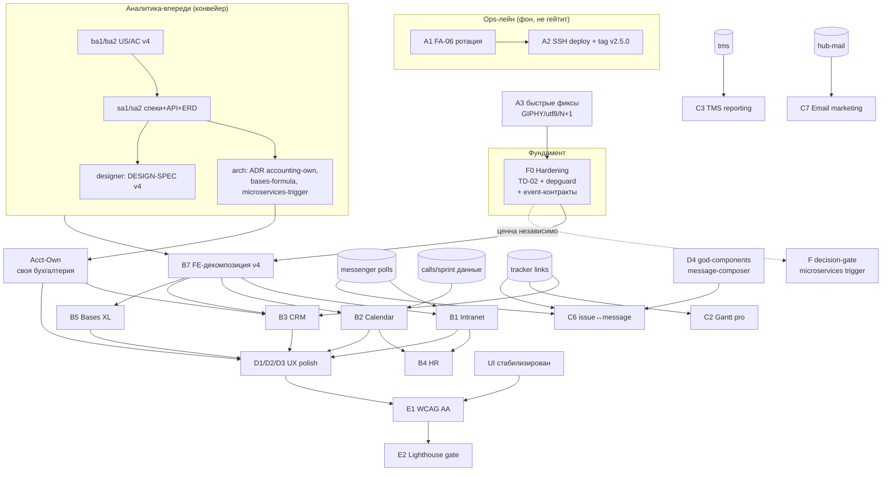

# PLAN — Волновое расписание исполнения бэклога расширения Hub

> **Роль автора:** `team-lead` (оркестратор, финальная инстанция), Opus 4.8 @ 1M, max effort.
> **Режим:** read-only по коду/тестам; единственный создаваемый артефакт — этот файл.
> **Дата:** 2026-07-02 · **A/B-тест качества оркестрации** (вариант Opus).
> **Вход (эпики A–F, оценки, зависимости):** `.planning/archive/july-2026/EXPANSION-ANALYSIS-2026-07-02.md` §5.
> **Правила команды:** `.cursor/playbooks/team-workflow.md` (ростер 30, RACI, волны ≤4, разведение файлов),
> `.cursor/playbooks/README.md` §4 (параллелизм без конфликтов). Микросервис-контекст: `.planning/decisions/ab-microservices/PLAN-team-lead-opus.md` (Фаза 0 Hardening).
> **Горизонт:** ~2.5 месяца (≈11 рабочих недель, ~55 рабочих дней), 17 волн, ≤4 параллельных исполнителя на волну.

---

## 0. TL;DR

1. **Форма исполнения — конвейер, а не «всё сразу».** Аналитика (`ba/sa/arch/designer`) идёт **на одну волну впереди** реализации. Это единственный способ не превратить `sa`/`arch` (по одному экземпляру) в боттлнек (см. §3).
2. **Три постоянных лейна** внутри лимита ≤4: *аналитика-впереди* → *реализация be∥fe* → *качество qa*. Плюс **ops-лейн FA-06** идёт фоном и НЕ гейтит расширение (решение пользователя).
3. **Фаза 0 Hardening из микросервис-плана** встроена в волны W2–W4 как backend-фундамент (чинит TD-02 `*ent.Client`, ставит `depguard`) — ценна сама по себе и даёт чистые границы модулей до углубления v4.
4. **Первые 3 волны:** W1 стабилизация (быстрые фиксы A3 + запуск ротации A1 фоном + security E5) → W2 сев аналитики v4 + Hardening#1 + ADR (accounting-own, microservices-trigger) → W3 спеки/дизайн + Hardening#2.
5. **Приоритет доведения (решения пользователя):** паритет Bitrix/Lark для v4 (полная глубина B), **своя бухгалтерия** (не только 1C-коннектор), релиз не гейтим. Из-за этого горизонт закрывает A+F0+E-ворота+B(P1: intranet/calendar/crm/bases-ядро/accounting-own)+топ-C; часть C/D/B6 переносится (см. §8 «Done»).

---

## 1. Вход и встроенные решения пользователя

### 1.1 Эпики (из EXPANSION-ANALYSIS §5) — как вход

| Эпик | Суть | Крупные планы (размер) |
|---|---|---|
| **A** | Prod cutover & trust (P0) | A1 FA-06/PG-03 ротация (M, ops) · A2 SSH deploy+tag (S) · A3 быстрые фиксы GIPHY/utf8/N+1 (S) |
| **B** | Углубление v4 «широких, но неглубоких» (P1) | B1 Intranet (L) · B2 Calendar (L) · B3 CRM (L) · B4 HR (M/L) · B5 Bases (XL) · B6 Marketplace/Status (M) · B7 FE-декомпозиция v4 (M) |
| **C** | Depth ядра (P1–P2) | C1 Custom fields UI (M) · C2 Gantt pro (M) · C3 TMS reporting (L) · C4 Notification digest (M) · C5 Dashboard панели (M/L) · C6 issue↔message (M) · C7 Email marketing (M) |
| **D** | UX polish (P2, сквозной FE) | D1 skeleton/empty (M) · D2 optimistic UI (S/M) · D3 RHF+Zod (M) · D4 god-components рефактор (M) |
| **E** | Quality/compliance (P1–P2) | E1 WCAG AA (M) · E2 Lighthouse gate (S) · E3 coverage uplift (M) · E4 perf (M) · E5 FA-02 security (S) |
| **F** | Платформа/масштаб (P3, ADR) | **F0 Modular Monolith Hardening** (из микросервис-плана, ценна независимо) · F1 feature flags (M) · F2 микросервис-split (XL, по нагрузке) · F3 v5 (XL, ADR) |

### 1.2 Решения пользователя → как встроено в расписание

| Решение | Влияние на план | Где |
|---|---|---|
| **Релиз НЕ гейтим** (FA-06 можно параллельно) | A1/A2 вынесены в **ops-лейн** (`devops`+`security`), идут фоном, НЕ блокируют волны расширения и не занимают 4 слота feature-разработки | §3.3, W1 |
| **Паритет Bitrix/Lark для v4** | B планируется в **полной глубине** (formula engine в bases, воронка+companies в crm, org-chart+handbook в hr, room booking+availability в calendar) — не MVP-надстройка | Блоки B (W5–W10) |
| **Своя бухгалтерия** (не только 1C) | Добавлен план **Acct-Own** (double-entry расширение: баланс, cash flow, AR aging, PDF; НДФЛ/мультивалюта — по ADR) как самостоятельный поток, размер L→XL; требует `arch` ADR-ACCOUNTING-OWN | ADR в W2, impl W7–W8 |
| **Направление на микросервисы** | **Фаза 0 Hardening** встроена в W2–W4 (backend-лейн); полный split (F2) остаётся обратимым run-book'ом за ADR-триггером — в горизонт НЕ входит, но decision-gate F назначен на W17 | §6, W2–W4, W17 |

---

## 2. Граф зависимостей эпиков/крупных планов

### 2.1 Mermaid



### 2.2 ASCII — критический путь

```
A3 ─► F0(Hardening) ─► [B7 FE-decomp] ─► B1/B2/B3/B5/Acct-Own ─► C(депт) ─► D(polish) ─► E1/E2(gates)
        ▲                                                                          
ba→sa→arch→designer (идёт НА ВОЛНУ ВПЕРЕДИ каждого блока реализации) ─────────────┘
(ops-лейн) A1 ─► A2 : фоном, параллельно всему, НЕ на критическом пути
```

**Правила порядка:** фундамент (F0 + event-контракты + общие типы/DTO) — раньше зависимых слоёв; аналитика модуля N — во время реализации модуля N−1; QA закрывает каждый блок перед мержем.

---

## 3. Ресурсные лейны и анти-боттлнек конвейер

### 3.1 Лейны (в пределах ≤4 на волну)

| Лейн | Агенты | Роль в конвейере |
|---|---|---|
| **Аналитика-впереди** | `ba1`,`ba2`,`sa1`,`sa2`,`arch`,`designer` (+ `*-ver`) | Производят спеки/дизайн для **следующего** блока, пока текущий реализуется |
| **Backend** | `be1`,`be2` (+ `be-ver`) | Разведены по модулям (§4-таблицы), кросс-ревью друг друга |
| **Frontend** | `fe1`,`fe2` (+ `fe-ver`) | Разведены по компонентам/роутам |
| **Качество** | `qa-auto1`,`qa-auto2`,`qa-manual` (+ `qa-*-ver`) | Закрывают блок: unit/integration (auto1), e2e (auto2), TC (manual) |
| **Ops/cross (фон)** | `devops-engineer`,`security-auditor`,`debugger`,`code-reviewer`,`docs-writer` | FA-06/deploy, security, отладка регрессий, pre-merge, docs bulk |

### 3.2 Анти-боттлнек: `sa`/`arch` как узкое место

`sa1/sa2` (2 шт.) и `arch` (1 шт.) — самый дефицитный ресурс на программе из 6 v4-модулей + C. Митигации:
1. **Аналитика на волну впереди** — `sa` никогда не простаивает и никогда не блокирует: пока `be/fe` кодят модуль N, `sa` пишет спеку N+1.
2. **Батчинг аналитики:** `ba1` берёт 2 модуля/волну, `ba2` — 2 других; так же `sa1/sa2`. Вся аналитика B укладывается в 2 волны, дизайн — в 2.
3. **`arch` только на архитектурно-значимом:** ADR (accounting-own, bases-formula-engine, microservices-trigger), а не на каждом CRUD. Обычные v4-планы идут `ba→sa→designer→be/fe` без `arch`.
4. **Контракт первым коммитом:** общие типы/DTO/API фиксируются до старта be∥fe, чтобы параллельные исполнители не переопределяли их (team-workflow §4.3).

### 3.3 Ops-лейн (FA-06) вне гейта

Пользователь решил релиз не гейтить. Поэтому A1 (ротация секретов + BFG) и A2 (SSH deploy + `git tag v2.5.0`) ведёт `devops`+`security-auditor` **как фоновую ops-задачу**: она в основном ждёт внешних ops-шагов (CTO sign-off, firewall), кода почти не трогает и **не занимает 4 слота feature-волны**. `team-lead` супервизирует и принимает по готовности, независимо от волн B–E.

---

## 4. Мастер-расписание волн

> Легенда размера: **S** 1–2д · **M** 3–5д · **L** 1–2нед · **XL** >2нед. Волна ≈ 2–5 дней.
> «Ворота» каждой волны (если не указано иное): регрессия затронутого слоя green → docs-sync (STATE + доменный doc) → персональный `*-ver` (`verified:true`) → `/qa-gate` → `code-reviewer` → приёмка `team-lead`.

### 4.1 Сводная таблица

| W | Нед. | Цель | Агенты (≤4) | Границы (без конфликтов) | Выход |
|---|---|---|---|---|---|
| **W1** | 1 | Стабилизация ядра + старт cutover | be1, fe1, security-auditor, devops(ops) | be1: `auth/handler.go`(utf8)+`audit/service.go,repository.go`(N+1); fe1: `messenger/gif-picker.tsx`+`.env.example`; security: `calls`(LiveKit iss)+auth middleware(RequireAuth); devops: `deployments/`,`scripts/fa06.sh` | Быстрые фиксы A3+E5; ротация A1 в работе |
| **W2** | 1–2 | Сев аналитики v4 + Hardening#1 + ADR | ba1, ba2, be2, arch | ba1: vision §intranet,§calendar; ba2: vision §crm,§accounting-own; be2: `auth/*repository*.go`(TD-02); arch: `decisions/ADR-ACCOUNTING-OWN`,`ADR-MICROSERVICES-TRIGGER` | US/AC (intranet,calendar,crm,acct); auth за repo-интерфейсом; 2 ADR |
| **W3** | 2 | Спеки+дизайн блока B1 + Hardening#2 | sa1, sa2, designer, be1 | sa1: `system_spec §intranet,§calendar`+`wiki/API`; sa2: `§crm,§accounting`; designer: `DESIGN-SPEC-intranet`; be1: `dashboard/*repo*,storage/*repo*`(TD-02) | API+ERD intranet/calendar/crm/acct; дизайн intranet |
| **W4** | 3 | FE-декомпозиция (B7) + Hardening#3 + спеки B2 | fe1, fe2, be2, sa1 | fe1: разбить `modules/intranet/*`,`modules/calendar/*`; fe2: разбить `modules/crm/*`,`modules/hr/*`,`modules/accounting/*`; be2: `backup,imex,apigateway,rbac`(TD-02)+`depguard` CI; sa1: `§bases-formula`,`§hr` | v4-модули → components/hooks/stores; TD-02 closed; depguard; спеки bases/hr |
| **W5** | 3–4 | Intranet до Mighty-lite (B1) | be1, be2, fe1, designer | be1: `intranet/service.go,handler.go`(polls,feed,pin); be2: `messenger`(polls-зависимость)+`ent/schema/poll.go`; fe1: `components|modules/intranet/*`; designer: `DESIGN-SPEC-calendar,-crm` | Intranet: polls, лента pin/reactions, модерация |
| **W6** | 4–5 | Calendar first-class (B2) | be1, be2, fe1, fe2 | be1: `calendar/service.go`(recurring,availability); be2: `calendar/ent_repository.go`+`ent/schema`(room,booking); fe1: `calendar` grid/views; fe2: `calendar` booking/availability panel | Room booking, team availability, recurring, iCal |
| **W7** | 5–6 | CRM углубление (B3) + Acct-Own backend | be1, be2, fe1, sa2 | be1: `crm/service.go`(companies,activities,pipeline-analytics); be2: `accounting/service.go`(balance,cashflow,AR-aging); fe1: `crm/*`(companies,deal activities); sa2: `§tms-reporting`,`§dashboard-panels` (аналитика C-блока) | CRM companies+воронка; бух: баланс/cashflow черновик |
| **W8** | 6 | Acct-Own FE+PDF (B3/Acct) + Gantt pro (C2) | be1, be2, fe1, fe2 | be1: `accounting`(PDF invoice, income statement); be2: `tracker`(gantt deps FS/SS/FF, critical path); fe1: `accounting/*`(баланс,cashflow UI); fe2: `components/tracker/gantt-chart.tsx`(drag-resize,крит.путь) | Своя бухгалтерия MVP+; Gantt pro |
| **W9** | 7 | Bases XL #1: formula engine + relations (B5) | be1, be2, fe1, arch | be1: `bases/formula/*`(движок формул); be2: `bases`(relations,lookup)+`ent/schema`; fe1: `bases` grid formula-cells; arch: `ADR-BASES-FORMULA` review + оценка риска | Формулы, relations/lookup |
| **W10** | 7–8 | Bases XL #2: views/filters (B5) + HR (B4) | be1, be2, fe1, fe2 | be1: `bases`(views: grid/kanban/calendar); be2: `hr/service.go`(org-chart data, leave balance); fe1: `bases`(views+filters/sort+sharing); fe2: `hr/*`(org-chart визуал, handbook wiki) | Bases-представления; HR org-chart+handbook |
| **W11** | 8–9 | Core depth: TMS reporting (C3) + Custom fields UI (C1) | be1, fe1, be2, fe2 | be1: `tms`(тренды,run-diff,категории дефектов,flaky-статистика); fe1: `components/tms/reports/*`; be2: `tracker`(custom-fields API glue); fe2: `components/tracker/custom-fields-builder.tsx` | TMS-отчёты уровня TestOps; билдер полей |
| **W12** | 9 | Core depth: Notification digest (C4) + Dashboard панели (C5) | be1, fe1, be2, fe2 | be1: `notification`(digest, smart-delivery); fe1: `notification` settings digest; be2: `dashboard`(кастом-панели, шаблоны Dev/QA/Manager); fe2: `components/dashboard/*` | Digest; кастом-дашборды |
| **W13** | 9–10 | issue↔message (C6) + god-components рефактор (D4) | fe1, fe2, be1, be2 | fe1: рефактор `message-composer.tsx`→под-компоненты; fe2: `onboarding.lazy.tsx`,`cases_.$caseKey.lazy.tsx` декомпозиция; be1: `messenger`↔`tracker` bidirectional link+saga; be2: `tracker` link API | Двусторонняя связь; убраны god-components |
| **W14** | 10 | UX polish: skeleton/empty (D1) + optimistic (D2) + RHF/Zod (D3) | fe1, fe2, qa-manual, designer | fe1: skeleton loaders+empty states (список роутов A); fe2: optimistic мутации (messenger reactions + список B)+RHF/Zod формы; qa-manual: TC на состояния; designer: спека состояний | Единый UX состояний; оптимистичные мутации |
| **W15** | 10–11 | Quality gates: WCAG (E1) + Lighthouse (E2) + perf (E4) | fe1, fe2, be1, designer | fe1: a11y-фиксы dark+light (axe по страницам A); fe2: a11y страницы B + Lighthouse baseline; be1: perf (GZIP/Brotli `wiring_fiber.go`, composite-индексы `ent/schema`); designer: WCAG sign-off чек-лист | WCAG AA sign-off; Lighthouse-gate; perf |
| **W16** | 11 | Coverage uplift (E3) + сквозная регрессия | qa-auto1, qa-auto2, qa-manual, code-reviewer | qa-auto1: backend cov (gitlab 68.5→80, ai→80, bases→80); qa-auto2: e2e новых v4-флоу; qa-manual: регресс-набор; code-reviewer: финальный diff-свод | COV ≥82% сохранён на новых модулях; e2e зелёные |
| **W17** | 11+ | F decision-gate + feature flags (F1) | arch, product, devops, be2 | arch: свод «microservices trigger» (метрики нагрузки vs ADR); product: ROI-решение; devops: K3s base (TD-04) при go; be2: F1 feature flags (Redis) | Решение по split (go/no-go); feature flags |

### 4.2 Детализация ворот по типам волн

- **Аналитические волны (W2–W4, W7 sa2):** ворота = `ba-ver`/`sa-ver`/`arch-ver`/`designer-ver` `verified:true` + docs-sync (`vision_and_scope`/`system_specification`/`wiki/API`/`architecture`). Регрессия кода не требуется (артефакты — docs).
- **Реализационные волны (W5–W15):** ворота = регрессия слоя green (backend `go build -tags release && go test -race`; frontend `tsc+vitest+lint`) → docs-sync → `be-ver`/`fe-ver` → `/qa-gate` → `code-reviewer` → `team-lead`. Каждая закрывается мини-QA (qa-auto прогон по затронутому домену) до мержа.
- **QA/quality волны (W16):** ворота = COVERAGE.md не ниже 82% на новых модулях, e2e green, `qa-*-ver`.
- **Hardening (W2–W4 backend):** ворота дополнительно = `arch-ver` (нет `*ent.Client` в service/handler), `depguard` запрещает кросс-модульные импорты.

---

## 5. Точки синхронизации и критерии перехода

| Sync-point | После | Критерий перехода к следующей волне |
|---|---|---|
| **SP-1 Стабильно** | W1 | A3+E5 merged, регрессия green; A1 ротация запущена (не обязана завершиться) |
| **SP-2 Фундамент готов** | W4 | TD-02 = 0 `*ent.Client`; `depguard` активен; B7 FE-декомпозиция merged; спеки+дизайн B1 `verified` |
| **SP-3 v4 P1 закрыт** | W10 | Intranet/Calendar/CRM/Bases-ядро/HR/Acct-Own приняты `team-lead`; COV ≥82% на них; e2e-smoke green |
| **SP-4 Core depth закрыт** | W13 | C1/C2/C3/C4/C5/C6 приняты; god-components устранены; двусторонняя связь работает |
| **SP-5 Готово к тегу** | W16 | WCAG AA sign-off; Lighthouse-gate; perf; полный `/qa-gate` green; COV ≥82% overall |
| **SP-6 Платформа** | W17 | Решение microservices go/no-go зафиксировано; feature flags готовы |

**Правило перехода (team-workflow §4.4):** волна N+1 стартует только когда артефакты волны N собраны, `/qa-gate` на объединении green, `STATE.md` обновлён (`/handoff-sync`). Аналитика-впереди — исключение: её артефакты `verified` разблокируют реализацию, а не наоборот.

**Порядок мержа внутри волны:** фундамент (Ent schema/миграции → общие типы/DTO → API-контракт) → service → handler → frontend. Squash в `master` после green gate + `code-reviewer`.

---

## 6. Куда встроена Фаза 0 Hardening и микросервисы

**Фаза 0 (Modular Monolith Hardening)** из `.planning/decisions/ab-microservices/PLAN-team-lead-opus.md` §10 встроена в **W2–W4 (backend-лейн, `be1`/`be2`)** параллельно аналитическому севу:

- W2 `be2`: TD-02 в `auth` (repository-интерфейс).
- W3 `be1`: TD-02 в `dashboard`, `storage`.
- W4 `be2`: TD-02 в `backup`,`imex`,`apigateway`,`rbac` + `depguard` (запрет кросс-модульных импортов) + каталог event-контрактов (`sa1` спека).

**Почему здесь:** (1) hardening ценен независимо от split (чистые границы, тестируемость); (2) он должен пройти **до** углубления v4 backend, чтобы `be1/be2` работали по чистым repo-интерфейсам и не спотыкались о протекающий `*ent.Client`; (3) даёт «микросервис-ready по границам» без затрат на реальный split. **Конфликт-риск:** `dashboard` трогается и в hardening (W3), и в C5 (W12) — разведены по времени (W3≪W12), поэтому чисто.

**Полный split (F2)** в горизонт НЕ входит (нет драйвера нагрузки; 10–50 чел/инстанс). Он остаётся обратимым run-book'ом за ADR-триггером; **decision-gate F** назначен на **W17** — `arch`+`product` смотрят метрики нагрузки и решают go/no-go. ADR-стаб (`ADR-MICROSERVICES-TRIGGER`) заводится уже в W2, чтобы триггер был измерим.

---

## 7. Риски расписания и митигации

| # | Риск | Вер. | Влияние | Митигация |
|---|---|---|---|---|
| SR1 | **`sa`/`arch` боттлнек** (1–2 экземпляра на 6+ модулей) | Высокая | Высокое | Аналитика-впереди (§3.2); батчинг 2 модуля/агент; `arch` только на ADR; спеки готовы за волну до impl |
| SR2 | **Конфликт правок** (dashboard в W3-hardening и W12-C5; messenger в W1/W5/W13) | Средняя | Высокое | Временнóе разведение волн; контракт первым коммитом; `team-lead` назначает базовый коммит при пересечении |
| SR3 | **Перегрузка `be1`** (на критическом пути в W5–W11 почти всегда) | Высокая | Среднее | Балансировка: тяжёлые XL (bases W9, tms W11) делить be1/be2; не запускать `fe` вхолостую — держать на след. волне |
| SR4 | **Bases XL недооценён** (formula engine — исследовательский) | Высокая | Высокое | `arch` ADR+спайк в W9 до impl; разбить на formula(W9)+views(W10); при переполнении — перенос views за горизонт |
| SR5 | **Acct-Own расползание scope** (баланс→НДФЛ→мультивалюта) | Высокая | Высокое | ADR-ACCOUNTING-OWN фиксирует границу: баланс/cashflow/AR/PDF в горизонте; НДФЛ/мультивалюта — backlog за ADR |
| SR6 | **v4-паритет Bitrix/Lark = XL-объём** > горизонта | Высокая | Высокое | Приоритет P1-модулей; B6 (marketplace/status) и часть C переносятся (§8); честный «Done» по срезу, не по всему |
| SR7 | **Регрессия от сквозных D-волн** (optimistic/RHF трогают много форм) | Средняя | Среднее | D-волны после стабилизации модулей (W14); список форм по роутам A/B (fe1/fe2 разведены); qa-manual TC на состояния |
| SR8 | **FA-06 ops затягивается** (внешний CTO sign-off) | Средняя | Низкое (не гейтит) | Вынесено в фон (§3.3); расширение не зависит; `team-lead` принимает по готовности |
| SR9 | **Docs drift** (Phase 8/9/12 чекбоксы, EXPANSION §3.3) | Средняя | Среднее | В W1 `docs-writer` сверяет ROADMAP-чекбоксы визуально; расхождение = задача, не тихий фикс |
| SR10 | **>4 агента соблазн** на «широкой» волне | Средняя | Среднее | Жёсткий лимит ≤4; лишнее — следующая волна; аналитика-впереди снимает давление |

---

## 8. Критерий «готово» для горизонта (~2.5 мес)

Горизонт считается закрытым, когда:

- [ ] **A (trust):** A3+E5 merged; A1 ротация выполнена, A2 tag `v2.5.0` возможен по готовности ops (не гейт).
- [ ] **F0 (hardening):** TD-02 = 0 `*ent.Client` в service/handler; `depguard` активен; event-контракты задокументированы.
- [ ] **B (v4 P1, паритет-срез):** Intranet, Calendar, CRM, **Bases-ядро (formula+relations+views)**, HR, **Acct-Own (баланс/cashflow/AR/PDF)** доведены и приняты; каждый — FE-декомпозирован (не 1 файл), COV ≥82%.
- [ ] **C (топ-депт):** C1 Custom fields UI, C2 Gantt pro, C3 TMS reporting, C4 digest, C5 dashboard-панели, C6 issue↔message — приняты.
- [ ] **D (polish):** skeleton/empty/optimistic/RHF-Zod применены; god-components (message-composer, 2 lazy) устранены.
- [ ] **E (gates):** WCAG AA sign-off (dark+light); Lighthouse blocking-gate ≥90; perf (GZIP/Brotli, composite-индексы); COV ≥82% overall.
- [ ] **F (decision):** microservices go/no-go зафиксирован; feature flags (F1) готовы.
- [ ] **Сквозное:** полный `/qa-gate` green; `STATE.md`/`ROADMAP.md`/`COVERAGE.md` синхронизированы; 0 CRITICAL security.

**Осознанно ЗА горизонтом (перенос):** B6 Marketplace/Status polish; C7 Email marketing; Acct НДФЛ/мультивалюта; Bases sharing/advanced-views; F2 полный split; F3 v5 (multi-org/SSO — за ADR-границей TZ).

---

## 9. Саммари и рекомендованные первые 3 волны

**Рекомендованная последовательность (5–8 строк):**
1. **W1 Стабилизация** — быстрые фиксы (GIPHY→env, magic-link utf8, audit N+1) + security E5, ротацию FA-06 запускаем **фоном** (не гейтит).
2. **W2 Сев аналитики + Hardening#1** — `ba1/ba2` пишут US/AC для intranet/calendar/crm/accounting-own; `be2` чинит TD-02 в auth; `arch` выпускает ADR по своей бухгалтерии и по триггеру микросервисов.
3. **W3 Спеки+дизайн + Hardening#2** — `sa1/sa2` API+ERD, `designer` DESIGN-SPEC intranet, `be1` дочищает TD-02.
4. Далее: **W4** FE-декомпозиция v4 (B7) + завершение Hardening (depguard) → **W5+** реализация модулей по конвейеру «аналитика-впереди».
5. Ключ к скорости — **держать `sa`/`arch` на волну впереди реализации** (анти-боттлнек), FA-06 — фоном, ≤4 агента/волну строго.

**Рекомендованная Волна 1 (одним абзацем):** запускаем 4 агента без взаимных зависимостей по разным файлам: `be1` закрывает быстрый tech-debt в бэкенде (`auth/handler.go` — `utf8.RuneCountInString` для magic-link, батч N+1 в `audit/service.go`+`repository.go`); `fe1` выносит GIPHY-ключ в `import.meta.env` (`messenger/gif-picker.tsx`, уже в git status) и правит `.env.example`; `security-auditor` закрывает E5 (LiveKit `iss` constant-time compare, RequireAuth fail-open edge в calls/auth middleware); `devops-engineer` в фоновом ops-лейне стартует ротацию секретов FA-06/PG-03 (`deployments/`, `scripts/fa06.sh`) — она НЕ гейтит расширение по решению пользователя. Ворота волны: регрессия backend (`go build -tags release && go test -race`) и frontend (`tsc+vitest+lint`) green, docs-sync (`STATE.md`+`security_guidelines.md`), `be-ver`/`fe-ver`+security review, `/qa-gate`, приёмка `team-lead`. Параллельно `docs-writer` сверяет дрейф ROADMAP-чекбоксов (Phase 8/9/12) — фиксируем как задачу, не тихо. Это разблокирует чистый старт W2 (аналитика v4 + Hardening) без хвостов tech-debt.
