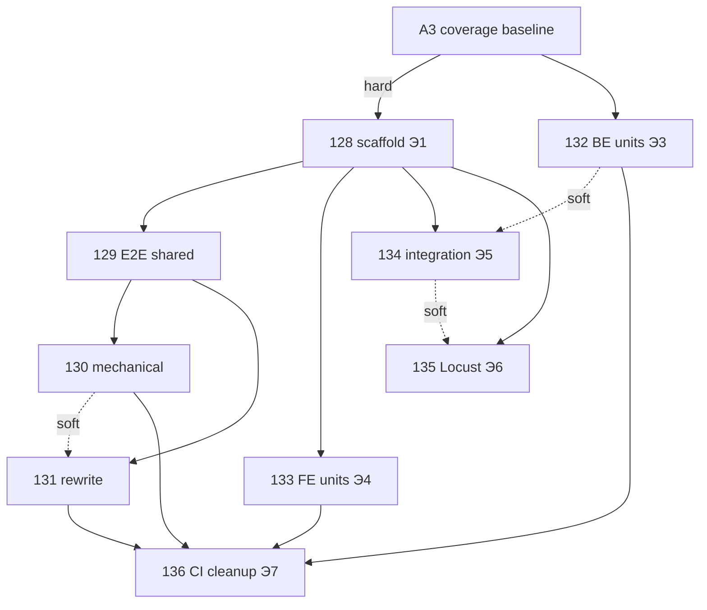

# E6 — TF migration GSD phases (index)

**Дата:** 2026-07-27  
**Источник:** [`02-TEST-FRAMEWORK-MIGRATION.md`](02-TEST-FRAMEWORK-MIGRATION.md)  
**Детали:** [E3](TF-MIGRATE-E3-PLAYWRIGHT.md) · [E4](TF-MIGRATE-E4-TESTS-LAYOUT.md) · [E5](TF-MIGRATE-E5-LOCUST.md)

---

## Hard gate

| Gate | Meaning |
|------|---------|
| **A3 coverage baseline** | [`01-PLANNING-FIXES.md`](01-PLANNING-FIXES.md) §A3 — прогнать coverage, обновить `COVERAGE.md` с датой |
| **Э1 / Phase 128** | **Не начинать** до A3 — иначе потеря покрытия при переезде 508 файлов незаметна |

> В ТЗ задачи иногда фигурирует «A1 coverage baseline»; канон миграции и planning-fixes — именно **A3** (протухшее покрытие). A1 в `01-PLANNING-FIXES` — про `goals_verified`, не coverage.

---

## Phase map (128–136)

| Phase | Dir | Э | Estimate | Depends on | Goal (one line) |
|------:|-----|---|----------:|--------------|-----------------|
| **128** | [`128-tf-python-scaffold`](../../phases/128-tf-python-scaffold/PLAN.md) | Э1 | 2–3 d | **A3** | `/tests` pyproject + conftest; 1 integration green |
| **129** | [`129-tf-e2e-shared`](../../phases/129-tf-e2e-shared/PLAN.md) | Э2 shared | 3–4 d | 128 | Auth/fixtures/POM/a11y Python |
| **130** | [`130-tf-e2e-mechanical`](../../phases/130-tf-e2e-mechanical/PLAN.md) | Э2 mech | 4–5 d | 129 | 15 mechanical specs |
| **131** | [`131-tf-e2e-rewrite`](../../phases/131-tf-e2e-rewrite/PLAN.md) | Э2 rewrite | 4–5 d | 129, soft:130 | 5 rewrite specs; e2e 20/20 |
| **132** | [`132-tf-backend-units-colocated`](../../phases/132-tf-backend-units-colocated/PLAN.md) | Э3 | 10–15 d | A3; soft:128 | Go tests → `internal/` |
| **133** | [`133-tf-frontend-units-colocated`](../../phases/133-tf-frontend-units-colocated/PLAN.md) | Э4 | 5–8 d | parallel OK after 128 | Vitest → `frontend/src` |
| **134** | [`134-tf-integration-python`](../../phases/134-tf-integration-python/PLAN.md) | Э5 | 5–7 d | 128; soft:132 | `tests/integration` domains |
| **135** | [`135-tf-locust-load`](../../phases/135-tf-locust-load/PLAN.md) | Э6 | 3–4 d | 128; soft:134 | Locust hot paths + A13 |
| **136** | [`136-tf-ci-cleanup`](../../phases/136-tf-ci-cleanup/PLAN.md) | Э7 | 3–4 d | 130+131+132+133 | CI cutover; delete legacy |

**Total (calendar parallelizable):** ~40–55 person-days; wall-clock shorter if 132∥133∥134 after 128–131.

---

## Dependency graph

---

## Suggested waves

| Wave | Phases | Notes |
|------|--------|-------|
| W0 | A3 | Docs+coverage only; blocks all |
| W1 | 128 | Scaffold |
| W2 | 129 → 130 → 131 | E2E Python parity |
| W3 | 132 ∥ 133 | Units colocated (largest effort) |
| W4 | 134 → 135 | Integration + load |
| W5 | 136 | Cutover when parity proven |

---

## Ownership (draft)

| Phase | Primary | Review |
|-------|---------|--------|
| 128–131, 134–135 | qa-auto1/2 | qa-auto-ver |
| 132 | be1/be2 + qa-auto | be-ver |
| 133 | fe1/fe2 + qa-auto | fe-ver |
| 136 | devops-engineer + qa-auto | team-lead |

---

## Open questions (carry from migration)

1. Coverage floor после 132 — держать 82%?  
2. Ownership `/tests` — только QA или и разработчики?  
3. Locust в CI schedule vs manual only?  
4. Перенос vs rewrite `TESTING_GUIDE` / guides?
