# MAIL-SPEC — Hub mailbox and calendar synchronization contract

> **144-02D lifecycle (current):** exact nine-doc content `7d29d08c827cf857fc6fc8cc6a0f8201e42d4ecb` plus same-nine-doc transition `e563a3d3be8898371e5c8a9861c58f11b72167bc` is narrowly docs-only `STATIC_ACCEPTED` / `EXACT_SHA_PASS`; Contract/Spec/Oracle Terra/high, Security/Adversarial Terra/xhigh and Lifecycle/Dependency Terra/high PASS C/I/M `0/0/0`, dispatcher-enforced, fallback none, telemetry `UNKNOWN`. Earlier lifecycle FAIL and contrary combined 02D/02F-next wording below are `CONSUMED/HISTORICAL`. Sole next action is three independent exact 02F closure reviews against accepted 02D; 02F is unaccepted. No source/schema/generation/migration/service/runtime authority; launcher `NOT_READY`, executable `NOT_RUN`.
> **Version:** 0.1.8
> **Status:** five-document 0.1.8 entry amendment independently PASS at `5e314fb080d420696642058ae47397e251c23207`, authorizing only 144-01A entry; Thread callable/encoding/oracle contract remains accepted at `cbc12577a6444df9c660e43fedfd0c8133c6e461`; its implementation+oracle are narrowly `STATIC_ACCEPTED` at `9903f4df3e5ca8034ea3f043b0386170e83a5101` / `EXACT_SHA_PASS` (source `c221d547`, oracle `b21bd6fd`, exact-SHA reviews PASS C/I/M `0/0/0`); broader Phase 142/cross-contract review and runtime remain pending; 0.1.7 review evidence is historical `STALE`
> **Date:** 2026-08-13
> **Architecture:** `../ADR-MAIL-01-mail-engine-calendar-sync.md`
> **OpenAPI:** `../../../docs/mail/openapi.yaml`
> **QA handoff:** `../../../docs/mail/QA-HANDOFF.md`
> **Engine boundary:** `../../../docs/mail/ENGINE-CONTRACT-0.1.8.md`
> **Persistence boundary:** `../../../docs/mail/PERSISTENCE-CONTRACT-0.1.8.md`

## 1. Scope and terms

This document freezes the domain, HTTP, event, security, and traceability contracts for
the Hub mail feature. It does not claim that the described behavior is implemented.

- **Mailbox engine:** adapter-backed Stalwart candidate; owns raw mail and mailbox state.
- **Mailbox:** one engine account owned by one Hub user in one organization.
- **Identity:** a permitted `From` address attached to a mailbox.
- **Message:** immutable RFC message content plus mutable engine mailbox/flag state.
- **Thread:** Hub projection grouping messages by references and normalized subject.
- **Event:** canonical Hub calendar object with stable iCalendar UID.
- **Occurrence:** one recurrence instance identified by UTC-normalized `RECURRENCE-ID`.
- **Projection:** rebuildable Hub metadata derived from engine state.

## 2. Domain invariants

1. Every HTTP mailbox operation derives `organization_id` and owner `user_id` from the
   authenticated principal; clients never choose them.
2. Every engine identifier is opaque. An id from mailbox A is invalid in mailbox B.
3. Raw MIME and message body are never persisted in PostgreSQL.
4. A mail submission is idempotent on `(mailbox_id, hash(idempotency_key))`; the raw key
   is request-scoped only.
5. A canonical calendar master is unique on `(calendar_owner_id, uid)`. Imported
   occurrences are unique on `(calendar_event_id, recurrence_id)` in
   `CalendarEventException`; `CalendarEvent` itself never carries `recurrence_id`.
6. Calendar create/RSVP HTTP retries are serialized through a persisted
   `CalendarMutationReceipt`; a reused key with a different request hash is a conflict,
   while a matching completed request replays the original status and response.
7. RSVP updates compare attendee `version`; exactly one successful transition increments
   it by one.
8. Incoming iTIP replies may mutate only the sender-matching attendee row.
9. Soft-deleted projection rows never authorize engine access.
10. Search results are post-filtered by current organization + mailbox ownership before
   any snippet or identifier is returned.
11. All externally observable timestamps are RFC 3339. Event timezone is a valid IANA
    name. All-day event values use dates and never infer persisted/wire midnight instants;
    the reminder subsystem's explicitly contracted first-representable local day boundary
    does not replace that date representation.
12. Hub-uploaded mail bytes use a mail-owned storage namespace and authorization port;
    project-scoped `FileMetadata` is never reused as an implicit mailbox ACL.
13. Raw idempotency keys, engine credentials, DKIM private keys, message bodies, and raw
    MIME are never persisted in Hub PostgreSQL or returned by read APIs.
14. Durable `mail.*` and `calendar.*` outbox events are admitted to the shared EVENTS
    stream explicitly. Linked-call due intents reuse the already admitted
    `calls.channel.{channelId}.scheduled_due.v1` namespace. None is added to the outbound
    webhook filter because payloads contain mailbox/calendar/call metadata.
15. Inbound iTIP REPLY delivery is deduplicated by a bounded durable ledger of every
    processed canonical-version + sender-bound payload hash for attendee + event sequence;
    storing only the last hash is forbidden because delayed redelivery could roll a later
    RSVP backward.
16. Incoming REQUEST/CANCEL order is durable per owner + UID + optional recurrence id.
    Lower sequence cannot mutate, equal conflicting content quarantines, and an early
    CANCEL tombstone prevents delayed resurrection.
17. External-organizer REPLY delivery uses stable mailbox draft/submission keys and
    reconciles indeterminate results before retry.
18. Availability authorizes the whole requested user set before source queries: self or an
    active same-org user sharing a non-deleted project/active channel, without admin bypass.
    It exposes only busy/free intervals with `event|call|leave` attribution, never private
    details; approved leave preserves the existing viewer/shared-project scope.
19. Calendar reminders have one durable intent and one durable in-app outcome: one
    persistently deduplicated row when policy permits, otherwise suppression. Existing
    Telegram/push delivery remains best-effort; no Resend channel is added. Transient
    policy/repository lookup failure remains pending and retriable rather than becoming a
    false suppression.
20. A linked `CalendarEvent` is the sole authority for meeting content, time, recurrence,
    reminder, status and attendees. `ScheduledCall` stores channel/project execution state
    plus a mirrored next effective occurrence; no linked writer may mutate it independently.
21. Every non-deleted ScheduledCall, including paused/completed rows, is linked before bridge
    cutover. Event/call
    mutations and due advancement lock event before call and commit projection plus outbox
    atomically; a mismatch fails closed and is never auto-resolved by choosing a side.
22. Compatibility readers count a linked event/call pair once. Legacy aggregate renders it
    as `call`; availability renders it as `event`. Unlinked active calls are a pre-cutover
    fallback only; after activation any unlinked non-deleted row is an invariant failure.
23. Legacy recurring calls are not reinterpreted across UTC/IANA/DST semantics without the
    explicit founder decision and recorded recurrence-oracle evidence.
24. Legacy ScheduledCall POST uses one mandatory idempotency key after both shipped clients
    move atomically; same key/input replays and changed input cannot create a second pair.
25. A linked-call creator is an active exact-channel member, and every internal participant
    is an active same-project/same-organization member. Invalid conflict UUID input is never
    silently discarded from the authorization set.
26. Attaching an existing call is exact-match and no-overwrite. Ordinary events may contain
    email-only guests, while linked-call guests fail closed until founder question 23 defines
    revocable join credentials and delivery.
27. ScheduledCall participants mirror series-level internal non-organizer attendees only;
    an occurrence RSVP cannot change another occurrence's call access/projection.
28. One durable owner-scoped mailbox sync lease advances one engine change page and its
    Hub projection/outbox events atomically with the opaque cursor. Every engine command
    workflow acquires an expiring account mutation lease and increments `mutation_epoch`
    before network I/O; completion/reconciliation clears it and increments the epoch again.
    Sync capture is forbidden while the lease is present, and a page under an older epoch
    is discarded and refetched, never committed over newer user-visible state.
29. An invalid/expired engine cursor marks the projection degraded and starts a resumable
    base-anchored enumeration plus mandatory change catch-up. Existing rows remain owner-
    scoped and visibly stale while pages apply; destructive cleanup waits for catch-up/
    finalization. A rebuild never clears live rows up front, forges freshness, skips an
    unchanged surviving base object, or re-emits an already recorded inbound event.
30. Mailbox provisioning/lifecycle is an explicit desired-state control plane. A bounded
    leased worker creates one stable account intent for each eligible active user only after
    an enabled verified default domain exists, reconciles exact identity generations, and
    disables the engine account when the Hub user is deactivated. Projection and public
    mailbox resources are ineligible until the engine account and primary identity commit
    atomically as active.
31. Hub rule rows are canonical. Rule HTTP writes advance a desired generation in the Hub
    transaction and never claim that Sieve is installed synchronously. A separate leased
    worker compiles the complete ordered rule set, reconciles the fixed Hub-owned engine
    script by generation/hash, and reports `pending|applying|ready|unknown|error`.
32. Rich message and signature input is sanitized on the server. Plain text is derived by
    the server from the accepted sanitized rich value; raw client HTML is never returned.
    Received HTML has every remote fetch rewritten to an owner/message-bound short-lived
    token or removed before it can reach the browser.
33. The owner Meilisearch document may contain bounded server-sanitized plain body text and
    normalized attachment filenames because v1 search explicitly covers both. It never
    contains raw HTML/MIME, BCC, engine credentials, or an unfiltered recipient projection;
    current owner/account authorization is rechecked before any hit or snippet is returned.
34. `junk` and `not_junk` are classifier-feedback commands, not aliases for moving a
    message. The adapter must report spam/ham training outcome explicitly; moving or flagging
    without accepted feedback cannot be represented as trained.
35. Every public create intent and bulk classifier intent has a persisted mail mutation
    receipt keyed by server-derived scope, operation and the frozen generic-key digest.
    During its 30-day replay window, identical input reconstructs the original resource or
    safe result when it still exists; a deleted/expired target returns replay-unavailable and
    never recreates it. Changed input conflicts; an unknown engine outcome reconciles before
    any retry. After compaction, the lifetime tombstone returns replay-expired for either
    hash and never executes the operation again.
36. Bulk thread targets are expanded from one owner-scoped consistent projection snapshot,
    deduplicated across the request, and rejected before engine I/O when more than 200
    distinct messages result. One request has exactly one target type. The receipt persists
    the bounded target order, exact expansion ids and safe per-target outcome before/after
    I/O so replay never re-expands a changed thread or double-trains. Per-target results
    retain the request target type; no client-side expansion or partial over-cap execution
    is allowed.
37. Engine list/change/enumeration values are projection-only and obey both item-count and
    retained-byte ceilings. Full content, draft save/reconciliation and blobs carry explicit
    caller byte budgets and whole-value overflow rejection. Engine adapter hard caps are
    52,428,800 bytes per message and 26,214,400 bytes per attachment; policy may only lower
    them. Request/page/message/
    attachment field grammar is closed by `ENGINE-CONTRACT-0.1.8.md`; submission references
    the confirmed engine draft and final-MIME ceiling and contains no second content copy.
38. A draft has an immutable engine draft key derived from its Hub UUID before the first
    engine call. Initial create/lost-response reconciliation uses that key; an unknown first
    response never becomes a blind second create.
39. `MailUserSettings` pointers are the only persisted authority for default identity and
    signature. Public `is_default` flags are derived; identity/signature rows do not duplicate
    the canonical choice.
40. Rule deployment persists desired, attempted and deployed versioned hash tuples. A crash
    or newer desired generation cannot erase which exact tuple may have reached the engine.
41. Public stored/list resources are capped before side effects: 100 folders, 100 labels,
    200 identities including primary, 20 signatures, 100 rules, 100 organization domains
    and at most 1,000 recent contacts with `user_id IS NULL` per account; Hub-linked contacts
    are exempt from that external-retention cap. Cursor pages default 50/max 100 except
    contacts max 30 and bounded folder snapshot max 100. Cursor/list pages additionally fit
    within 8,388,608 serialized UTF-8 bytes by returning fewer whole items plus a cursor;
    legacy calendar/call envelopes are non-truncating and fail above 16,777,216 bytes.
42. Every accepted message projection carries and atomically persists a required opaque
    engine version with its engine message id; optional auxiliary state is never a version
    substitute.
43. A confirmed submission stores opaque engine submission/result-message ids separately
    from the Hub message UUID exposed to clients. `sent` is committed only after a bounded
    exact-account/exact-message read and atomic Hub projection upsert; the domain derives
    confirmed submission origin from that persisted result pair. Any gap reconciles without
    resubmit, and a stored result pair can only retry projection finalization.
44. A draft owns at most 50 selected attachment rows. The complete replacement and resulting
    durable association count are checked under the draft lock before engine I/O, so
    sequential saves cannot bypass the public request bound.

## 3. ERD

```mermaid
erDiagram
    Organization ||--o{ MailDomain : configures
    Organization ||--o| MailboxPolicy : governs
    User ||--o| MailAccount : owns
    MailAccount ||--o{ MailIdentity : exposes
    MailAccount ||--o{ MailFolder : maps
    MailAccount ||--o{ MailThread : projects
    MailThread ||--o{ MailMessage : groups
    MailMessage ||--o{ MailMessageFolder : projects
    MailFolder ||--o{ MailMessageFolder : contains
    MailMessage ||--o{ MailMessageLabel : tagged
    MailLabel ||--o{ MailMessageLabel : applies
    MailMessage ||--o{ MailAttachment : has
    MailAccount ||--o{ MailObject : authorizes
    MailObject o|--o| MailAttachment : backs
    MailAccount ||--o{ MailDraft : edits
    MailDraft o|--o{ MailAttachment : stages
    MailAccount ||--o{ MailLabel : owns
    MailAccount ||--o{ MailRule : owns
    MailAccount ||--o| MailRuleDeployment : deploys
    MailAccount o|--o{ MailMutationReceipt : deduplicates
    MailMutationReceipt ||--o{ MailMutationReceiptTarget : records
    MailMutationReceiptTarget ||--o{ MailMutationReceiptMember : expands
    MailAccount ||--o{ RecentContact : remembers
    MailAccount ||--o| MailUserSettings : configures
    MailAccount ||--o{ MailSignature : owns
    MailAccount ||--o{ MailSubmission : submits
    MailDraft o|--o{ MailSubmission : sends
    User ||--o{ CalendarEvent : organizes
    CalendarEvent ||--o{ CalendarAttendee : invites
    CalendarAttendee ||--o{ CalendarInboundReplyReceipt : deduplicates
    User ||--o{ CalendarInboundObjectState : orders
    CalendarEvent o|--o{ CalendarInboundObjectState : resolves
    MailMessage ||--o{ CalendarInboundMessageReceipt : processes
    CalendarEvent o|--o{ CalendarInboundMessageReceipt : resolves
    CalendarAttendee ||--o{ CalendarReplyDelivery : transports
    MailSubmission o|--o{ CalendarReplyDelivery : reconciles
    CalendarEvent ||--o{ CalendarReminderReceipt : schedules
    User ||--o{ CalendarReminderReceipt : receives
    CalendarEvent ||--o{ CalendarEventException : overrides
    User ||--o{ CalendarMutationReceipt : initiates
    CalendarEvent o|--o{ CalendarMutationReceipt : resolves
    CalendarEvent }o--o| ScheduledCall : links
    MailMessage }o--o| CalendarEvent : carries
    CrmDeal ||--o{ CrmMailActivity : timelines
    MailMessage ||--o{ CrmMailActivity : links
    User o|--o{ CalendarAttendee : identifies
```



### 3.1 MailAccount

| Field | Type | Contract |
|---|---|---|
| `id` | UUID | primary key |
| `organization_id` | UUID | required, indexed |
| `user_id` | UUID | required, unique with organization |
| `engine_account_id` | string nullable | opaque and unique; absent until provisioning commits |
| `desired_enabled` | bool | canonical engine enable/disable intent; defaults true |
| `status` | enum | `provisioning`, `active`, `suspended`, `error` |
| `engine_provisioning_key` | string | stable non-secret Hub-derived key; unique and immutable |
| `local_part` | string | reserved normalized EmailLocalPart; unique within selected domain and immutable after engine creation |
| `mail_domain_id` | UUID | selected verified default domain; immutable after engine creation |
| `provision_lease_token`, `provision_lease_until` | UUID/time nullable | one bounded provisioning claim; both present or absent |
| `next_provision_at`, `provision_attempts` | timestamp/non-negative int | bounded retry scheduling |
| `provision_error_code` | string nullable | stable allowlisted code only; no provider text |
| `control_generation`, `attempted_control_generation`, `deployed_generation` | positive int64 / nullable pairs | exact current, in-flight/unknown and last confirmed engine generation |
| `control_hash_version`, `control_hash`, attempted/deployed version+hash | positive version + SHA-256 tuples | canonical desired/attempted/confirmed spec per persistence companion; no address list or secret |
| `projection_state` | enum | `bootstrapping`, `ready`, `degraded`, `rebuilding` |
| `sync_cursor` | string nullable | last atomically committed opaque incremental state token |
| `rebuild_checkpoint` | string nullable | opaque resumable enumeration/catch-up checkpoint |
| `rebuild_base_cursor` | string nullable | adapter-issued composite object-state cursor captured before enumeration |
| `sync_epoch`, `mutation_epoch` | non-negative int64 | rebuild marking and begin/end command fencing |
| `sync_lease_token`, `sync_lease_until` | UUID/time nullable | one bounded worker claim; both present or both absent |
| `mutation_lease_token`, `mutation_lease_until` | UUID/time nullable | one account-scoped engine command/reconciliation; both present or both absent |
| `next_sync_at`, `sync_attempts` | timestamp/non-negative int | bounded retry scheduling |
| `sync_error_code` | string nullable | stable allowlisted code only; no provider text |
| `event_cutoff_at` | timestamp | immutable injected activation instant committed before first worker eligibility; compare engine receipt time, never message `Date` |
| `last_synced_at` | timestamp nullable | last fully committed incremental page/finalized rebuild |
| `created_at`, `updated_at` | timestamp | required |

No password, token, DKIM key, or engine administrator secret is stored on this entity.

#### 3.1.1 Provisioning lifecycle

When the engine, mailbox policy and one verified enabled default `MailDomain` are ready, a
bounded control-plane worker enumerates active users without an account in stable UUID order.
In one transaction it reserves a unique immutable local part, creates `MailAccount` in
`provisioning`, creates its primary `MailIdentity`, assigns the immutable injected
`event_cutoff_at`, and schedules the intent. The default local part is the normalized local
part of the user's existing Hub email when it is valid and unclaimed in the selected domain;
otherwise it is stable `u-` plus the first 12 lowercase UUID hex characters. If that short
fallback is already reserved, the deterministic final fallback is `u-` plus all 32 UUID hex
characters. Both fallback shapes are reserved for system primary creation and admin alias
requests cannot claim them. Any remaining uniqueness failure is a safe collision error with
zero engine call, never random suffixing. Founder question 24 may replace this naming policy
before migration; code must not guess another.

The account-control worker claims an expiring lease and calls idempotent `EnsureAccount`
with `engine_provisioning_key`, captured generation/hash, desired enabled state, reserved
local part, selected domain and exact primary/alias set.
It has a 30-second I/O deadline, bounded retry/backoff and context-owned shutdown. A lost
response repeats `EnsureAccount` with the same key; it never creates a new reservation.
Only one transaction that still owns the lease may store the opaque engine account/identity
ids and change status to `active`. Projection, settings, drafts and commands require active
status. Disabled engine/policy, missing verified default domain, suspended/deactivated user,
or unresolved collision causes no engine call and exposes only a safe public status. The
exact v1 account/domain control hash encodings, attempted tuple persistence and state checks
are defined by `docs/mail/PERSISTENCE-CONTRACT-0.1.8.md`.

`GET /mail/account` is read-only: it reports `not_configured`, `provisioning`, `active`,
`suspended` or `error`, an optional primary address and allowlisted recovery code. It never
creates an account, exposes a local-part reservation, engine id, lease, provider error or
credential. New-user and existing-user coverage comes from the same periodic bounded scan;
there is no request-path provisioning side effect.

For an active account, admin alias create/delete and Hub user active/deactivated transitions
change only canonical desired state, increment `control_generation`, and schedule the same
worker. New aliases remain `pending` and are not selectable for From until the captured
generation is confirmed; deletions remain `deleting` until the engine no longer exposes the
alias. A deactivated user is reconciled to engine disabled and Hub `suspended`; reactivation
reuses the immutable account key/address and a newer generation. A stale worker may never
finalize over a newer alias or user-lifecycle generation.

#### 3.1.2 Projection synchronization lifecycle

`MailEngine.Changes` returns a bounded projection-only page tied to exact `from_cursor` and
`next_cursor`; `MailEngine.EnumerateProjection` returns resumable bounded enumeration pages
associated with one pre-enumeration composite `base_cursor`. Both values are opaque and
never logged or exposed publicly. The adapter must prove an unfiltered stable ID-anchor
enumeration whose ordering cannot move an unchanged surviving
base object across the resume boundary. Pages may hydrate a newer object value; mandatory
`Changes(base_cursor)` catch-up converges those values and every create/update/destroy after
the base. Ordinary JMAP `queryState` drift is therefore not itself completion or failure.
Missing resume anchor, unstable/unsupported enumeration, or inability to calculate changes
from the base is typed restart-required; the domain never guesses an empty cursor.

An incremental worker claim first atomically reclaims any expired mutation lease by
clearing it and incrementing `mutation_epoch`; it otherwise refuses to capture while a
mutation lease is present. The claim then records sync lease token, current cursor,
`sync_epoch` and `mutation_epoch` before engine I/O outside the PostgreSQL transaction. Page apply
locks the account, proves the same live lease/cursor/epochs, upserts current snapshots,
soft-deletes destroyed engine objects, recomputes affected threads/folder counts, writes
the complete versioned events and advances cursor/freshness in one transaction. It also
requires no mutation lease to be present. Epoch or lease mismatch discards the entire page
and retries from the unchanged committed cursor.
The lease is renewable but bounded; crash/timeout recovery can reclaim it without two
workers committing the same page.

Every Hub command workflow that mutates or reconciles engine-authoritative folder/message/
draft/submission/rule state first atomically acquires a 60-second account mutation lease and
increments `mutation_epoch`. Before acquisition it may reclaim an expired prior lease only
by clearing it and incrementing the epoch; a live prior lease returns the stable retryable
busy result after a bounded wait. Only one such workflow runs per account. Engine I/O has a shorter
30-second deadline and no database transaction spans it. Completion, definitive failure or
unknown-result handoff verifies the exact token, reconciles or marks degraded as required,
clears the lease and increments `mutation_epoch` again in one transaction. A sync page
fetched before begin fails the first epoch edge; sync cannot capture during the lease; a
page from any expired owner fails the completion/reclaim edge. If an expired lease was
reclaimed, a late former owner may only enter explicit reconciliation under a new lease and
must never finalize directly from its stale result.

The existing bounded projection scheduler also selects due generic engine-mutation receipts
as an alternative account work item; this is not a fifth worker. It orders sync and recovery
items by due time, processes at most one bounded item per account step, and cannot hold sync
and mutation leases together. Recovery claims the receipt lease, then the account mutation
lease, and uses only its persisted pending folder intent or bulk target/member snapshot.
Only a proven injected `ExclusiveCustomFolderWriter=true` permits folder exact-match
finalization, definitive-absence create retry or rename/delete recovery; system roles never
match. False/unknown or contradicted exclusivity makes zero recovery mutation and leaves the
projection degraded. Under the true gate, folder create may retry only after exact-account
enumeration proves definitive absence, while rename/delete/state mutation reconcile current
state. Training with an indeterminate result
is finalized `unknown` without another feedback call unless the accepted adapter proves an
idempotent reconciliation primitive. Completion updates receipt, pending control rows,
projection/events and both lease/epoch edges atomically. Unknown operations/version or
ambiguous matches stay degraded with bounded backoff and an operator-visible safe code;
they never block unrelated accounts or re-expand user scope.

Bootstrap or invalid-cursor recovery enters `bootstrapping`/`rebuilding`, increments
`sync_epoch`, preserves all current rows and applies base-anchored enumeration pages with
that epoch marker. It then catches up from the captured `base_cursor` through ordinary
change pages; every row seen in enumeration or catch-up receives the current epoch marker.
Only finalization may soft-delete engine projection rows not seen in the epoch,
recompute derived rows/counts, install the final cursor, clear rebuild/lease/error state
and mark `ready`. Until then read APIs return the current owner-filtered projection with
explicit `projection_state` and nullable `projection_as_of`; they never call it fresh.
For folder/thread projection, `ready` requires non-null
`projection_as_of == last_synced_at`; non-ready states may retain the prior value or use
null when no complete page has ever committed.
For `/mail/search`, the server derives these fields conservatively from both the mailbox
projection and the owner-scoped search consumer checkpoint: `ready` requires both ready,
and `projection_as_of` is their older complete instant. Search lag can therefore never be
hidden behind a ready mailbox cursor.
Transient failures retain checkpoint and retry with bounded backoff. Missing anchor,
unsupported stable enumeration or expired base catch-up restarts the rebuild with a new
epoch without clearing rows.

First-seen inbound-or-unknown messages whose engine arrival time is after
`event_cutoff_at` reserve one nullable `received_event_id` and write one
`mail.received.v1` envelope in the same projection transaction. Suppression requires stable
proof that the object is a Hub-confirmed owner submission or draft, such as the mapped
engine submission/message id; matching `From`/alias, a mutable Sent mailbox membership or
address equality is never proof. Unknown provenance fails toward inbound admission, not
silent suppression. Existing marker means no second event during cursor replay/rebuild.
Enumeration history at/before the cutoff is projected without notification/calendar-import
events. Successful submit already owns `mail.sent.v1`; its confirmed Sent projection never
becomes `mail.received.v1`.

### 3.2 MailIdentity

| Field | Type | Contract |
|---|---|---|
| `id` | UUID | primary key |
| `mail_account_id` | UUID | required |
| `address` | normalized email | unique within organization |
| `display_name` | string | max 160 |
| `kind` | enum | `primary`, `alias`, `group` |
| `send_allowed` | bool | server-authoritative |
| `is_default` | derived bool | public DTO derives equality with `MailUserSettings.default_identity_id`; not persisted here |
| `status` | enum | `pending`, `active`, `error`, `deleting`; public From list exposes only active |
| `engine_identity_id` | string nullable | opaque mapping |
| `created_at`, `updated_at` | timestamp | required |

Group identity is schema-only in wave 1. The API must not expose it as selectable until
group authorization and fan-out are implemented.

### 3.3 MailFolder

| Field | Type | Contract |
|---|---|---|
| `id` | UUID | Hub projection id |
| `mail_account_id` | UUID | required |
| `engine_folder_id` | string nullable | opaque, unique per account; null only for a reserved create intent |
| `parent_id` | UUID nullable | same-account folder only; depth at most 2 in v1 |
| `role` | enum nullable | `inbox`, `sent`, `drafts`, `archive`, `trash`, `junk` |
| `name` | string | raw valid UTF-8/no Unicode control/NUL, 1..120 runes/<=480 bytes; display preserves exact raw bytes/runes; custom sibling names use the private NFC/cases.Fold(v0.35.0)/NFC key and are unique case-insensitively |
| `color` | string nullable | design-token-safe color value |
| `sort_order` | int | stable user ordering |
| `unread_count`, `total_count` | non-negative int | rebuildable projection |
| `control_state` | enum | `creating`, `active`, `unknown`, `deleting`, `error` |
| `control_receipt_id` | UUID nullable | exact unresolved create/rename/delete receipt |
| `version` | positive int | optimistic Hub control mutation version |
| `last_seen_sync_epoch` | non-negative int64 | resumable rebuild mark |
| `created_at`, `updated_at`, `deleted_at` | timestamp | soft delete for projection |

System-role folders are protected exactly from rename, reparent and delete; create is always
custom. Folder cycles are rejected. Engine enumeration permits at most 100 engine-backed
folders per account including system roles; an over-cap enumeration leaves the prior owner
projection degraded and never partially marks it ready. Separately, Hub admission permits at
most 100 live non-deleted control slots, including system rows and `creating`/unknown/error/
deleting reservations; the account transaction atomically rechecks and reserves that live-slot
quota. Hub's projected-count precheck is UX-only and does not replace either boundary. Color
and sort are outside the 144-03B structural packet.
For a new folder key, Hub first acquires the account command lease; busy returns 423 without
a receipt or folder change. While that lease is live, one transaction rechecks/reserves the
client-keyed mutation receipt, evaluates name/tree/cap policy, and inserts a `creating` folder row
with null engine id before I/O, so another key cannot pass the sibling uniqueness guard.
Name/tree/cap rejection is terminally replayable but creates no folder row or engine call. The
private folder key first collapses/trims every `unicode.IsSpace` run to ASCII space, then NFC,
`cases.Fold` from `golang.org/x/text v0.35.0`, then final NFC; it must be nonempty and <=480
bytes and never enters OpenAPI. Any Unicode/x-text change needs an accepted migration/collision
plan. Projection/persistence maps opaque engine IDs to Hub UUID rows before the pure Folder
policy; that policy never accepts engine IDs.
PATCH/DELETE require `If-Match`. Before any receipt or engine I/O, nondisclosing target
resolution returns 404 for a missing target and a system target returns
`MAIL_FOLDER_SYSTEM_ROLE`; only a resolved custom PATCH target with supplied `parent_id`
is temporarily rejected with 409 `MAIL_FOLDER_TREE_CONFLICT` until the engine-port reparent
packet is accepted. After those guards and the same pre-mutation lease claim, Hub generates an
internal injected unexposed UUID v4/v7 receipt and atomically stores desired visible fields/state,
receipt link and the next version before engine I/O. A busy/stale/protected request changes
nothing, and another accepted mutation of that folder conflicts until recovery. After
an unknown result, reconciliation is enabled only when the injected selected-adapter
capability proves that Hub is the exclusive custom-folder writer for the reviewed runtime
profile. It lists the exact account folders and accepts only one exact normalized
custom-folder parent/name match; a system-role folder is never a match. None permits one
controlled retry with the same receipt, while multiple/mismatched results stay degraded.
Rename/delete are desired-state idempotent and likewise read current engine folder state
before retrying an unknown outcome. If writer exclusivity is false, unknown, or contradicted
by an exposed user/admin mailbox mutation surface, recovery performs no adoption, retry,
rename or delete and leaves the account degraded for operator resolution. Public folder rows expose the safe control state/version;
pending/deleting rows have zero counters and never claim engine completion.
Any nonterminal or ambiguous folder control intent makes the account projection
`degraded`; a normal sync page may refresh unrelated engine projection but cannot overwrite
that row's desired fields, control state, receipt link or version. Rebuild enumeration and
final cleanup preserve `creating`/`unknown`/`deleting`/`error` control rows even when no
engine id was seen. Only the same receipt's recovery finalization may activate or delete the
row and allow projection freshness to become `ready` again.

Wave 1 does not expose user-facing engine IMAP/JMAP/ManageSieve or direct engine-admin
folder mutation. The engine's JMAP/management endpoints are fixed-internal Hub adapter
dependencies; optional external SMTP is delivery-only. The capability defaults false and
may be enabled only by reviewed deployment configuration plus runtime evidence that no
alternate custom-folder writer is reachable.

### 3.4 MailThread

| Field | Type | Contract |
|---|---|---|
| `id` | UUID | primary key |
| `mail_account_id` | UUID | required |
| `thread_key_version` | int32 | required immutable version, default 1; version/key is one identity tuple |
| `thread_key` | raw SHA-256 `[32]byte` | unique with account+version; never base64url in storage/API/hash |
| `normalized_subject` | string | `normalized_subject_v1` prefix-normalized and Unicode-normalized |
| `participant_addresses` | typed JSON `[]string` | canonical seed snapshot, unique, live 1..401, <=1,048,576 serialized UTF-8 bytes |
| `last_message_at` | timestamp | sort key |
| `message_count`, `unread_count` | non-negative int | projection |
| `is_pinned` | bool | Hub canonical |
| `has_attachments` | bool | projection |
| `snippet` | string | sanitized plain text, max 400 graphemes |
| `last_seen_sync_epoch` | non-negative int64 | resumable rebuild mark |
| `created_at`, `updated_at`, `deleted_at` | timestamp | projection lifecycle |

Thread key algorithm:

1. Prefer the nearest existing ancestor resolved from valid `References`, then
   `In-Reply-To`.
2. If no ancestor is present, derive a bounded fallback from normalized subject and
   canonical participant set.
3. Strip localized reply/forward prefixes iteratively with a bounded table; do not strip
   arbitrary colon-delimited text.
4. A later header-based match may merge fallback projections atomically; it never changes
   the engine message id.

### 3.5 MailMessage

| Field | Type | Contract |
|---|---|---|
| `id` | UUID | Hub projection id |
| `mail_account_id`, `mail_thread_id` | UUID | required |
| `engine_message_id` | string | opaque, unique per account |
| `engine_version` | string | required opaque projection version, stored atomically with engine message id |
| `internet_message_id` | string nullable | strict byte-preserved case-sensitive ASCII Message-ID literal; non-unique resolver index is `(mail_account_id, internet_message_id COLLATE "C") WHERE deleted_at IS NULL` or binary equivalent |
| `in_reply_to` | string nullable | strict byte-preserved case-sensitive ASCII Message-ID literal |
| `references` | JSON array | bounded strict byte-preserved case-sensitive ASCII Message-ID literals |
| `from`, `to`, `cc`, `bcc`, `reply_to` | structured JSON | normalized addresses; BCC only for confirmed owner submission/draft |
| `subject` | string | max 998 octets at transport boundary |
| `snippet` | string | safe plain-text projection, max 400 graphemes |
| `sent_at`, `received_at` | timestamp nullable | protocol timestamps |
| `size_bytes` | int64 | non-negative |
| `priority` | enum | `low`, `normal`, `high` |
| `has_attachments`, `is_draft` | bool | projection |
| `is_seen`, `is_answered`, `is_flagged`, `is_junk` | bool | engine-authoritative projection snapshot |
| `engine_state` | string nullable | optional auxiliary engine state; never substitutes for `engine_version` |
| `projection_origin` | enum | `inbound_or_unknown`, `confirmed_owner_submission`, `confirmed_owner_draft`; server-derived, never address-trusted |
| `flags_synced_at` | timestamp nullable | snapshot freshness |
| `calendar_method` | enum nullable | `request`, `cancel`, `reply` |
| `calendar_event_id` | UUID nullable | verified Hub link only |
| `last_seen_sync_epoch` | non-negative int64 | resumable rebuild mark |
| `received_event_id` | UUID nullable | stable application event id; set once for admitted inbound |
| `created_at`, `updated_at`, `deleted_at` | timestamp | projection lifecycle |

Seen/answered/flagged/junk/mailbox membership stay authoritative in the engine and are
exposed through a projection snapshot. `bcc` is never reconstructed for received mail;
address or alias equality alone cannot classify a message as confirmed owner provenance.
`from` stores exactly one normalized Address object. `to`, `cc`, `bcc` and `reply_to` are
required concrete arrays (empty when absent), each independently bounded at 200 addresses.

### 3.5.1 MailMessageFolder

`mail_message_id`, `mail_folder_id`, `engine_state`, `last_seen_sync_epoch`, `projected_at`.
Unique message +
folder. Both rows must belong to the same `MailAccount`. This join is rebuildable from
engine state and must not be used to authorize an engine call without resolving the
authenticated owner's account again.

### 3.6 MailLabel

`id`, `mail_account_id`, `name` (1..60, unique case-insensitive), `color`, one server-
generated opaque `engine_keyword` unique per account, version and timestamps. The keyword is
never public and contains no label name/account/user id. Thread label aggregation is derived.
A label referenced by any non-deleted rule cannot be deleted; after rule removal, deletion
invalidates the keyword mapping and any inert engine keyword is ignored rather than mapped
to a future/recreated label.

### 3.6.1 MailMessageLabel

One same-account join per message + label stores source bits `manual` and `engine_rule`, at
least one true, plus timestamps. Manual add changes only Hub state. A Sieve `add_label`
action compiles the resolved label's opaque keyword into the fixed engine script; mailbox
sync maps that exact keyword to `engine_rule=true` idempotently. Public/event/search values
contain only Hub label ids. Removing a visible label deletes the manual source and, when the
engine source is present, removes the reserved keyword through an account-fenced engine
command before clearing the engine source. Unknown outcome reconciles current keywords;
raw/public callers can never submit an engine keyword.
Public message label add/remove uses only the receipt-backed `/mail/messages/bulk` action,
including for a single message. There is no second replace-label route with weaker crash
recovery; label metadata CRUD remains separate under `/mail/labels`.

### 3.7 MailAttachment

| Field | Type | Contract |
|---|---|---|
| `id` | UUID | primary key |
| `mail_message_id` | UUID nullable | set when saved/submitted/ingested |
| `mail_draft_id` | UUID nullable | one consuming draft; never many-to-many |
| `draft_client_id` | UUID nullable | immutable owner-bound storage-upload scope |
| `storage_object_id` | UUID nullable | SeaweedFS-backed Hub upload |
| `engine_blob_id` | string nullable | received/engine MIME blob |
| `content_id` | string nullable | inline reference |
| `filename`, `media_type`, `size_bytes` | metadata | server-normalized |
| `disposition` | enum | `attachment`, `inline` |
| `scan_status` | enum | `pending`, `clean`, `rejected`, `error` |
| `sha256` | string | required after confirm/ingest |
| timestamps | timestamp | required |

Exactly one of `storage_object_id` and `engine_blob_id` is always set. A storage-backed
attachment owns one unique `MailObject`; an engine-blob attachment has an owning message.
`draft_client_id` is an immutable owner/account staging scope also persisted on its one
`MailDraft`. A storage attachment is initially unclaimed, then receives that draft's
`mail_draft_id` in the draft reservation transaction; the scalar edge prevents many-to-many
reuse. The same draft and its eventual message may retain it, while another draft must
clone/restage rather than alias the same upload.
One draft may select at most 50 distinct attachments. Draft create/save locks the draft and
validates the complete replacement set plus resulting row count before associating rows or
calling the engine; the repository independently rejects a 51st association.
Only `clean` attachments may be submitted. The scanner interface is fail-closed.

### 3.7.1 MailObject

`id`, `organization_id`, `mail_account_id`, server-generated `object_key`, bounded
`bucket`, `upload_state` (`pending`, `confirmed`, `orphaned`, `deleted`), expected and
actual sizes, normalized filename/media type, nullable `sha256`, uploader user id,
`draft_client_id`, `expires_at`, and timestamps. `MailObject` owns upload lifecycle only;
`MailAttachment.scan_status` is the sole scan authority for storage and engine backing.
Object keys are generated
only by the server under `mail/<organization>/<account>/<object-id>`; no client-supplied
path is accepted. A dedicated mail storage port performs presign/confirm/read/delete and
rechecks owner + account on every operation. Pending/orphaned objects expire and are
cleaned idempotently. Project-scoped `FileMetadata` and project membership never grant
mail access. A matching presign receipt replay may mint a new short-lived upload URL only
for the same still-pending, unexpired object id and immutable expected metadata. Once the
object is confirmed, expired, orphaned or deleted, replay returns
`IDEMPOTENCY_REPLAY_UNAVAILABLE`; it never allocates another object or extends the immutable
object lease. A refreshed URL expires no later than the existing `MailObject.expires_at`.
Confirm with changed size/hash or non-confirmable state returns a no-mutation 409; an
expired pending lease returns 410. Download is available only after `clean` and redirects
only to a short-lived HTTPS URL minted for the fixed configured mail-storage origin with
`no-store` and `no-referrer`.

### 3.8 MailRule

`id`, `mail_account_id`, `name`, `enabled`, `priority`, a bounded flat conjunction of typed
conditions, typed actions, `version`, soft-delete state and timestamps. V1 supports safe conjunctions
over sender/recipient/subject/has-attachment and actions move/add-label/mark-read. Raw
user-provided Sieve is never accepted by the public API. An individual row does not own an
engine script id or claim deployment success.
`move` and `mark_read` compile to native Sieve actions. `add_label` compiles only the
server-resolved opaque `MailLabel.engine_keyword`; the projection worker converts that
marker to the same-account join above. Label names/UUIDs are never embedded in the script.

#### 3.8.1 MailRuleDeployment

One row per account stores versioned `desired_generation`/`desired_hash`, nullable
`attempted_generation`/`attempted_hash` and `deployed_generation`/`deployed_hash` tuples,
`state` (`pending`, `applying`, `ready`, `unknown`, `error`), safe `last_error_code`, retry
schedule, attempt count, and a paired expiring lease.
Every rule create/update/delete transaction increments desired generation and hashes the
complete canonical ordered active set. The HTTP response returns the saved Hub rule plus
the current deployment state; it never waits for or promises engine installation.

A bounded worker acquires the ordinary account mutation lease, captures and persists the
desired tuple as the immutable current attempted tuple, compiles the entire ordered set and
installs one fixed-name Hub Sieve script whose marker contains its hash version,
generation and hash. A newer desired generation never rewrites the attempted tuple. Before
retrying an `unknown` result it reads the
active fixed script and compares the marker; matching state finalizes without another
upload. Only the captured generation may become deployed; a newer desired generation stays
pending. External activation or mutation of the fixed Hub script is detected as drift and
repaired under founder question 26's default. No public route accepts raw Sieve or an engine
script id.

### 3.9 RecentContact

`id`, required `mail_account_id` FK (`ON DELETE CASCADE`), canonical normalized `email`,
nullable `display_name`, nullable `user_id` FK (`ON DELETE SET NULL`), `last_used_at`,
`use_count`. The database enforces unique `(mail_account_id, normalized_email)`, canonical email
1..320 UTF-8 bytes, nullable display name using the safe address-name policy and <=160 runes/640
UTF-8 bytes, required
`last_used_at`, `use_count` int32 `0..2,147,483,647`, and partial eviction index
`(mail_account_id,last_used_at,id) WHERE user_id IS NULL`. The external retention cap is
exactly <=1,000 rows with `user_id IS NULL` per account; Hub-linked rows are exempt.

A link is allowed only to an active same-organization Hub user with exactly the same canonical
normalized email. Linked rows have `display_name NULL`; linking clears it, and unlink or user
deletion never restores a stale external name. These lifecycle rules are service/transaction
invariants, not a row CHECK.

External-only admission/upsert locks the account row first and revalidates that it is live and owned.
A same-account/email upsert refreshes injected UTC `last_used_at` and saturates `use_count` at
`INT32_MAX`; a distinct admission at 999 external rows inserts without eviction, while at 1,000
it evicts the exact per-account minimum `(last_used_at ASC,id ASC raw UUID)` before insert.
Every operation that creates, changes or consumes `RecentContact.user_id`, including link/manual
unlink and user delete/deactivate/organization/email mutation, locks the user row first, then
enumerates/revalidates affected accounts and locks those accounts by ascending raw UUID. With the
user locked, no new link or invalidating user mutation may race. After account locks, link/unlink
re-reads exact rows and revalidates account plus user organization/status/email. Explicit unlink first clears
`user_id` and `display_name`, then repeatedly evicts the global minimum within that locked account
among all its current null-user rows until <=1,000; the just-unlinked row participates and may be
the victim. Unlink is never
rejected or truncated to preserve that row.

For user delete/deactivate/organization/email mutation, the locked user row prevents new links and
owned-account lifecycle changes outside this protocol. Before account locking, the affected set is
the deduplicated union of every account containing a `RecentContact.user_id` link to that user and
every MailAccount owned by the user that will be cascade-deleted or whose ownership/lifecycle is
affected. The operation locks that complete union by ascending raw UUID, then re-reads and
revalidates that the union remains complete. It clears every invalidated `user_id` and
`display_name`, restores the cap within each `mail_account_id` by repeatedly evicting that account's
global minimum among all current null-user rows, then completes the user mutation; it never
rejects/truncates the user mutation and never prefers only newly external rows. Final
`User -> MailAccount` FK cascade must not acquire an omitted account lock: every owned account due
for cascade is already in the sorted union. Standalone account deletion locks only the account and
never subsequently requests a user lock; it serializes with the account-scoped phase of link/user
operations without a lock cycle. Delete-first makes later link/mutation revalidation fail without
a row; mutation-first is followed by cascade. Either outcome leaves no orphan or cap breach. Direct
deletion outside this lifecycle service is unsupported. FK `SET NULL` is referential fallback,
never cap restoration.

External `display_name` ingestion reuses the safe address-name validator: valid UTF-8, no Unicode
`Cc` or header-injection controls, and <=160 runes/640 bytes. It preserves permitted whitespace,
`Cf`, rune and byte content exactly—no trim, NFC or casefold. Linking clears the name, and no
unlink or invalidating user mutation restores a stale value.

Suggestions remain a separate privacy projection: existing `limit`/`maxItems` 30 is unchanged,
with active same-organization Hub users first and caller-account external rows second, deduped by
canonical email with the Hub user winning. Hub-user results derive live directory name and may
expose `user_id`/avatar/presence; external results use stored nullable display name and expose
those fields as null. They never expose RecentContact id, account, `last_used_at` or `use_count`,
and have no cursor, history or list route.

#### 3.9.1 Search projection

The NATS consumer builds one owner/account-scoped Meilisearch document from safe envelope
metadata plus bounded engine hydration: normalized From/To, subject, sanitized plain-text
body, normalized attachment filenames, folder/label ids, flags and timestamps. Body text is
truncated to 256 KiB UTF-8 after sanitization; each filename is at most 255 characters and
at most 50 names are indexed. Raw HTML/MIME, BCC, remote-image URLs and attachment bytes are
forbidden. Delete/change events remove or replace the document idempotently. Query embeds
organization/account filters before search and then reauthorizes every returned Hub message
id against the current owner projection before returning identifiers or snippets. Search
freshness is the conservative minimum of mailbox and search-consumer checkpoints.

### 3.10 MailSubmission

`id`, `mail_account_id`, nullable `mail_draft_id`, `idempotency_key_hash`, canonical
`request_hash`, stable `engine_submission_key`, `status` (`queued`, `submitting`, `sent`,
`unknown`, `failed`), nullable opaque `engine_submission_id`, nullable opaque
`engine_result_message_id`, nullable Hub UUID snapshot `result_mail_message_id`,
`last_error_code`, `attempt_count`, timestamps. Unique account + key hash. The raw key is
never persisted or returned. Persisted/public submission, rule, domain and bulk-target errors
come only from their closed OpenAPI allowlists, never raw SMTP/JMAP/provider content or
recipient/body text.

An `unknown` or interrupted submission with no stored opaque result pair calls the engine's
submission reconciliation operation with the stable engine key. A confirmed engine result
stores the complete pair and enters projection finalization without another submit; only a
definitive absence from this no-pair branch may transition back to queued. An indeterminate
result remains `unknown` and is not blindly retried. An `unknown` row that already has the
complete opaque pair skips submission reconciliation and retries only bounded result-message
read, projection upsert and finalization; it can never requeue or call Submit. Reusing a key
with a different request hash returns `409`; identical input returns the same receipt.
The public receipt has a fixed nullable shape. Queued/submitting have no message or error;
sent requires a message and no error; unknown requires only an unknown/reconciliation/
unavailable allowlisted code; failed requires one terminal allowlisted code and no message.
The public `message_id` is always `result_mail_message_id`, never either opaque engine id.
Confirmed engine submission/result ids are persisted as a pair. The domain then performs a
bounded same-account result-message read, atomically upserts the required message id/version
projection and stores its Hub UUID before publishing `sent`; a failed projection/finalization
step remains reconciliation-required and cannot submit again. The Hub result UUID is an
immutable scalar receipt snapshot so later projection retention does not rewrite history.
The returned projection account and message id must exactly match the request/persisted
opaque result, and its version must be non-empty/bounded. The domain derives
`confirmed_owner_submission` from the persisted confirmed pair; address, Sent membership and
the adapter-provided origin are not proof. Mismatch produces no binding, `sent` or outbox.
The ERD intentionally has no `MailSubmission` foreign-key edge to `MailMessage`; the scalar
snapshot is owner-validated when written but survives later projection retention/deletion.

The canonical send request hash covers the account, draft id, Hub revision, opaque engine
version, authorized From identity, normalized recipients, subject/body content hash,
priority and ordered attachment ids/hashes. Only the final hash is persisted. The stable
engine submission key derives from the Hub submission id, never from the raw HTTP key.

### 3.10.1 MailDraft

`id`, `mail_account_id`, immutable unique `draft_client_id`, immutable stable
`engine_draft_key`, nullable-paired opaque
`engine_message_id`/`engine_version`, positive Hub `revision`, `status` (`active`, `saving`,
`unknown`, `submitting`, `submitted`,
`deleted`), hashed
create-idempotency key + canonical create-request hash, nullable reply/forward message ids,
nullable last mutation id, timestamps. Unique engine message id per account and unique
account + create-key hash and account + draft-client id. Draft create/update requires the
same `draft_client_id`; every selected storage attachment must carry that scope and is
atomically bound to this draft before engine I/O. The complete distinct selected set and
persisted draft association are both capped at 50 under the locked draft.
The canonical create fingerprint includes account, immutable draft-client id, authorized
From identity, normalized recipients, subject/body source and content hash, priority,
ordered attachment ids/hashes and reply/forward snapshots; PATCH requires the stored
draft-client id but does not change it.
Recipients, subject, rich/plain bodies and MIME remain canonical in the engine and are
hydrated only for an authorized draft read; PostgreSQL never stores a second body copy.
Every engine save and draft reconciliation receives an explicit positive content budget no
greater than effective mailbox policy and the 52,428,800-byte hard ceiling. The request and
any returned hydrated draft value are independently validated against that budget using the
exact variable-byte accounting in `ENGINE-CONTRACT-0.1.8.md`; an expanded adapter response
fails as a whole and never replaces canonical draft state.

Draft mutation is serialized per draft. Save and delete require `If-Match` against the Hub
revision; save then supplies the last engine version and a stable Hub mutation id. A successful engine
write stores the returned version and increments Hub revision exactly once. If the process
loses the response, state becomes `unknown`; the next read/save reconciles the engine
version before accepting another edit. It never overwrites a newer engine draft blindly.
Delete rejects an unknown/non-editable or stale draft before engine I/O. Starting a
submission requires both its stable idempotency key and the last confirmed `If-Match`. An
existing matching submission receipt replays first; for a new key, version/state validation
and receipt reservation atomically move the draft to `submitting` and freeze its exact content;
edits are rejected until reconciliation proves definitive failure/absence and restores
`active`, or successful delivery moves it to `submitted`.

### 3.10.2 MailUserSettings

One row per active account is the sole persisted default authority: required default
identity and nullable default signature ids owned by the same account, `remote_images`
(`blocked`, `trusted_senders`),
`compose_format` (`rich`, `plain`), version and timestamps. Provisioning/error accounts do
not expose this public resource. Defaults never bypass identity `send_allowed` checks.

### 3.10.3 MailSignature

`id`, `mail_account_id`, bounded name, sanitized rich body, server-normalized plain body,
version and timestamps. `is_default` is derived by comparing the signature id with the
canonical nullable `MailUserSettings.default_signature_id`; it is not persisted on the
signature row. Signatures are user
configuration rather than message bodies, but are still sanitized on write and render.
`MailIdentity.is_default` is response-only and derives after commit only from
`MailUserSettings.default_identity_id = MailIdentity.id`; it never derives from a signature.
Create/update accepts rich content plus format; the server derives the stored plain value
and does not trust a client-supplied rich/plain pair.

Signature `is_default` commands exclusively select or clear the canonical settings pointer in
the transaction that locks the live old/new signature and unique settings row. Create false
leaves it, create true selects it; update false clears only if selected, update true selects;
each already-satisfied command is a no-op. Delete clears a selected pointer before soft delete.
Settings version increments exactly iff that pointer changes; same-account/live validation and
signature `If-Match` apply, and no second caller settings PATCH participates.

`UpsertMailSignatureRequest.is_default` carries this complete command meaning. The returned
signature value is post-commit derived from `default_signature_id = MailSignature.id`, never
from the request command itself.

### 3.10.3a MailMutationReceipt

`id`, `organization_id`, `actor_user_id`, nullable `mail_account_id`, `operation`, key source
(`client`, `internal`), `idempotency_key_hash`, canonical `request_hash`, positive
`fingerprint_version`, state (`in_progress`, `unknown`,
`completed`, `failed`), nullable target kind/id and safe argument kind/id, original HTTP
status, safe error code, bounded reconcile attempts/next-at, paired reconcile lease, and
nullable terminal/replay-until timestamps. Unique organization + actor + operation + key
hash. Client-keyed rows cover folder/label/signature/rule/attachment-presign/admin-domain/
admin-alias create and bulk message classifier/mutation intents. Internal rows cover only
folder update/delete recovery after a valid optimistic check; draft create and send retain
their specialized receipts. The raw key, response
body, addresses and content are never stored. `replay_until` is 30 days from the first
terminal commit; in-progress/unknown receipts are never compacted and must reconcile or
surface an operator-visible safe stuck state. Full replay metadata expires only after that instant,
but a client-keyed key/request hash tombstone remains until account or organization deletion;
an internal terminal row may be deleted after the recovery window. Within
the window a matching live target is reconstructed, a removed/expired target returns
`IDEMPOTENCY_REPLAY_UNAVAILABLE`; after compaction any reuse returns
`IDEMPOTENCY_REPLAY_EXPIRED`. Neither state executes the operation again.
Receipt reconciliation defines `prior_attempts p`: for `0 <= p < 10` it atomically claims the
receipt plus account lease/epoch and persists `p+1` before one bounded recovery I/O slot (`p=9`
is tenth); preclaim/poll/busy do not increment. A live tenth lease is no-op contention; `p=10`
grants no I/O and post-expiry takeover terminalizes a folder receipt generically as 409
`MAIL_RECONCILIATION_EXHAUSTED`. The tenth owner may complete, but crash/unknown exhausts it.
Generic public mail intents require a fresh client-generated UUID v4/v7. Folder update/
delete instead receive an injected server-generated UUID v4/v7 only after the account lease and
`If-Match`/state checks succeed; it never crosses the service boundary. The stored key digest is
SHA-256 over a length-delimited scope + operation + normalized UUID; `request_hash` is
HMAC-SHA-256 keyed by the raw UUID over a length-delimited canonical request that repeats
the same scope/operation. Fingerprint v1 serializes validated typed fields without maps,
uses explicit field tags/lengths, normalized scalar forms, and preserves request array order;
unknown fields never enter it. This prevents offline enumeration of small admin/rule payloads
without adding a lifetime server-pepper rotation dependency. The raw client or internal key
remains request/transaction-scoped, is dropped after reservation, and never enters
persistence, logs, errors, audit or response.

### 3.10.3b MailMutationReceiptTarget and Member

During the 30-day full replay window, a bulk receipt owns at most 200 ordered target rows:
`request_index`, `target_type` (`message|thread`), target UUID, safe mutation status/counts,
training status and nullable allowlisted code. Each target owns bounded member rows containing
only the expanded Hub message UUID; total distinct members per receipt is at most 200. For
message targets the one member equals the target. For thread targets the owner-scoped
consistent expansion is committed with the reserved receipt before engine I/O; a later
thread change never alters replay. No engine id, body, address, filename or response JSON is
stored. An over-cap result terminally stores only safe 422 metadata and no partial expansion/
I/O. Full target/member rows are deleted at replay compaction while the parent hash tombstone
remains.

Bulk replay returns these stored safe outcomes even if a target was later deleted; the
create-target `REPLAY_UNAVAILABLE` rule does not apply. Indeterminate classifier feedback is
a terminal `unknown` training outcome unless the accepted engine API proves a stable
idempotent reconciliation primitive. It is never blindly submitted again. State mutation
may reconcile from the captured member UUIDs, but cannot re-expand targets or broaden scope.

### 3.10.4 MailDomain

`id`, `organization_id`, normalized ASCII domain, stable non-secret provisioning key,
desired `desired_present`, `enabled`, `is_default`, state (`pending`, `provisioning`, `dns_required`, `verified`,
`error`, `deleting`), verification and DKIM status, bounded public required-DNS projection,
nullable opaque engine domain id, positive desired and nullable attempted/deployed versioned generation/hash tuples,
safe error/retry fields, paired expiring lease, version and timestamps. Domain is unique
globally after normalization; at most one verified enabled default per organization. DKIM
private material remains engine/secret-provider state and is never stored here.

Admin create writes a Hub intent and returns pending; it never claims that engine/DNS setup
completed. A bounded domain-control worker calls idempotent `EnsureDomain` with stable key,
captured generation and desired presence/config, persists only public DNS requirements and
safe status, and uses `GetDomain` before retrying an unknown outcome. Delete marks deleting;
only confirmed engine absence permits hard/soft finalization. A domain referenced by an
account or selected default cannot be deleted. Account provisioning is eligible only after
the selected domain is confirmed `verified`; DNS changes remain an operator action and are
never performed by Hub automatically.

Selected Stalwart 0.16.17 does not itself satisfy that confirmation contract for manual
DNS: its `x:Domain` exposes expected `dnsZoneFile`, but no verification result. Until
G145-5C/founder question 43 selects a reviewed verification authority, its adapter may
return only `dns_required`; domain existence, enabled state and zone text never promote the
row, and account provisioning/external mode make zero engine calls. The engine's broader
expected zone also requires the exact typed public projection in question 44. Exact
candidate source confirms stable sender identity ids exist through mailbox RFC 8621
`Identity/get|set`; management `x:Account` ensures the address set and mailbox JMAP
reconciles exactly one opaque id per desired address. That two-plane path remains disabled
until G145-5B accepts mailbox authentication. These are explicit selected-adapter gates,
not permission to weaken the canonical verified-domain or identity reconciliation invariants.

### 3.10.5 MailboxPolicy

One versioned row per organization containing external-mail enablement, maximum message,
attachment and recipient limits, per-minute send rate, trash/junk retention, and
timestamps. `max_recipients` is 1..300 because draft `to`, `cc` and `bcc` are independently
bounded at 100; after normalized cross-collection deduplication their combined count must be
at most the configured value and therefore can never exceed 300. Creation provisions
`max_message_bytes=25,000,000` and `max_attachment_bytes=25,000,000` decimal bytes. Those
product defaults are distinct from the engine adapter hard caps of 52,428,800 message bytes
and 26,214,400 attachment bytes. Administrators may configure each value only within its
respective bound, with attachment <= message. The existing flat Resend alert setting remains
a separate legacy resource.

### 3.11 CalendarEvent

| Field | Type | Contract |
|---|---|---|
| `id` | UUID | primary key |
| `organization_id`, `calendar_owner_id` | UUID | required, indexed |
| `uid` | string | stable, bounded, unique with owner; master-level only |
| `title`, `description`, `location` | string | bounded; description sanitized at render |
| `starts_at`, `ends_at` | timestamp nullable | required for timed events, end > start |
| `start_date`, `end_date_exclusive` | date nullable | required for all-day events |
| `all_day` | bool | selects date vs timestamp representation |
| `timezone` | IANA string | required |
| `rrule` | string nullable | RFC 5545 subset daily/weekly/monthly + until/count |
| `exdates` | JSON date/date-time array | same value type and timezone semantics as DTSTART |
| `sequence` | non-negative int | monotonic invitation revision |
| `source` | enum | `hub`, `mail_import`, `ical_feed` |
| `status` | enum | `confirmed`, `tentative`, `cancelled` |
| `organizer_id` | UUID nullable | null only for external organizer |
| `organizer_email` | normalized email | required |
| `scheduled_call_id` | UUID nullable unique | immutable optional 1:1 execution projection; server-authorized at creation |
| `reminder_minutes` | int nullable | 0..40320 |
| `payload_hash_version` | uint8 nullable | present with `payload_hash`; v1 is `1`; cross-version equality is forbidden |
| `payload_hash` | SHA-256 nullable | versioned normalized inbound-iTIP idempotency check; both hash fields are null until an inbound payload is admitted |
| `version` | int | optimistic event editing |
| timestamps + `deleted_at` | timestamp | soft delete/cancellation audit |

The canonical timed-event RRULE subset stores recurrence rules without `DTSTART` and without
`BYHOUR`, `BYMINUTE` or `BYSECOND`; the event-local wall time comes only from `starts_at`
interpreted in `timezone`. It requires `FREQ=DAILY|WEEKLY|MONTHLY`, allows `INTERVAL=1..365`,
at most one of `COUNT=1..1000` or compatible `UNTIL` (UTC date-time for timed events, date
for all-day), 1–7 unique unnumbered `BYDAY` values for weekly rules and
`BYMONTHDAY=1..31` for monthly rules. Unsupported selectors, duplicate keys,
mixed COUNT/UNTIL, invalid values and expansions beyond the global occurrence cap fail
validation. A legacy create RRULE containing time selectors is accepted only when they
exactly match the creator-local `scheduled_at`, then normalized by removing them; mismatch
is rejected, never allowed to override DTSTART. Historical rows use the separate migration
oracle rather than this new-write normalization.

### 3.12 CalendarAttendee

| Field | Type | Contract |
|---|---|---|
| `id`, `calendar_event_id` | UUID | required |
| `user_id` | UUID nullable | null for external guest |
| `email`, `display_name` | normalized identity | email required |
| `role` | enum | `required`, `optional` |
| `rsvp_status` | enum | `needs_action`, `accepted`, `declined`, `tentative` |
| `recurrence_id` | string nullable | normalized occurrence key; null means series |
| `responded_at` | timestamp nullable | set outside `needs_action` |
| `version` | positive int | optimistic lock |
| `reply_delivery_status` | enum | `not_required`, `pending`, `sent`, `failed` |
| timestamps | timestamp | required |

Database enforcement uses two partial unique indexes because PostgreSQL does not consider
null values equal: `(event_id, normalized_email) WHERE recurrence_id IS NULL` and
`(event_id, normalized_email, recurrence_id) WHERE recurrence_id IS NOT NULL`. An
occurrence-specific attendee row inherits the series row until a response or override
materializes it.

### 3.13 CalendarEventException

`id`, `calendar_event_id`, `recurrence_id`, optional overridden start/end/date/timezone/
location/status, `sequence`, nullable paired `payload_hash_version` + `payload_hash`,
timestamps. Unique event + recurrence id.
Deleting one occurrence stores a cancelled exception rather than mutating the master rule.

### 3.14 CalendarMutationReceipt

`id`, `organization_id`, authenticated `actor_user_id`, `operation`
(`event_create`, `legacy_call_create`, `rsvp_series`, `rsvp_occurrence`),
`idempotency_key_hash`, canonical
`request_hash`, `state` (`in_progress`, `completed`), `response_status`, bounded
`response_json`, nullable `calendar_event_id`, timestamps and `expires_at`. Unique
`(organization_id, actor_user_id, operation, idempotency_key_hash)`. The raw key is never
persisted. Reservation, domain mutation, outbox write and completed response are committed
atomically; abandoned `in_progress` receipts reconcile by transaction rollback, not by a
second mutation. Completed responses are retained for at least 24 hours and replayed byte-
equivalently. The stored response is calendar metadata only and follows the same access and
retention policy as its event.

### 3.15 CalendarInboundReplyReceipt

`id`, `calendar_attendee_id`, non-negative `event_sequence`, `payload_hash_version`,
canonical sender-bound `payload_hash` (SHA-256), `outcome` (`applied`,
`observed_no_change`), and `created_at`. Unique `(calendar_attendee_id, event_sequence,
payload_hash_version, payload_hash)`. For canonical version `v`, normalized sender bytes
`s` and the parser's 32-byte payload hash `h`, the service derives the sender-bound hash as
SHA-256(`"hub.calendar.itip.reply" || 0x00 || U8(v) || U32BE(len(s)) || s || h`). The
parser hash already covers UID, optional recurrence id, sequence and normalized REPLY
semantics; raw MIME is never stored. This ledger is
distinct from the HTTP
`CalendarMutationReceipt` and contains no idempotency key or response body.

The service accepts at most eight distinct validated REPLY hashes for one attendee and
event sequence. It retains all eight until that event sequence is obsolete; a ninth new
hash is quarantined without attendee/outbox mutation. Older-sequence receipts may be
removed only after the event sequence has advanced because every lower-sequence REPLY is
then unconditionally stale. Receipt insertion, optional attendee transition and optional
outbox write share the same transaction and a lock on the sender-matched attendee
serializes concurrent distinct replies and cap checks.

### 3.16 CalendarInboundObjectState

One current ordering row per calendar owner + normalized UID + optional recurrence id
stores authenticated organizer email, highest non-negative sequence, `request|cancel`,
canonical `payload_hash_version` plus payload SHA-256, state (`applied`, `tombstone`,
`deferred_missing_master`),
nullable event link, nullable expiry and timestamps. Series and occurrence uniqueness use
separate partial
indexes. The row is locked with the event/exception mutation. An early CANCEL is a
tombstone, not an invalid empty `CalendarEvent`. After first admission the normalized
organizer is immutable; any other organizer is quarantined regardless of sequence. State
bound to a retained event follows calendar retention. An unbound CANCEL tombstone persists
for the mailbox/account lifetime so delayed mail cannot resurrect the object;
`deferred_missing_master` expires after seven days with its dead-lettered message receipt.
All unbound object states share a 10,000-row mailbox cap. At the cap, state-changing parts
for previously unseen UIDs quarantine before event mutation, known UID state continues,
and calendar-import health becomes visibly degraded with a rate-limited content-free ops
signal. Cleanup never evicts a tombstone to make room; recovery requires an approved quota
increase or mailbox/account removal, not automatic tombstone reset.
Occurrence admission also locks the series state: it must match an existing series
organizer, or remain deferred with its candidate organizer until a matching active master
exists. A whole-series CANCEL makes every materialized exception effectively cancelled and
an occurrence-only REQUEST cannot reactivate the series. Sequence comparison itself remains
per RFC 5546 component key (UID plus optional RECURRENCE-ID), not across distinct keys.

### 3.17 CalendarInboundMessageReceipt

One row per projected mail message + SHA-256 of the stable calendar-part locator stores the
source event-envelope id, bounded attempt/lease/retry data, nullable event link and state
(`pending`, `processing`, `applied`, `ignored_stale`, `duplicate`,
`deferred_missing_master`, `quarantined`, `dead_letter`). It contains no calendar bytes,
raw locator, provider error or authentication header. It provides consumer idempotency;
`CalendarInboundObjectState` separately provides cross-message ordering. Deferred work
dead-letters after seven days; finalized receipts are retained for 30 days.

### 3.18 CalendarReplyDelivery

One immutable outward REPLY intent is unique on attendee + event sequence + attendee
version. It stores optional recurrence id, RSVP status, state (`pending`, `submitting`,
`unknown`, `sent`, `failed_permanent`), nullable mail submission link, bounded retry/error
metadata and timestamps. It is created with the RSVP transaction. `unknown` reconciles the
same hidden draft and `MailSubmission`; it never blindly resubmits.
The public attendee status maps `pending|submitting|unknown` to `pending`, `sent` to `sent`,
`failed_permanent` to `failed`, and absence of an external delivery intent to
`not_required`.

### 3.19 CalendarReminderReceipt

One receipt per event + internal user + normalized occurrence + event sequence + derived
due time stores reminder minutes, state (`pending`, `emitted`, `suppressed`, `expired`),
nullable outbox id, nullable in-app outcome (`pending`, `delivered`, `suppressed`), nullable
safe suppressed-outcome reason (`policy_disabled`, `quiet_hours`, `stale_event`,
`ineligible_user`, `configuration_changed`, `policy_invalid`, `expired`), notification id and
timestamps. Suppressed requires a reason; pending/delivered forbid one. No event text is
stored. The notification row accepts an
optional fixed dedupe-key hash with a partial unique user + type + hash index; legacy callers
without a key preserve their existing behavior. Final reminder receipts remain for 90 days
after due time; cleanup never removes pending work.
Timed `due_at` is the effective occurrence start instant minus the offset. All-day
`due_at` uses the first representable instant of the effective `start_date` in the event's
valid IANA timezone minus the offset. A midnight overlap chooses the earlier instant, a
midnight gap chooses the first instant after the gap, and a wholly skipped date chooses the
first instant after that date's gap. This scheduling instant never converts the date-only
event in persistence, API or iTIP.
Lookahead creates/finds `pending`; the due-time claim alone rechecks current event,
occurrence, attendee and reminder configuration, then atomically emits one outbox event or
finalizes suppressed/expired. The current sequence, effective start, non-null offset and
recomputed due time must exactly match the receipt. A changed/disabled offset creates no
delivery from the old receipt; a new offset uses a separate receipt at its own derived due.
The notification consumer repeats those checks plus owner/internal-attendee eligibility in
the same transaction and lock order as the optional notification row. Event, optional
linked ScheduledCall, optional exception, optional attendee, stable user-policy guard,
reminder receipt and notification are locked in that order. The guard is the user row:
preference upsert locks it before
resolving/upserting optional preference rows, a quiet-hours profile update locks it before
mutation, and the consumer resolves both only after acquiring it. This serializes policy
changes even when a preference row did not previously exist.
When notification policy permits in-app delivery, one row is created; a definitive stale,
ineligible or policy-suppressed outcome creates none and is durably recorded. Duplicate
delivery cannot re-evaluate policy or change either outcome. Transient user/event/
preferences/repository failure leaves the outcome pending and NAKs for bounded retry.
WebSocket publication is post-commit best-effort; notification list/query refetch is the
recovery path and no exactly-once realtime guarantee is claimed.
Telegram/Web Push attempts for this keyed path are also post-commit only. A transaction
rollback produces no external attempt, and an external success/failure never changes or
rolls back the canonical receipt/notification outcome; crash-boundary misses/duplicates
remain within their documented best-effort contract.
The keyed calendar path treats quiet hours as disabled only when both fields are absent.
Otherwise both must be strict `HH:MM` and the user timezone valid IANA. Invalid/incomplete
policy has no UTC/deliver fallback: it durably suppresses with `policy_invalid` and emits a
rate-limited content-free health signal. Repository/read failures remain transient instead.
State coherence is closed: pending has no outbox/notification; emitted requires outbox;
delivered requires notification and no reason; every suppressed outcome has no notification
and one safe reason; scheduler-expired uses outcome suppressed + reason `expired`. No
terminal state is reopened.

### 3.20 CrmMailActivity

Immutable link metadata contains id, deal id, owned projected mail message id, linking user,
server-derived inbound/outbound direction, message occurred-at, created-at and nullable
deleted-at. Unique
`(deal_id, mail_message_id)`. It stores no subject, address, body, raw MIME, engine id,
campaign or tracking state and never authorizes mailbox access. Relinking restores the same
owned soft-deleted link instead of creating duplicate history. A deal is capped at 10,000
active mail links and public lists use an opaque cursor with at most 100 rows; history is
never silently evicted. Deal/mail
retention tombstones links before either parent can be hard-deleted; no cascade deletes a
deal or leaves a navigable link to removed personal mail.

## 4. Calendar state machines

### 4.1 RSVP

All transitions between `needs_action`, `accepted`, `tentative`, and `declined` are valid
for an active event. A cancelled event accepts no RSVP mutation. Each transition:

1. validates event/occurrence and current attendee version;
2. updates status, `responded_at`, version in one transaction;
3. appends `calendar.rsvp.changed.v1` to the outbox;
4. queues external `METHOD:REPLY` when organizer is external;
5. returns the canonical attendee including delivery status.

Repeated request with the same idempotency key returns the original result. Repeated
request without the same key but with stale version returns `409`, canonical
`{error,request_id}`, `X-Hub-Error-Code: ATTENDEE_VERSION_CONFLICT`, the current attendee
version as `ETag`, and a `Location` to refetch the canonical event before retry.

### 4.2 Event updates

| Change | Sequence | Existing attendee RSVP | Notification |
|---|---:|---|---|
| description only, silent | unchanged | preserve | none |
| description only, notify | +1 | preserve | REQUEST update |
| title/agenda | +1 | preserve | REQUEST update |
| time, timezone, all-day | +1 | reset non-organizer | REQUEST update |
| location | +1 | reset non-organizer | REQUEST update |
| recurrence/exdate | +1 | reset affected non-organizer scope | REQUEST update |
| reminder_minutes only | unchanged | preserve | none; event version still increments |
| add attendee | +1 | preserve existing; new needs_action | REQUEST to affected/all per transport policy |
| remove attendee | +1 | removed row retained as audit tombstone | CANCEL to removed attendee |
| cancel event/occurrence | +1 | preserve historical response | CANCEL |

Cancelling one occurrence writes or updates a `CalendarEventException` with canonical
`recurrence_id` and `cancelled` status; it never rewrites the master RRULE or cancels the
series. `DELETE /calendar/v2/events/{eventId}/instances/{recurrenceId}` compares the master
event version from `If-Match`, increments master sequence and version once, returns the
cancelled occurrence metadata, writes one `calendar.invite.cancelled.v1` outbox event and
queues one iTIP `CANCEL` carrying `RECURRENCE-ID`. A retry after an ambiguous response
refetches the event/occurrence; a stale version conflicts before any second mutation.
Changing only `reminder_minutes` is local scheduling metadata: it advances optimistic event
version but not iTIP `SEQUENCE`, attendee RSVP or invitation delivery. Existing reminder
receipts are not rewritten; the due-time and consumer checks suppress mismatched old work,
and a non-null new offset obtains its own derived receipt.

### 4.3 ScheduledCall compatibility bridge

For a linked pair, `CalendarEvent` owns title, description, start/end, timezone, RRULE,
EXDATE/occurrence exceptions, reminder, status, organizer and attendees. `ScheduledCall`
mirrors title/description, next effective occurrence, duration, RRULE/reminder for old
readers, creator/project/channel identity, active execution state and internal non-organizer
participant ids. External guests never become ScheduledCall participants.

- Legacy create requires `Idempotency-Key`, validates authenticated creator,
  project/channel equality, project
  organization, exact-channel membership, active creator and participant membership in that
  project/organization, every participant email, the 50-participant call cap,
  interval/reminder bounds and the canonical
  recurrence subset, then writes event + attendees + call + invitation outbox in
  one transaction. Organizer is `accepted`; distinct requested internal participants start
  `needs_action`. The `legacy_call_create` receipt replays the exact original ScheduledCall
  response; changed input conflicts. The existing successful response JSON is unchanged.
- Calendar-v2 create may attach only an active, non-deleted, unlinked ScheduledCall owned by
  the authenticated organizer in the same organization/project/channel boundary. It does
  not create a call from nested input. Its normalized title/description/start/duration/
  recurrence/reminder/organizer/current-participant set must exactly match the locked call;
  mismatch returns `409` + `SCHEDULED_CALL_LINK_MISMATCH` without mutation. An owned call
  that is inactive/deleted/already linked returns `409` +
  `SCHEDULED_CALL_NOT_ATTACHABLE`; inaccessible and nonexistent ids remain the same `404`.
  `scheduled_call_id` cannot be patched later. Under
  founder question 23's safe default, any external attendee makes a linked-call create
  invalid; ordinary unlinked CalendarEvents continue to support email-only guests.
- Calendar-v2 and legacy edits serialize on event → call. V2 master PATCH/DELETE uses
  `If-Match`: a stale version returns `CALENDAR_EVENT_VERSION_CONFLICT` with the current
  quoted event-version `ETag` and same-origin canonical event `Location`, while terminal
  state returns `CALENDAR_EVENT_NOT_MUTABLE`; both change nothing. Occurrence DELETE compares
  the expected master version and returns the same version-conflict recovery headers when
  stale, or `CALENDAR_OCCURRENCE_NOT_MUTABLE` when the selected instance cannot be cancelled.
  Legacy PUT/DELETE has no version input and therefore uses the locked current event version
  with its historical last-write-wins contract. A terminal or invalid pause/resume/update/
  delete transition returns `SCHEDULED_CALL_NOT_MUTABLE` with zero event/call mutation.
  Invitation-relevant legacy edits still apply the canonical sequence/RSVP/notification
  rules.
- The call participant edge is a series-level projection of distinct internal non-organizer
  attendees in `needs_action|accepted|tentative`. Declined or removed series attendees are
  removed atomically; an occurrence-specific RSVP never changes this edge.
- Legacy `DELETE` cancels the canonical event and soft-deletes/deactivates the call in the
  same transaction. Pending founder question 19, `is_active=false/true` pauses/resumes only
  call execution; resume recomputes the next non-cancelled occurrence and rejects a
  cancelled/deleted event or a series with no future occurrence as
  `SCHEDULED_CALL_NOT_MUTABLE`.
- Event cancellation deactivates the call projection. One-time due completion deactivates
  only that projection. Cancelling the projection's next occurrence advances it inside the
  occurrence-cancel transaction.
- The due worker locks event → call, validates the current occurrence against canonical
  recurrence/EXDATE/exceptions, writes one occurrence-keyed
  `calls.channel.{channelId}.scheduled_due.v1` outbox row
  and advances/deactivates the call atomically. It never mutates event sequence/version or
  reminder state. At-least-once consumers deduplicate the occurrence key.
- Legacy aggregate emits a linked pair once as `call` using canonical temporal truth and
  emits only unlinked canonical events as `event`. V2 availability emits all canonical
  events once plus active unlinked calls only while the pre-cutover transition flag is on;
  after activation an unlinked non-deleted row fails as an invalid source rather than being
  hidden. Legacy call-conflict detail requires the
  caller to belong to the exact conflicting channel; the Mail meeting UI uses v2 private
  availability instead.
- `GET /channels/{channelId}/scheduled-calls` retains its exact-channel authorization and
  normal response. When paired `from`/`to` (at most 366 days) are supplied, each call gains
  an additive bounded `occurrences` array of canonical `{recurrence_id,scheduled_at,
  ends_at}` values (max 1,000; limit failure is not truncated). The call calendar uses this
  channel-scoped range and never expands raw RRULE in the browser.

The cutover gate, mapping and recurring ambiguity rules are authoritative in Phase 143
`MIGRATION-PLAN.md`. A partially linked active set, direct linked-call writer or reconciliation
mismatch blocks activation.

### 4.4 Incoming iTIP

- MIME parser enforces total size, nesting depth, line length, component count, timezone,
  recurrence expansion, and attendee count bounds.
- `REQUEST`: validate addressed mailbox and organizer; upsert by owner + UID + recurrence;
  apply only newer sequence or recognize an exact equal-sequence duplicate. An occurrence
  REQUEST received before its master is durably deferred and rehydrated later.
- `CANCEL`: same idempotency rules; cancel only matching event/occurrence. If no event
  exists, record an ordering tombstone so a delayed lower/equal REQUEST cannot resurrect it.
- For an occurrence, lock and verify the series organizer before its own object state. If
  the master is absent or cancelled, an occurrence REQUEST remains deferred; a whole-series
  CANCEL cancels every materialized exception without deleting its ordering watermark.
  Series and occurrence SEQUENCE values are compared only within the same UID plus optional
  RECURRENCE-ID key, following RFC 5546 section 2.1.5.
- `REPLY`: match the normalized authenticated/envelope sender to exactly one attendee and
  never accept organizer/event mutations. Its `SEQUENCE` must equal the current event
  sequence: lower is stale, higher is quarantined. The service derives the sender-bound
  domain-separated hash from the canonical version, normalized sender and parser-provided
  canonical payload hash and looks up version + hash in `CalendarInboundReplyReceipt`; a
  hash already processed for that attendee and
  sequence is a no-op even if later replies changed the attendee again. A distinct
  current-sequence sender-bound PARTSTAT may advance only that attendee and atomically
  records an `applied` receipt plus one outbox event. A distinct hash whose PARTSTAT already
  equals current state records `observed_no_change` without attendee/outbox mutation, so a
  later redelivery cannot roll state backward. The bounded ninth distinct hash is
  quarantined. This inbound path never creates or consumes an HTTP
  `CalendarMutationReceipt`.
- Untrusted or malformed calendar parts remain downloadable attachments with zero state
  mutation and a safe parse error code.
- REQUEST/CANCEL mutation requires either an engine-confirmed authenticated local identity
  or external DMARC-aligned From equal to ORGANIZER. v1 has no implicit forwarded-message
  or organizer-delegation trust. Message receipt, object state, event/exception and outbox
  update atomically according to Phase 147 `CONTRACT.md`.

### 4.4.1 Canonical iTIP payload hash v1

The inbound duplicate identity is deliberately independent of `SerializeITIP`. The
serializer is the accepted outbound wire subset and rejects occurrence `REQUEST`; the
bounded parser must accept a valid inbound occurrence `REQUEST`. Neither wire folding nor
serializer output is a persistence identity.

After bounded syntax parsing and semantic validation, the parser returns
`CanonicalVersion = 1` and:

```text
PayloadHash = SHA-256(CVE-v1(normalized ITIPMessage))
```

The CVE-v1 byte stream begins with ASCII `hub.calendar.itip.payload`, one zero byte, and
version byte `0x01`. It then appends each top-level frame once in ascending tag order:

```text
frame(tag, value) = U8(tag) || U32BE(len(value)) || value
```

`U32BE` and `U64BE` are unsigned big-endian integers. `I64BE` is a signed two's-complement
big-endian integer. `str(s) = U32BE(len(UTF-8(s))) || UTF-8(s)`. `bool(false)=0x00` and
`bool(true)=0x01`. Lengths count bytes, not Unicode code points. No platform-native integer,
JSON, map iteration, locale, wall clock or random value participates.

| Tag | Value bytes |
|---:|---|
| `0x01` | method `REQUEST=0x01`, `CANCEL=0x02`, `REPLY=0x03` |
| `0x02` | normalized UID as raw UTF-8 inside the outer frame |
| `0x03` | recurrence id: `0x00` absent, otherwise `0x01 || recurrence` |
| `0x04` | sequence `0..2147483647` as `U64BE` |
| `0x05` | UTC `DTSTAMP` Unix seconds as `I64BE` |
| `0x06` | status `CONFIRMED=0x01`, `TENTATIVE=0x02`, `CANCELLED=0x03` |
| `0x07` | temporal value |
| `0x08` | organizer `str(email) || str(display_name)` |
| `0x09` | attendee vector |
| `0x0a` | normalized summary as raw UTF-8 inside the outer frame |
| `0x0b` | normalized description as raw UTF-8 inside the outer frame |
| `0x0c` | normalized location as raw UTF-8 inside the outer frame |
| `0x0d` | RRULE: `0x00` absent, otherwise `0x01 || str(normalized_rule)` |
| `0x0e` | EXDATE vector |

A recurrence value is `0x01 || I64BE(UTC Unix seconds)` for timed data or
`0x02 || str(YYYY-MM-DD)` for all-day data. A timed temporal value is
`0x01 || str(canonical IANA zone) || I64BE(start UTC Unix seconds) || I64BE(end UTC Unix
seconds)`. An all-day temporal value is
`0x02 || str("UTC") || str(start YYYY-MM-DD) || str(exclusive-end YYYY-MM-DD)`. RFC 5545
`VALUE=DATE` carries no trustworthy IANA zone; v1 therefore uses the fixed semantic marker
`UTC` and never infers midnight or a mailbox/organizer zone. Founder question 27 records
the only permitted future policy change.

The attendee vector is `U32BE(count)` followed by, for each attendee, `U32BE(record_len) ||
record`. A record is `str(email) || str(display_name) || U8(role) || U8(partstat) ||
bool(rsvp)`, with role `required=0x01`, `optional=0x02`, and PARTSTAT
`needs_action=0x01`, `accepted=0x02`, `declined=0x03`, `tentative=0x04`. Records are sorted
by normalized email bytes and duplicate normalized emails are rejected. The EXDATE vector
uses the same count + length-delimited-record shape, with each record being one recurrence
value; values are sorted chronologically for timed data or lexically for dates, and
duplicates are rejected.

Normalization before encoding is closed and deterministic:

- accept CRLF or LF physical line endings, reject every lone CR, and unfold a following
  space or tab before parsing. Every unfolded content line, including BEGIN/END, counts
  toward `MaxProperties`; the line bound excludes its terminator and continuation prefix;
- property and parameter names and enumerated tokens are case-insensitive. During wire
  parsing, RFC TEXT values (`PRODID`, `UID`, `SUMMARY`, `DESCRIPTION`, `LOCATION`) decode
  exactly once: only `\\` -> `\`,
  `\,` -> `,`, `\;` -> `;`, and `\n|\N` -> LF. A terminal backslash or backslash
  before any other character is `ErrInvalidITIPSyntax`; escape matching is otherwise
  case-sensitive;
- parameter values use RFC 6868 only: `^^` -> `^`, `^n|^N` -> LF, and `^'` -> `"`.
  A terminal caret or every other caret pair rejects with `ErrInvalidITIPSyntax` instead
  of being preserved. Quoted parameter values have no backslash escape; they must close,
  and a literal quote inside is invalid;
- require valid UTF-8. The only content line break produced by decoding is LF from the
  explicit `\n|\N` or `^n|^N` forms above; no other control is translated. Preserve
  Unicode code points byte-for-byte and perform no NFC/NFKC normalization. After decoding,
  UID and PRODID reject every Unicode general-category `Cc` control.
  Summary/description/location and `CN` allow
  LF only and reject CR, NUL, DEL/C1 and every other `Cc` code point. All non-text fields
  reject every `Cc` code point, including encoded LF;
- UID is 1..255 UTF-8 bytes, contains no control byte or leading/trailing ASCII whitespace,
  and otherwise remains case-sensitive and byte-exact;
- email uses the existing strict accepted-address normalizer and lowercases the complete
  accepted address; display names and text fields retain decoded content after the LF rule;
- timed values must resolve through the runtime IANA timezone database, preserve the
  canonical supplied IANA name, convert to UTC whole Unix seconds and reject nanoseconds;
  all-day values remain dates with an exclusive end and reject `TZID`;
- normalize the RRULE subset to `FREQ;INTERVAL;BYDAY|BYMONTHDAY;COUNT|UNTIL`: FREQ is
  `DAILY|WEEKLY|MONTHLY`; absent INTERVAL defaults to 1 and normalized output always emits
  `INTERVAL=1..365`. DAILY forbids BYDAY/BYMONTHDAY; WEEKLY requires 1..7 unique unnumbered
  BYDAY values in Monday-first order; MONTHLY requires one `BYMONTHDAY=1..31`. At most one
  `COUNT=1..1000` or compatible UNTIL is allowed; timed UNTIL normalizes to UTC
  `YYYYMMDDTHHMMSSZ`, all-day UNTIL to `YYYYMMDD`. Duplicate/unsupported keys, COUNT+UNTIL,
  numbered weekdays and time selectors are rejected;
- require `VERSION:2.0`, one matching `METHOD`, exactly one `VEVENT`, one bounded `PRODID`,
  and absent-or-`GREGORIAN` CALSCALE. VERSION/CALSCALE/PRODID are validated but excluded
  because they add no v1 domain identity;
- only the properties and parameters represented above are accepted. Unknown standard or
  `X-` properties/parameters, additional components, `VTIMEZONE`, `RDATE`, `EXRULE`,
  `TRANSP`, `CLASS`, `URL`, `ATTACH`, `SENT-BY`, and recurrence `RANGE` are rejected rather
  than ignored.

The accepted wire grammar is also closed. Every listed singleton occurs exactly once unless
marked optional; duplicate singleton properties and duplicate parameters reject. Calendar
properties are `VERSION:2.0`, non-empty UTF-8 `PRODID` (max 255 bytes), optional
`CALSCALE:GREGORIAN`, and one `METHOD:REQUEST|CANCEL|REPLY`, all without parameters. One
`VEVENT` contains:

| Property | Cardinality and permitted parameters |
|---|---|
| `UID` | one; no parameters; decoded value follows the UID rule above |
| `DTSTAMP` | one; no parameters; exact whole-second UTC `YYYYMMDDTHHMMSSZ` |
| `DTSTART`, `DTEND` | one each; both use the same form: `VALUE=DATE`, or the same single `TZID`, or parameterless UTC `...Z`; floating/mixed forms reject |
| `RECURRENCE-ID` | optional; `VALUE=DATE`, matching event `TZID`, or parameterless UTC `...Z`; `RANGE` and every other parameter reject |
| `SEQUENCE`, `STATUS`, `SUMMARY` | one each, no parameters; sequence is decimal `0..2147483647`; summary must be non-empty |
| `DESCRIPTION`, `LOCATION`, `RRULE` | optional singleton, no parameters |
| `ORGANIZER` | one `mailto:` cal-address; optional `CN` only |
| `ATTENDEE` | repeatable; one `mailto:` cal-address; optional unique `CN`, `ROLE`, `PARTSTAT`, `RSVP` only |
| `EXDATE` | repeatable; comma-separated values using `VALUE=DATE`, matching event `TZID`, or parameterless UTC `...Z` |

`ROLE`, `PARTSTAT` and `RSVP` default respectively to required, needs-action and false when
absent; their accepted explicit values are exactly the enum table above (`REQ-PARTICIPANT`
or `OPT-PARTICIPANT` on wire for role, and `TRUE|FALSE` for RSVP). REPLY requires exactly
one attendee whose normalized PARTSTAT is not needs-action. REQUEST and CANCEL may contain
zero to 200 attendees; addressed-mailbox and sender authorization remain later service
checks. CANCEL requires cancelled STATUS; REQUEST and REPLY require confirmed or tentative
STATUS. RECURRENCE-ID is valid for all three inbound methods. Unsupported `DURATION` never
substitutes for required DTEND.

Timed DTSTART/DTEND with `TZID` use local whole-second basic date-time and the same validated
IANA name; parameterless values must end in `Z` and normalize to zone `UTC`. Recurrence and
EXDATE timed values may use that event TZID or UTC and normalize to UTC seconds. All-day
DTSTART/DTEND/RECURRENCE-ID/EXDATE require `VALUE=DATE`, reject TZID, and normalize compact
wire dates to `YYYY-MM-DD`. Field maxima after decoding are UID 255 bytes, summary 500,
description 200,000, location 500, email 320, display name 160, timezone 64 and normalized
RRULE 1,000. Every maximum in this sentence is a UTF-8 byte count after all decoding,
LF/email/RRULE normalization and before CVE framing; the smaller unfolded-line and total-
payload limits still win.

The returned `ITIPMessage` is the normalized value: fresh attendee/EXDATE slices, no alias
into `payload`, normalized RRULE/email/date/time/text fields and UTC for the all-day timezone
marker. `CanonicalITIPIdentity` treats its `ITIPMessage` strings as already-decoded domain
values: it applies semantic validation, byte bounds, email/RRULE/date/time normalization and
sorting, but never interprets backslash or caret a second time. A literal backslash/caret in
a domain string therefore remains literal. The identity function does not call the
serializer; its recurrence string is UTC RFC3339 without fractional seconds or
`YYYY-MM-DD`. Wire-only VERSION/PRODID/CALSCALE and escape syntax checks occur in
`ParseITIP` before that domain function.

Physical folding, property/parameter order, quoting style, raw MIME boundaries, transport
headers, envelope sender and message ids are excluded. The authenticated sender is bound
later by the separately domain-separated REPLY receipt hash above.

The v1 parser hard maxima/defaults are 1,048,576 total bytes, 8,192 unfolded bytes per
line, 4,096 unfolded properties, 200 attendees and 1,000 EXDATE values. Component depth is
fixed at two (`VCALENDAR` -> `VEVENT`) and any additional component is rejected. Every
caller-supplied limit must be positive and no greater than its hard maximum; zero-value
magic and caller-raised maxima are forbidden. The implementation streams framed bytes
directly into SHA-256 and does not retain a second unbounded canonical payload.

Resource/syntax failure exposes only these additional stable sentinels:
`ErrInvalidITIPLimits`, `ErrITIPLimitExceeded`, `ErrInvalidITIPSyntax`, and
`ErrUnsupportedITIPContent`. They and the existing iTIP semantic sentinels are returned
without raw property values, addresses or body text in the error string.

Every stored canonical hash is paired with its version. Hashes from different versions are
never compared as equal. A future version must keep old encoders available while old rows
exist: for an equal-sequence input it computes the row's stored version; if that encoder is
unavailable the input quarantines. A strictly newer admitted revision may store the current
version. Retained raw MIME is never rehashed because raw calendar content is not persisted.

## 5. HTTP API contract

The machine-readable contract is `docs/mail/openapi.yaml`. General rules:

- Prefix: `/api`, matching the existing Fiber router and generated Swagger base path.
- Auth: existing bearer/session middleware.
- Authorization: every non-admin operation declares exactly one policy id from OpenAPI
  `x-hub-authz-vocabulary` v1. The vocabulary is default-deny, applies the organization and
  resource relationship before response-body hydration, engine I/O or mutation, and maps a
  resource-scope miss to the same `404` as a nonexistent id. Admin operations instead retain
  explicit `x-hub-rbac: admin` and their named audit action. The read-only
  `GET /api/mail/account` status probe authorizes the authenticated user's mail namespace,
  not a pre-existing account row, so it can safely return `not_configured` without creating
  an authorization existence oracle.
- Pagination: opaque `cursor` max 512 characters, default 50, max 100. Labels, identities,
  signatures, rules, admin domains, admin identities, thread summaries and thread messages
  use it. Folder snapshot is a single bounded array of at most 100; contact suggestions are
  at most 30. Every cursor page has an 8 MiB serialized UTF-8 ceiling and may return fewer
  whole items with a non-null cursor; it never truncates a value inside an item.
- Mutation idempotency: a client-generated UUID v4/v7 `Idempotency-Key` is required for folder, label, signature, rule,
  attachment-presign, admin-domain and admin-alias create; message bulk mutation/classifier feedback;
  draft create, send, event create, RSVP and legacy ScheduledCall create.
- Calendar create/RSVP idempotency uses `CalendarMutationReceipt`; `MailSubmission`
  remains the send-specific receipt; other named mail operations use
  `MailMutationReceipt`.
- Folder PATCH/DELETE do not accept an idempotency header. Their optimistic write creates an
  internal unexposed UUID v4/v7 receipt solely for crash recovery; a lost response is resolved by
  refetching the versioned folder state, not by inventing a client key.
- Optimistic locking: `If-Match: "<version>"` for draft update/delete/send, event/rule,
  folder, label, user-settings, signature, mailbox-policy and domain updates; versioned
  rule/label/signature deletes use the same header. RSVP body includes `attendee_version`
  for explicit conflict responses.
- Errors retain mandatory Hub NFR-13 wire JSON `{error,request_id}`. Machine-readable
  calendar conflict codes use `X-Hub-Error-Code`: RSVP uses
  `ATTENDEE_VERSION_CONFLICT|IDEMPOTENCY_KEY_REUSED`; event PATCH/DELETE uses
  `CALENDAR_EVENT_VERSION_CONFLICT|CALENDAR_EVENT_NOT_MUTABLE`; occurrence DELETE uses
  `CALENDAR_EVENT_VERSION_CONFLICT|CALENDAR_OCCURRENCE_NOT_MUTABLE`; legacy ScheduledCall
  PUT/DELETE uses `SCHEDULED_CALL_NOT_MUTABLE`. Stale RSVP additionally returns the current
  attendee-version `ETag`; stale event/occurrence mutation returns the current event-version
  `ETag`; both include a same-origin canonical event `Location` for refetch. Legacy mutation
  has no optimistic header because its compatibility wire has no `If-Match`.
- New mailbox 409 responses always carry the route-specific `X-Hub-Error-Code` frozen in
  OpenAPI. Version conflicts are resource-specific; label name/in-use, mailbox-policy
  prerequisite, domain verified/default/in-use and alias mutability/account-state conflicts
  are distinct. Global domain/address collisions use only `MAIL_DOMAIN_UNAVAILABLE` or
  `MAIL_ALIAS_ADDRESS_UNAVAILABLE`, never another tenant's resource identity.
- Account-scoped synchronous engine commands and reconciliations serialize through the mutation lease.
  Active contention makes zero engine call and returns `423`,
  `X-Hub-Error-Code: MAIL_ACCOUNT_BUSY` and bounded `Retry-After`; this response never
  means that the rejected request may have reached the engine.
- `403` does not reveal whether an engine/message id exists in another mailbox.
- New mailbox request objects reject unknown properties. Public payloads cannot smuggle
  organization/account/engine ids; rule condition/action combinations are exact typed
  unions rather than permissive field/operator/value bags.

  Rule compiler conditions are flat conjunctions and selected rules evaluate first-match-wins by
  `(priority, raw UUID bytes)`. String rules retain exact valid UTF-8 within 500 code points/
  2000 bytes and reject forbidden category-C/control values; address equals and IDNA exact-domain
  normalization are limited to from/to, with `to` only visible To. `has_attachment` stays typed
  but deployment-blocked until accepted mapping. Compiler errors are internal; 04M masks foreign
  and missing account-scoped target lookup identically.
- Public response DTOs and NFR-13 `ErrorEnvelope` reject unknown properties. OpenAPI examples
  are required for bounded cursor continuation, recoverable `409` headers, mailbox-busy
  `423` retry metadata and identical-input idempotent replay; examples do not substitute for
  executable Docker validation.
- Bulk message actions are also an exact union: `move` accepts only `folder_id`, label
  actions accept only `label_id`, pin/unpin require thread targets, and all other actions
  forbid both target fields. Irrelevant nullable arguments are not silently ignored.
- Draft recipient input contains only bounded email plus optional display name. Any enriched
  `user_id` in response address objects is resolved server-side and is never accepted as
  request authority or included in the send fingerprint from an untrusted client field.
- MailboxPolicy creation defaults are 25,000,000 decimal bytes for both message and
  attachment. They are product defaults, not engine adapter caps. Effective mailbox policy
  has hard ceilings of 52,428,800 message bytes and 26,214,400 attachment bytes, with
  attachment <= message; administrators can lower or raise a configured value only within
  its corresponding bound.
- V2 calendar list accepts at most a 366-day half-open range and returns compact summaries in
  cursor pages of at most 100. Full description/attendees are detail-only. Legacy calendar
  retains `{events,from,to}` but rejects more than 5,000 expanded events with its existing
  validation status; scheduled-call list rejects more than 100 calls or 1,000 total
  occurrences. Neither legacy endpoint truncates silently.
- `scheduled_call_id` on event create is an immutable server-authorized link to an existing
  owned active call. It is not accepted on event PATCH and cannot be used to discover or
  take over another call.

Endpoint groups frozen for v1:

| Group | Endpoints |
|---|---|
| Account state | `GET /mail/account` |
| Folders | `GET/POST /mail/folders`, `PATCH/DELETE /mail/folders/{id}` |
| Labels | `GET/POST /mail/labels`, `PATCH/DELETE /mail/labels/{id}`, `PUT /mail/messages/{id}/labels` |
| Threads/messages | `GET /mail/threads`, `GET /mail/threads/{id}`, `GET /mail/messages/{id}`, `POST /mail/messages/bulk` |
| Draft/send | `POST /mail/drafts`, `GET/PATCH/DELETE /mail/drafts/{id}`, `POST /mail/drafts/{id}/send`, `GET /mail/submissions/{id}` |
| Attachments | `POST /mail/attachments/presign`, `POST /mail/attachments/{id}/confirm`, `GET/DELETE /mail/attachments/{id}` |
| Search/contacts | `GET /mail/search`, `GET /mail/contacts/suggest` |
| User settings | `GET/PATCH /mail/settings`, `GET /mail/identities`, CRUD `/mail/signatures`, CRUD `/mail/rules`; rule writes return deployment state and deploy asynchronously |
| Existing calendar aggregate | `GET /calendar/events` remains byte-shape compatible as `{events,from,to}`; first-class events are later added only as an additive aggregate kind |
| Canonical calendar | `GET/POST /calendar/v2/events`, `GET/PATCH/DELETE /calendar/v2/events/{id}`, `DELETE /calendar/v2/events/{id}/instances/{recurrenceId}`, v2 RSVP series/occurrence and v2 availability |
| Existing scheduled calls | POST create requires `Idempotency-Key`; list keeps its envelope and accepts paired `from/to` for additive canonical `occurrences`; update/delete/conflict keep compatible success shapes; every writer delegates to the bridge and new meeting conflict UX uses v2 availability |
| CRM mail seam | `GET /crm/deals/{dealId}/mail-compose-context`, `GET /crm/deals/{dealId}/mail-activities`, idempotent `PUT` and audited `DELETE /crm/deals/{dealId}/mail-activities/{messageId}` |
| Existing Resend admin | `GET/PUT /admin/mail/settings` retains the flat `hub_mail_url/from_alerts/alerts_enabled/daily_limit/resend_ready` response contract; deprecated `POST /admin/mail/broadcast` is documented as a current ADR-NOTIF-01 governance gap, not new scope |
| Mailbox admin | `GET/PUT /admin/mail/mailbox-settings`, domain CRUD, per-user alias list/create/delete, `GET /admin/mail/health`; all require admin RBAC and an audit action |

## 6. Event envelope and compatibility

Canonical JSON envelope:

```json
{
  "subject": "calendar.invite.created.v1",
  "schema_version": 1,
  "event_id": "uuid",
  "occurred_at": "2026-08-13T12:00:00Z",
  "organization_id": "uuid",
  "actor_id": "uuid-or-null",
  "correlation_id": "opaque-bounded-string",
  "payload": {}
}
```

- Phase 143 first adds one shared pure `events.EnvelopeV1` builder under
  `backend/internal/platform/events/**`. It accepts the subject, application event UUID,
  timestamp, organization, nullable actor, bounded correlation id and typed payload as
  explicit inputs; it never reads a clock or generates an id. It exposes no mutable exported
  fields/references: construction snapshots one valid JSON-object payload and freezes the
  complete envelope; `MarshalJSON` gives callers a copy of those frozen bytes. Its public
  copy-returning reads are `Subject() string` and `EventID() uuid.UUID`. Phase 144 mail
  mappers and every calendar/linked-call producer reuse that builder.
- Subject validity for every new `EnvelopeV1` is: valid UTF-8; 1..255 bytes; dot-separated
  nonempty tokens; no leading/trailing dot or `..`; no `*`/`>`; no Unicode whitespace or
  control characters; suffix `.v1`. The 255-byte bound is a Hub product/safety contract,
  not a NATS transport/control-line ceiling. It applies only to the new `EnvelopeV1` builder
  and does not apply globally to legacy `OutboxEvent` or the publisher.
- The existing outbox contract is additive and remains globally unchanged. A new producer
  calls `PublishInTx(ctx, tx, envelope.Subject(), envelope)`: `OutboxEvent.event_type` must
  equal the envelope `subject` byte-for-byte and `OutboxEvent.payload` stores the **full
  envelope**, not only its inner `payload`. The existing worker therefore publishes that
  full JSON unchanged on `event_type`; no global wrapper is added around legacy payloads.
- Occurrence time is accepted when it is RFC3339-capable and its actual zone offset is zero,
  then normalized and emitted as UTC `Z`; UTC location pointer identity is not a condition.
  Payload is accepted only when serialization succeeds and yields a non-null JSON object.
  Scalars, arrays/slices, funcs/chans/unsupported values, typed nils, `null`, marshal errors
  and custom non-object marshal output reject as stable, content-free `ErrInvalidPayload`.
  The object bytes are snapshotted before envelope assembly, so source mutation cannot change
  a constructed envelope.
- Envelope `event_id` is the stable application-event id generated once before the domain
  transaction. The existing outbox row UUID, exposed as the `Hub-Event-Id` NATS header, is
  a separate transport id. New mail/calendar/linked-call consumers deduplicate on envelope
  `event_id`; they use `Hub-Event-Id` only for transport diagnostics. A retry/redelivery of
  one row preserves both ids and the exact envelope bytes.
- Consumers require the broker subject, `OutboxEvent.event_type` and envelope `subject` to
  agree. A mismatch, malformed envelope or unknown schema version is dead-lettered before
  any projection/domain mutation. `correlation_id` is an injected request/job/ingress
  correlation value and is never a raw HTTP idempotency key, credential or trace header.
- Subject suffix and `schema_version` advance together for breaking changes.
- Additive optional fields do not require a new subject version.
- Consumers reject unknown major versions to dead letter; they never guess.
- PII-bearing payloads contain normalized addresses but no body, raw MIME, attachment
  content, auth tokens, or engine credentials.
- Retention follows existing event/audit policies; search consumers store only projections.
- The shared JetStream `EVENTS` subject configuration must include `mail.>` and
  `calendar.>` before any producer is enabled. The outbound webhook consumer allowlist is
  unchanged unless a separate privacy/security decision explicitly adds a safe event.

### 6.1 Payload schemas

`mail.received.v1`:

```json
{
  "mailbox_id": "uuid",
  "message_id": "uuid",
  "engine_message_id": "opaque",
  "thread_id": "uuid",
  "from": {"email": "sender@example.test", "name": "Sender"},
  "to": [{"email": "user@hub.example"}],
  "received_at": "2026-08-13T12:00:00Z",
  "folder_ids": ["uuid"],
  "has_attachments": true,
  "calendar_method": "request"
}
```

`mail.sent.v1` adds `submission_id`, `sent_at`, and `delivery_class` (`internal`,
`instance_domain`, `external`). `mail.message.changed.v1` contains a non-empty bounded
`changed_fields` list plus current folder ids/flags/label ids.

Calendar invite events contain `event_id`, `uid`, `sequence`, optional `recurrence_id`,
attendee ids, and changed fields. `calendar.rsvp.changed.v1` contains attendee id/email,
previous/new status, new version, recurrence id, and reply delivery status.
`calendar.reminder.due.v1` contains only reminder receipt id, event id, internal user id,
optional recurrence id, sequence and due time. The notification consumer reauthorizes and
hydrates display metadata after consumption; the event contains no title or description.
It must also transactionally prove the current effective start, offset, sequence and
eligibility still match before creating the notification.

## 7. Security acceptance contract

| Control | Required behavior | Failure mode |
|---|---|---|
| Owner isolation | all engine calls bind server-resolved account id | `404`/`403`, no engine call |
| HTML sanitization | approved server allowlist removes active content/fetch primitives and derives plain text; absent dependency/configuration fails to plain-only | plain-text fallback |
| Reader isolation | CSP/sandbox; no direct remote network | content remains blocked |
| Image proxy SSRF | DNS/IP validation before and after connect; private ranges blocked; size/time/type caps | `REMOTE_CONTENT_BLOCKED` |
| Attachments | limits, filename normalization, type policy, hash, fail-closed scanner | quarantine/reject |
| Sending | per-user/instance token buckets, recipient/message caps | `429` with bounded retry hint |
| Auto-response | `Auto-Submitted`, precedence, null sender and loop headers honored | no automated response |
| iTIP reply | sender-attendee match, UID/sequence/version rules | attachment-only/quarantine |
| Admin | existing admin RBAC + audit | `403` |
| Search | owner/org filters before hydrate | empty/not found, audit anomaly |
| Secrets | engine/DKIM credentials never in repository/log/API | startup failure if absent |

Remote image retrieval uses only server-issued tokens bound to an owned message via
`GET /mail/messages/{messageId}/remote-images/{imageToken}`. The public API never accepts
an arbitrary target URL for proxying. The path token is canonical unpadded base64url,
32..1024 ASCII characters (`A-Z a-z 0-9 _ -`); invalid alphabet, padding, escaping,
separator or length is rejected before decode, authorization or network work. The
signed/encrypted token binds organization,
account, message, normalized original URL and expiry; it is never logged or placed in a
search document. On every redirect and connect the proxy reauthorizes the message, validates
scheme/host/resolved IP with the existing safe outbound HTTP primitives, rejects private/
loopback/link-local/metadata/rebinding targets, sends no user cookies or referrer, and caps
redirects, bytes, duration and image media types. The browser receives only a short-lived
same-origin byte response, never a redirect/cache URL or the origin URL. The response is
`private, max-age=300`, `nosniff`, `no-referrer` and carries the restrictive image CSP.
Application access logging and generic HTTP audit store only the matched route template
for this endpoint, never parameter values; unmatched routes use a fixed label. Deployment
proxy logs must likewise suppress/redact the token path. Mail search query parameters are
absent from application and ingress access logs even though the user's own browser URL owns
the explicit search state.

## 8. Requirements and traceability

Priority: P0 blocks merge-ready feature claim; P1 is required for full requested scope;
P2 is explicitly deferred. Risk uses Critical/High/Medium.

| ID | Requirement | Priority | Risk | Unit evidence owner | Higher-layer handoff |
|---|---|---:|---|---|---|
| FR-MAIL-001 | owned mailbox provisioning and isolation | P0 | Critical | Go adapter/service fakes | contract/API/authz |
| FR-MAIL-002 | system + depth-2 custom folders | P1 | High | Go folder invariants | API/E2E |
| FR-MAIL-003 | thread grouping from references + bounded fallback | P0 | High | Go pure table tests | API/E2E |
| FR-MAIL-004 | message/thread read, flag, pin and realtime unread | P1 | High | Go projection + FE reducer | API/E2E/realtime |
| FR-MAIL-005 | bulk move/label/archive/junk/trash | P1 | High | Go command tests | API/E2E/audit |
| FR-MAIL-006 | drafts with revisioned autosave and recovery | P0 | High | Go service + FE hook | API/E2E |
| FR-MAIL-007 | reply/reply-all/forward RFC headers and quoting | P0 | High | Go pure tests | contract/E2E |
| FR-MAIL-008 | SeaweedFS multi/inline attachments with scan gate | P0 | Critical | Go policy + FE state | API/integration/security |
| FR-MAIL-009 | internal and instance-domain external send/receive through engine | P0 | Critical | adapter mock | integration/E2E/runtime |
| FR-MAIL-010 | labels and nested folders | P1 | Medium | Go invariants + FE | API/E2E |
| FR-MAIL-011 | Meilisearch async search/filter projection | P1 | High | event mapping | integration/API |
| FR-MAIL-012 | Hub user + recent contact autocomplete | P1 | Medium | ranking pure tests | API/E2E |
| FR-MAIL-013 | signature, From alias, CC/BCC, priority | P1 | High | composition tests | API/E2E |
| FR-MAIL-014 | user rules compile to safe typed Sieve | P1 | High | compiler tests | integration/security |
| FR-MAIL-015 | admin domains/limits/retention/health/external toggle | P0 | Critical | policy/service tests | API/authz/runtime |
| FR-MAIL-016 | HTML/remote content/attachment/rate/loop security controls | P0 | Critical | pure policy tests | security/integration |
| FR-MAIL-017 | durable incremental projection sync, mutation fencing and resumable no-clear rebuild | P0 | Critical | Go sync policy/service/worker fakes | PostgreSQL/adapter/restart/E2E |
| FR-MAIL-018 | bounded account/identity provisioning control plane and public safe state | P0 | Critical | Go service/worker fakes | PostgreSQL/adapter/restart/admin |
| FR-MAIL-019 | generation-reconciled asynchronous Hub-owned Sieve deployment | P1 | High | Go service/worker fakes | adapter/restart/security |
| FR-MAIL-020 | explicit spam/ham classifier feedback distinct from folder movement | P1 | High | Go command/adapter fakes | adapter/integration/E2E |
| FR-MAIL-021 | mutation receipts for create/bulk lost-response recovery | P0 | Critical | Go receipt/service fakes | PostgreSQL/API/restart |
| FR-CALSYNC-001 | first-class event/attendee model and call backfill | P0 | Critical | state/policy units | migration/integration |
| FR-CALSYNC-002 | deterministic REQUEST create/update | P0 | Critical | RFC fixture tests | contract/E2E |
| FR-CALSYNC-003 | deterministic CANCEL event/occurrence | P0 | Critical | RFC fixture tests | contract/E2E |
| FR-CALSYNC-004 | incoming REPLY updates only matching attendee | P0 | Critical | spoof/state tests | API/integration/security |
| FR-CALSYNC-005 | incoming external REQUEST import + outward REPLY | P0 | Critical | parser/state tests | integration/E2E |
| FR-CALSYNC-006 | inline RSVP with optimistic lock and realtime organizer view | P0 | Critical | Go state + FE card | API/E2E/realtime |
| FR-CALSYNC-007 | reschedule sequence/reset policy | P0 | High | policy table tests | contract/E2E |
| FR-CALSYNC-008 | duplicate UID/sequence idempotency | P0 | Critical | parser/service tests | integration |
| FR-CALSYNC-009 | series vs RECURRENCE-ID response | P0 | Critical | recurrence fixtures | integration/E2E |
| FR-CALSYNC-010 | IANA TZ, DST and all-day correctness | P0 | Critical | fixed-zone fixtures | integration/E2E |
| FR-CALSYNC-011 | busy/free includes calls/events/leave | P1 | High | interval pure tests | API/E2E |
| FR-CALSYNC-012 | durable in-app reminders through existing preferences; due/consumer current-config recheck; transient lookup retries; external realtime/channels best-effort | P1 | High | scheduler/consumer policy units | integration/E2E |
| FR-CALSYNC-013 | L1 external iCal feed subscription | P2 | High | parser fixtures | integration/security |
| FR-CALSYNC-014 | canonical ScheduledCall bridge, all-or-nothing backfill and single-count readers | P0 | Critical | bridge/recurrence/projection units | migration/integration/concurrency/security |
| FR-CALSYNC-015 | durable occurrence-keyed call due projection driven by canonical exceptions | P0 | Critical | due policy/service units | integration/outbox/recovery |
| FR-CRM-MAIL-001 | owned deal compose context creates one ordinary idempotent Mail draft and opens it by opaque UUID | P1 | High | authz/adapter/UI units | API/E2E |
| FR-CRM-MAIL-002 | explicit idempotent owned-message link/unlink from deal timeline or owned reader | P1 | High | service/privacy/reader units | API/security/E2E |

### Named critical scenarios

- `TC-CALSYNC-001`: accept whole recurring series.
- `TC-CALSYNC-002`: decline one occurrence using `RECURRENCE-ID`.
- `TC-CALSYNC-003`: time change increments sequence and resets non-organizer RSVP.
- `TC-CALSYNC-004`: silent description edit preserves sequence/RSVP.
- `TC-CALSYNC-005`: availability reports call/event conflict and approved leave.
- `TC-CALSYNC-006`: concurrent RSVP with stale attendee version returns 409.
- `TC-CALSYNC-007`: repeated same UID/sequence/payload is idempotent.
- `TC-CALSYNC-008`: same UID/sequence with conflicting payload is quarantined.
- `TC-CALSYNC-009`: external guest receives request and reply changes only that guest.
- `TC-CALSYNC-010`: organizer/attendee zones cross a DST boundary without instant drift.
- `TC-CALSYNC-011`: all-day event round-trips exclusive end date.
- `TC-CALSYNC-012`: spoofed REPLY cannot change another attendee or organizer.
- `TC-CALSYNC-013`: cancelling one recurrence instance creates a cancelled exception and
  occurrence-scoped iTIP/outbox without changing or cancelling the remaining series.
- `TC-CALSYNC-014`: for series and occurrence, accepted REPLY hashes A then B followed by
  delayed A cannot roll RSVP backward; same-status hashes are durably observed and a ninth
  distinct current-sequence hash quarantines without attendee/outbox mutation.
- `TC-CALSYNC-015`: authenticated CANCEL before REQUEST creates a tombstone; delayed lower
  or equal REQUEST cannot resurrect the series/occurrence.
- `TC-CALSYNC-016`: an occurrence REQUEST received before its master is deferred; when the
  master arrives it is rehydrated and cannot override a newer occurrence tombstone.
- `TC-CALSYNC-017`: outward external-organizer REPLY loses its submit response and
  reconciles the same hidden draft/submission without duplicate mail.
- `TC-CALSYNC-018`: availability returns deterministic private busy/free for canonical
  events, calls and policy-visible approved leave while rejecting the whole request when
  any user is foreign, inactive or outside self/shared-project-or-channel scope. Leave date
  labels expand in the target employee's valid IANA timezone.
- `TC-CALSYNC-019`: duplicate reminder outbox delivery creates exactly one in-app
  notification row when policy permits, or zero when suppressed; Telegram/push guarantees
  remain explicitly best-effort.
- `TC-CALSYNC-020`: reminder preferences/quiet hours suppress delivery without falling
  back to Resend/email.
- `TC-CALSYNC-020A`: transient user/preferences/repository failure leaves the reminder
  pending and retriable; post-commit WebSocket failure preserves the canonical in-app row.
- `TC-CALSYNC-020B`: an in-app reminder/channel disable, quiet-hours/offset change,
  reschedule/cancel/delete, or attendee decline/removal committed before consumer
  finalization durably suppresses the emitted intent without an in-app row; a consumer
  commit that serializes first remains the one valid row. Telegram/Web Push keep the
  documented best-effort boundary. Timed and all-day due derivation are deterministic
  across IANA/DST cases.
- `TC-CALSYNC-020C`: invalid IANA timezone or incomplete/malformed quiet hours records one
  `policy_invalid` suppression, no notification row and a bounded content-free signal; no
  UTC or delivery fallback occurs.
- `TC-CALSYNC-021`: an occurrence from another organizer cannot attach to or mutate a known
  series UID even when that occurrence has no prior ordering row.
- `TC-CALSYNC-022`: a whole-series CANCEL cancels materialized exceptions and an isolated
  occurrence REQUEST stays deferred until a same-organizer active master exists.
- `TC-CALSYNC-026`: backfill preserves organization, owner, description, duration, reminder,
  attendees and deterministic identity with no historical outbox; any orphan, inactive,
  cross-organization or out-of-bounds row blocks the whole apply.
- `TC-CALSYNC-027`: a legacy recurring row whose worker, aggregate and proposed canonical
  UTC occurrence sequences differ is reported and blocks migration without guessed IANA
  reinterpretation or partial apply.
- `TC-CALSYNC-028`: same-key legacy scheduled-call create commits/replays exactly one event,
  call, accepted organizer, needs-action participants and invitation outbox; changed input
  conflicts and rollback leaves none.
- `TC-CALSYNC-029`: concurrent calendar-v2 and legacy edits serialize event before call;
  committed canonical fields and projection agree and invitation sequence advances once.
- `TC-CALSYNC-030`: cancelling the next recurrence occurrence writes one cancelled exception
  and advances the call projection so no ghost due event or legacy calendar item appears.
- `TC-CALSYNC-031`: duplicate due-worker execution creates one occurrence-keyed outbox row
  and one projection advance; at-least-once redelivery is consumer-deduplicated.
- `TC-CALSYNC-032`: a linked pair appears once as legacy `call` and once as v2 availability
  `event`; a pre-cutover unlinked active call remains `call` without duplicate intervals,
  while the same state after activation is an invariant failure with no partial result.
- `TC-CALSYNC-033`: v2 event create cannot link a foreign, unauthorized, deleted, already
  linked or organization-incoherent ScheduledCall; normalized field/participant mismatch
  cannot overwrite it, and the link cannot be patched later.
- `TC-CALSYNC-034`: legacy conflict lookup never returns title/channel details unless the
  caller belongs to that exact conflicting channel; Mail meeting UX uses v2 private busy/free.
- `TC-CALSYNC-035`: a channel-scoped `from/to` call list returns bounded canonical
  occurrences including exception removal, while old no-range response fields remain. The
  browser converts each visual inclusive end to an exact RFC3339 UTC exclusive bound and
  performs no raw RRULE expansion.
- `TC-CALSYNC-036`: new legacy create uses `scheduled_at` in creator IANA timezone as
  DTSTART; matching legacy BYHOUR/MINUTE/SECOND normalizes away, mismatch rejects without
  creating event/call/receipt/outbox.
- `TC-CALSYNC-037`: series needs-action/accepted/tentative keeps an internal call participant,
  series declined/removed deletes it, and occurrence RSVP never mutates the participant edge.
- `TC-CALSYNC-038`: malformed/duplicate/over-limit legacy conflict UUID input returns 400;
  an exact-channel `call.scheduled_due.v1` invalidates canonical call queries without a
  duplicate reminder or trust in payload ids.
- `TC-CALSYNC-039`: two physically different but semantically equivalent iTIP parts
  (property order, folding, parameter case/quoting and RRULE order) produce the same
  CVE-v1 hash, while changing each included semantic field changes it.
- `TC-CALSYNC-040`: an occurrence `REQUEST` parses and hashes with its normalized
  `RECURRENCE-ID` even though the outbound 143-02A serializer intentionally rejects that
  shape; it remains deferred until its trusted matching master exists.
- `TC-CALSYNC-041`: an all-day inbound part hashes the date/exclusive-end union with the
  fixed v1 `UTC` marker and no midnight inference; persisted hashes include version `1`,
  and cross-version bytes are never treated as duplicate identity.
- Conditional `TC-CALSYNC-023`: L1 feed fetch rejects private/rebound/redirected targets and
  never exposes the encrypted URL or credentials.
- Conditional `TC-CALSYNC-024`: L1 conditional refresh handles 304 without rewriting the
  last complete source snapshot.
- Conditional `TC-CALSYNC-025`: L1 parse/apply failure retains the prior snapshot and cannot
  overwrite another calendar source.
- `TC-CRM-MAIL-001`: a deal owner creates one ordinary Mail draft with a stable key and no
  recipient in URL/history; a lost create response retries the same key/body. The owner
  sends through Mail and explicitly links the definitively owned projected message to the
  deal timeline.
- `TC-CRM-MAIL-002`: CRM admin/deal access cannot grant access to another user's message
  or cause engine hydration.
- `TC-CRM-MAIL-003`: the reader can manually link an existing owned inbound/outbound
  message, offers only deals owned by the authenticated user, and still relies on the
  server's independent deal/message ownership check.
- `TC-MAIL-001`: retry after send timeout reconciles idempotency key without duplicate.
- `TC-MAIL-002`: mailbox-owner isolation prevents cross-user engine access.
- `TC-MAIL-003`: hostile HTML and SVG active content are removed server-side.
- `TC-MAIL-004`: image proxy blocks loopback/private/rebound targets.
- `TC-MAIL-005`: pending/rejected attachment cannot be sent.
- `TC-MAIL-006`: nested folder cycle and depth 3 are rejected.
- `TC-MAIL-007`: References grouping wins over misleading normalized subject.
- `TC-MAIL-008`: auto-response loop headers suppress generated reply.
- `TC-MAIL-009`: lost draft-save response reconciles before another write and PostgreSQL
  contains no body copy.
- `TC-MAIL-010`: mail attachment object authorization is account-scoped and cannot be
  obtained through project membership.
- `TC-MAIL-011`: submission key reuse with changed frozen draft input returns 409; an
  unknown receipt never causes blind submit. A retained opaque result pair skips submission
  reconciliation, hydrates only the exact account/message/version, and mismatch cannot bind
  a Hub message, publish sent/outbox or resubmit.
- `TC-MAIL-012`: calendar/mail outbox subjects are admitted durably while the generic
  outbound webhook filter remains unchanged.
- `TC-MAIL-013`: draft content is frozen while its submission is queued/submitting/unknown
  and becomes editable again only after a definitive non-delivery result.
- `TC-MAIL-014`: one incremental change page commits projection, full envelopes and exact
  next cursor atomically; rollback/crash preserves the old cursor and redelivery emits no
  duplicate application event.
- `TC-MAIL-015`: a user mutation increments the account epoch before engine I/O; a page
  fetched under the prior epoch is discarded and cannot overwrite the reconciled result.
- `TC-MAIL-016`: invalid cursor enters visible degraded/rebuilding state, resumes a
  base-state/ID-anchored enumeration without clearing live rows, catches up from its
  captured composite cursor and only then tombstones unseen rows/marks ready. Query-state
  drift is caught up; missing anchor/expired base history restarts without pre-clear.
- `TC-MAIL-017`: initial/rebuild history at or before the event cutoff emits no inbound
  storm; a first-seen later inbound-or-unknown message emits one stable `mail.received.v1`,
  while replay/rebuild emits none. Only stable Hub submission/draft provenance suppresses;
  matching owner From/alias or mutable Sent membership does not.
- `TC-MAIL-018`: two backend replicas, lease expiry, cancellation and restart permit only
  one page commit; worker shutdown leaks no goroutine and disabled engine starts no worker.
- `TC-MAIL-019`: two provisioning workers plus a lost engine response create one logical
  account/primary identity using the same immutable key/address; `/mail/account` is read-only.
- `TC-MAIL-020`: every named create/bulk key replays the same owned result, conflicts on a
  changed request and remains duplicate-safe after replay metadata compacts to a tombstone.
- `TC-MAIL-021`: a lost Sieve apply is reconciled by fixed-script generation/hash before
  retry; an older generation cannot finalize over newer desired rules.
- `TC-MAIL-022`: thread-target junk expands owner-scoped messages once and reports spam
  training separately; moving to Junk without accepted feedback never reports trained.
- `TC-MAIL-023`: hostile rich/remote content reaches the browser only as sanitized HTML or
  plain text and owner/message-bound proxy tokens; no original URL or active fetch survives.
- `TC-MAIL-024`: body/attachment-filename search indexes bounded sanitized content, excludes
  raw/BCC/URL data, and reauthorizes every hit before returning id/snippet.

## 9. Delivery phases

| Phase | Backlog | Contract outcome |
|---:|---|---|
| 142 | TASK-235 | ADR, ERD, API/events/security/QA handoff frozen |
| 143 | TASK-236 | CalendarEvent/Attendee/Exception, iTIP and RSVP core |
| 144 | TASK-237 | Mailbox domain, fake engine, folders/threads/drafts/submission |
| 145 | TASK-238 | Stalwart adapter, instance domain, Docker profile and admin health |
| 146 | TASK-239 | Outlook three-pane UI, composer, attachments, search/realtime |
| 147 | TASK-240 | recurrence/import reliability, busy/free, reminders, L1/CRM seam |
| 148 | TASK-241 | security, reconciliation, docs, independent verification/rebase gate |

## 10. Status honesty

Freezing this document makes named atomic packets eligible only after their model,
dependency, migration, founder and launcher gates pass; it does not itself authorize a
blocked write. Until corresponding evidence exists, all implementation, migration,
Docker, API, UI, security, and end-to-end statuses remain `NOT_RUN` or `NOT_IMPLEMENTED`.

## 11. 144-03A-Thread callable and encoding amendment (static accepted contract)

**Status:** `THREAD_CALLABLE_ENCODING_ORACLE_STATIC_ACCEPTED` at
`cbc12577a6444df9c660e43fedfd0c8133c6e461` (parent
`4071ad8120850a8bde2d45d56fdedb5779270047`, tree
`2ee25fa08d343201ee72f80070c3fb58346f223c`) / `EXACT_SHA_PASS`. Independent
Spec/API/Persistence, Security and Lifecycle/Evidence reviews PASS with C/I/M `0/0/0`.
This narrow preimplementation 0.1.8 amendment is separate from the `5e314fb0` 144-01A
entry-only amendment: it neither revokes the `144-03A-Address` `STATIC_ACCEPTED` boundary
`41564d00` and now narrowly accepts Thread implementation at exact 19-path commit
`9903f4df3e5ca8034ea3f043b0386170e83a5101` / `EXACT_SHA_PASS` (source `c221d547`, oracle
`b21bd6fd`, C/I/M `0/0/0`). This is static-only and preserves contract acceptance `cbc12577`.
Folder source+oracle are narrowly `STATIC_ACCEPTED` at `f8cb7643986fc591cae16764575337b72ef3a692`
(source blob `3044055e1c5f6ff897fc646f4380d5a5a5be1b4b`, oracle blob
`efe0db0071cb22ce4b026c635157f0fb08885d64`, C/I/M `0/0/0`), static only. Folder docs are also
static-only accepted at `ca4e2854a319a020f7322ae0a9a98e3fb4a07374`. `144-03B-Rule-Compiler` is
separately narrowly docs-only `STATIC_ACCEPTED` / `EXACT_SHA_PASS` at `f199546513b758ca7b95328b5ccd7680009b732e`,
reviewed against transition commit `6735ae746c7acde657359e8a709cd897c4dce61c`; Contract/Spec Terra/high,
Security/Adversarial Terra/xhigh and Lifecycle/Dependency Terra/high PASS C/I/M `0/0/0`, dispatcher-enforced
with no fallback and telemetry `UNKNOWN`. Corrective commit
`7d29d08c827cf857fc6fc8cc6a0f8201e42d4ecb` plus transition
`e563a3d3be8898371e5c8a9861c58f11b72167bc` is docs-only `STATIC_ACCEPTED` /
`EXACT_SHA_PASS`; Contract/Spec/Oracle, Security/Adversarial and Lifecycle/Dependency exact reviews
all PASS C/I/M `0/0/0`. The earlier Lifecycle FAIL is historical. Three independent exact 02F
closure reviews against accepted 02D are sole next action. Later Rule plan and Phase-145 carrier
remain required. It does not authorize
schemas, generation, migration, runtime or a version bump. 144-01B, Phase 142/148 and 144-02B
remain pending; launcher is `NOT_READY` and runtime is `NOT_RUN`.

The exact two-file public API (`backend/internal/mail/threading.go` and its focused unit) has
the following **text declaration signatures**; implementation bodies are intentionally omitted
and this fence is not complete compilable Go source:

```text
type ThreadKey [32]byte
type ThreadKeyVersion uint8
const (
	ThreadKeyVersionV1 ThreadKeyVersion = 1
)
type ThreadIdentitySource string
const (
	ThreadIdentitySourceAncestor ThreadIdentitySource = "ancestor"
	ThreadIdentitySourceFallback ThreadIdentitySource = "fallback"
)
type ThreadAncestor struct { MessageID string; KeyVersion ThreadKeyVersion; Key ThreadKey }
type ThreadingInput struct { References []string; InReplyTo string; Subject string; From EngineAddress; To []EngineAddress; CC []EngineAddress; Ancestors []ThreadAncestor; AncestorLookupComplete bool }
type ThreadIdentity struct { KeyVersion ThreadKeyVersion; Key ThreadKey; Source ThreadIdentitySource; NormalizedSubject string; CanonicalParticipants []string }
type ThreadErrorKind string
const (
	ThreadErrorInvalid ThreadErrorKind = "invalid"
	ThreadErrorTooLarge ThreadErrorKind = "too_large"
)
var ErrThreadInvalid = errors.New("mail thread invalid")
var ErrThreadTooLarge = errors.New("mail thread exceeds bounds")
type ThreadPolicyError struct { Kind ThreadErrorKind }
func (e *ThreadPolicyError) Error() string
func (e *ThreadPolicyError) Unwrap() error
func DeriveThreadIdentity(input ThreadingInput) (ThreadIdentity,error)
```

`ThreadPolicyError` mirrors the accepted Address policy mapping exactly: a nil receiver or
unknown `Kind` has `Error() == "mail thread policy error"` and `Unwrap() == nil`;
`ThreadErrorInvalid` has `Error() == "mail thread invalid"` and
`Unwrap() == ErrThreadInvalid`; `ThreadErrorTooLarge` has
`Error() == "mail thread exceeds bounds"` and `Unwrap() == ErrThreadTooLarge`. Consequently
`errors.Is` matches only the corresponding
sentinel, and Error/Unwrap never expose raw input or detail. An external oracle must assert
these literals, the typed mapping, and unknown/nil receiver behavior. `NormalizeAddress`
errors propagate unchanged. There is no exported Base64 method. `DeriveThreadIdentity`
requires `AncestorLookupComplete==true`; false returns zero
`ThreadIdentity{}` plus content-free `ThreadErrorInvalid`. Resolver/database/cancellation
failure must instead abort the caller flow as a safe retriable projection failure: it must not
call Derive, fallback or write. Empty `Ancestors` with `AncestorLookupComplete==true` is a
successful definitive no-match lookup and permits fallback. The function is pure: no
mutation/aliasing, I/O, DB, network, clock, random or global
mutable state. Before any UTF-8/rune/Message-ID/IDNA/NFC/fold/prefix/group or
`NormalizeAddress` operation, it byte-preflights Subject, References, InReplyTo and ancestor
MessageID at <=998, every address email at <=320 and every address name at <=640. References
<=100 including invalid entries, To <=200, CC <=200 and Ancestors <=202 are also preflight
limits. Oversized candidate Reference/InReplyTo is skipped; oversize Subject, counts and
ancestor ID are `ThreadTooLarge`, while oversize email/name is the unchanged safe
`AddressTooLarge`. After the raw subject limit it requires `utf8.ValidString(Subject)` and no
`unicode.IsControl`; invalid UTF-8 is `ThreadInvalid`. It then strictly validates every
ancestor id/nonzero V1 key and normalizes/validates every From/To/CC before lookup. Ancestor
invalid/oversize/zero-key/non-V1-version is `ThreadInvalid`/`ThreadTooLarge`.

Strict Message-ID is exactly ASCII `<left@right>`, total 1..998 bytes including brackets;
left and right are nonempty RFC5322 `atext` dot-atoms without leading/trailing/repeated dot.
Whitespace/folding/trim/comments/quotes/domain-literals/control/Unicode are rejected. Whole
bytes and case are preserved: no lower/casefold/IDNA. Stored `internet_message_id`,
`in_reply_to`, `references`, and resolver equality are bytewise deterministic `C`/binary
equivalent, never normalized or shadow-keyed. The resolver has a non-unique live same-account
index/equality `(mail_account_id, internet_message_id COLLATE "C") WHERE deleted_at IS NULL` or
binary equivalent, and joins/requires same-account `MailThread` with `thread.deleted_at IS NULL`.
Candidate References then InReplyTo are individually skipped only after a definitive successful
lookup outcome when empty, malformed, oversized, unknown or ambiguous. Duplicate identical `(MessageID,KeyVersion,Key)` collapses; one ID with
distinct nonzero version/key tuple is ambiguous and skipped. `Ancestors` is trusted resolver
output only, never a header/API/event input: before the pure call the resolver copies exact
`(MessageID,KeyVersion,Key)` only from the same resolved mailbox account's live MailMessage
and live MailThread, excluding every other row. References scan right-to-left for the first
unique resolved tuple, then InReplyTo. An ancestor result returns its exact existing V1
version+key, source `ancestor`, empty normalized subject and a concrete nonnil empty
participants slice; caller preserves existing summary.

Fallback uses exactly From+To+CC (not ReplyTo/BCC/name/user_id), normalizes all, dedupes first
occurrence in From→To→CC, byte-sorts canonical ASCII email strings, and requires 1..401
participants. This is a seed snapshot, never a thread-wide union. `normalized_subject_v1`
runs only after raw preflight: NFC under pinned `x/text v0.35.0`, full `cases.Fold`, NFC again,
collapse every `unicode.IsSpace` run to ASCII space and trim; output <=998 UTF-8 bytes and may
be empty. Repeatedly (max 16) remove longest-first folded prefix token `пересылка|пересл|ответ|отв|fwd|fw|re` only at start when followed by optional one ASCII space, literal ASCII `:`, optional one ASCII space, then trim. On the 17th preserve the remainder; counters, fullwidth colon, arbitrary `x:` and locale lookup never qualify. The pinned x/text change requires a new hash version.

Fallback key is raw `sha256.Sum256` of `ASCII("hub.mail.thread.fallback") || 0x00 || 0x01 || str(subject) || U32BE(participantCount) || each sorted str(email)`, where `str` is `U32BE(UTF8 byte length)||bytes` and bounds precede uint conversion. No base64url enters storage, API or hashing; ancestor keys are reused without hashing. Independent literal oracles are V1 ` RE: alpha ` / `[alice@example.test]`: preimage `6875622e6d61696c2e7468726561642e66616c6c6261636b000100000005616c7068610000000100000012616c696365406578616d706c652e74657374`, SHA `abd293687e172e7a1df63bde199adf75d910a8e231a1c4374996e69cb582f279`; V2 `Ответ:  Café` / alice,bob: preimage `6875622e6d61696c2e7468726561642e66616c6c6261636b000100000005636166c3a90000000200000012616c696365406578616d706c652e7465737400000010626f62406578616d706c652e74657374`, SHA `42890e72238d36dec301d71ac6398623d417a56140609b903d7e6527a693e969`; V3 empty / `a@x.test,b@x.test`: preimage `6875622e6d61696c2e7468726561642e66616c6c6261636b00010000000000000002000000086140782e74657374000000086240782e74657374`, SHA `be60db881374e85b6f8129b562b910cb0f95cafc2704eeb855a94ce8051a3999`.

Persistence stores participant addresses as exact typed JSON `[]string`, live 1..401, max
serialized UTF-8 1,048,576 under default HTML-escaping JSON; no truncation/preview flag.
Thread pages/details retain their 8 MiB aggregate cap and stop before it with fewer complete
items/messages, never truncating an item/participant. References storage is typed strict
byte-preserved case-sensitive ASCII Message-ID string array <=100, each <=998, serialized UTF-8
<=1,048,576: no silent truncate.

V1 fixes `x/text v0.35.0`. Any x/text change requires separately accepted new key version,
rekey and dual-read plan. Fallback returns `ThreadKeyVersionV1`; storage/equality is the
versioned `(thread_key_version, thread_key)` tuple. An accepted ancestor returns its exact V1
version+key and never hashes it again; the three existing preimages already contain version
octet `01` and their SHA literals remain unchanged.

## 144-03B Rule compiler candidate

`CONTRACT-144-03B-RULE.md` is narrowly docs-only `STATIC_ACCEPTED` / `EXACT_SHA_PASS` at
`f199546513b758ca7b95328b5ccd7680009b732e`, reviewed against transition commit
`6735ae746c7acde657359e8a709cd897c4dce61c`; Contract/Spec Terra/high, Security/Adversarial
Terra/xhigh and Lifecycle/Dependency Terra/high PASS C/I/M `0/0/0`, dispatcher-enforced with no
fallback and telemetry `UNKNOWN`. It freezes a
provider-neutral typed IR, not Sieve: rules are first-match-wins and its compiler neither emits
scripts nor calculates persistence hash v1. 144-02D is docs-only accepted. Accepted 02F, a
separate accepted engine-port/Phase-145 carrier and later plan acceptance are all
required before Rule TDD/production. Folder static acceptance remains `f8cb7643`; Folder docs
acceptance remains `ca4e2854`; launcher `NOT_READY`, all executable evidence `NOT_RUN`.

Rule names are compiler-validated as valid UTF-8, `1..120` code points and `1..480` bytes;
category-C/control (including CR/LF/NUL/U+2028/U+2029) rejects. Accepted name bytes are exact:
no trim, normalization, case fold or whitespace collapse. Names participate in 04M hash v1 but
are not in compiled output; compiled output retains only Hub rule ID, never target UUIDs.
