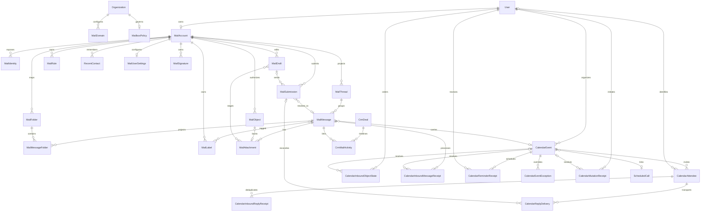

# MAIL-SPEC — Hub mailbox and calendar synchronization contract

> **Version:** 0.1.3
> **Status:** Frozen for implementation
> **Date:** 2026-08-13
> **Architecture:** `../ADR-MAIL-01-mail-engine-calendar-sync.md`
> **OpenAPI:** `../../../docs/mail/openapi.yaml`
> **QA handoff:** `../../../docs/mail/QA-HANDOFF.md`

## 1. Scope and terms

This document freezes the domain, HTTP, event, security, and traceability contracts for
the Hub mail feature. It does not claim that the described behavior is implemented.

- **Mailbox engine:** adapter-backed Stalwart candidate; owns raw mail and mailbox state.
- **Mailbox:** one engine account owned by one Hub user in one organization.
- **Identity:** a permitted `From` address attached to a mailbox.
- **Message:** immutable RFC message content plus mutable engine mailbox/flag state.
- **Thread:** Hub projection grouping messages by references and normalized subject.
- **Event:** canonical Hub calendar object with stable iCalendar UID.
- **Occurrence:** one recurrence instance identified by UTC-normalized `RECURRENCE-ID`.
- **Projection:** rebuildable Hub metadata derived from engine state.

## 2. Domain invariants

1. Every HTTP mailbox operation derives `organization_id` and owner `user_id` from the
   authenticated principal; clients never choose them.
2. Every engine identifier is opaque. An id from mailbox A is invalid in mailbox B.
3. Raw MIME and message body are never persisted in PostgreSQL.
4. A mail submission is idempotent on `(mailbox_id, hash(idempotency_key))`; the raw key
   is request-scoped only.
5. A canonical calendar master is unique on `(calendar_owner_id, uid)`. Imported
   occurrences are unique on `(calendar_event_id, recurrence_id)` in
   `CalendarEventException`; `CalendarEvent` itself never carries `recurrence_id`.
6. Calendar create/RSVP HTTP retries are serialized through a persisted
   `CalendarMutationReceipt`; a reused key with a different request hash is a conflict,
   while a matching completed request replays the original status and response.
7. RSVP updates compare attendee `version`; exactly one successful transition increments
   it by one.
8. Incoming iTIP replies may mutate only the sender-matching attendee row.
9. Soft-deleted projection rows never authorize engine access.
10. Search results are post-filtered by current organization + mailbox ownership before
   any snippet or identifier is returned.
11. All externally observable timestamps are RFC 3339. Event timezone is a valid IANA
    name. All-day event values use dates and never infer persisted/wire midnight instants;
    the reminder subsystem's explicitly contracted first-representable local day boundary
    does not replace that date representation.
12. Hub-uploaded mail bytes use a mail-owned storage namespace and authorization port;
    project-scoped `FileMetadata` is never reused as an implicit mailbox ACL.
13. Raw idempotency keys, engine credentials, DKIM private keys, message bodies, and raw
    MIME are never persisted in Hub PostgreSQL or returned by read APIs.
14. Durable `mail.*` and `calendar.*` outbox events are admitted to the shared EVENTS
    stream explicitly; neither subject family is added to the outbound webhook filter by
    default because payloads contain mailbox/calendar metadata.
15. Inbound iTIP REPLY delivery is deduplicated by a bounded durable ledger of every
    processed sender-bound payload hash for attendee + event sequence; storing only the
    last hash is forbidden because delayed redelivery could roll a later RSVP backward.
16. Incoming REQUEST/CANCEL order is durable per owner + UID + optional recurrence id.
    Lower sequence cannot mutate, equal conflicting content quarantines, and an early
    CANCEL tombstone prevents delayed resurrection.
17. External-organizer REPLY delivery uses stable mailbox draft/submission keys and
    reconciles indeterminate results before retry.
18. Availability authorizes the whole requested user set before source queries: self or an
    active same-org user sharing a non-deleted project/active channel, without admin bypass.
    It exposes only busy/free intervals with `event|call|leave` attribution, never private
    details; approved leave preserves the existing viewer/shared-project scope.
19. Calendar reminders have one durable intent and one durable in-app outcome: one
    persistently deduplicated row when policy permits, otherwise suppression. Existing
    Telegram/push delivery remains best-effort; no Resend channel is added. Transient
    policy/repository lookup failure remains pending and retriable rather than becoming a
    false suppression.

## 3. ERD



### 3.1 MailAccount

| Field | Type | Contract |
|---|---|---|
| `id` | UUID | primary key |
| `organization_id` | UUID | required, indexed |
| `user_id` | UUID | required, unique with organization |
| `engine_account_id` | string | opaque, encrypted-at-rest if credential-like, unique |
| `status` | enum | `provisioning`, `active`, `suspended`, `error` |
| `sync_cursor` | string nullable | opaque JMAP/adapter state token |
| `last_synced_at` | timestamp nullable | projection freshness |
| `created_at`, `updated_at` | timestamp | required |

No password, token, DKIM key, or engine administrator secret is stored on this entity.

### 3.2 MailIdentity

| Field | Type | Contract |
|---|---|---|
| `id` | UUID | primary key |
| `mail_account_id` | UUID | required |
| `address` | normalized email | unique within organization |
| `display_name` | string | max 160 |
| `kind` | enum | `primary`, `alias`, `group` |
| `send_allowed` | bool | server-authoritative |
| `is_default` | bool | at most one per account |
| `engine_identity_id` | string nullable | opaque mapping |
| `created_at`, `updated_at` | timestamp | required |

Group identity is schema-only in wave 1. The API must not expose it as selectable until
group authorization and fan-out are implemented.

### 3.3 MailFolder

| Field | Type | Contract |
|---|---|---|
| `id` | UUID | Hub projection id |
| `mail_account_id` | UUID | required |
| `engine_folder_id` | string | opaque, unique per account |
| `parent_id` | UUID nullable | same-account folder only; depth at most 2 in v1 |
| `role` | enum nullable | `inbox`, `sent`, `drafts`, `archive`, `trash`, `junk` |
| `name` | string | 1..120; custom sibling names unique case-insensitively |
| `color` | string nullable | design-token-safe color value |
| `sort_order` | int | stable user ordering |
| `unread_count`, `total_count` | non-negative int | rebuildable projection |
| `created_at`, `updated_at`, `deleted_at` | timestamp | soft delete for projection |

System-role folders cannot be deleted or reparented. Folder cycles are rejected.

### 3.4 MailThread

| Field | Type | Contract |
|---|---|---|
| `id` | UUID | primary key |
| `mail_account_id` | UUID | required |
| `thread_key` | SHA-256/base64url | unique per account |
| `normalized_subject` | string | prefix-normalized, Unicode-normalized |
| `participant_addresses` | JSON array | normalized unique addresses, bounded |
| `last_message_at` | timestamp | sort key |
| `message_count`, `unread_count` | non-negative int | projection |
| `is_pinned` | bool | Hub canonical |
| `has_attachments` | bool | projection |
| `snippet` | string | sanitized plain text, max 400 graphemes |
| `created_at`, `updated_at`, `deleted_at` | timestamp | projection lifecycle |

Thread key algorithm:

1. Prefer the nearest existing ancestor resolved from valid `References`, then
   `In-Reply-To`.
2. If no ancestor is present, derive a bounded fallback from normalized subject and
   canonical participant set.
3. Strip localized reply/forward prefixes iteratively with a bounded table; do not strip
   arbitrary colon-delimited text.
4. A later header-based match may merge fallback projections atomically; it never changes
   the engine message id.

### 3.5 MailMessage

| Field | Type | Contract |
|---|---|---|
| `id` | UUID | Hub projection id |
| `mail_account_id`, `mail_thread_id` | UUID | required |
| `engine_message_id` | string | opaque, unique per account |
| `internet_message_id` | string nullable | normalized RFC Message-ID, indexed |
| `in_reply_to` | string nullable | normalized RFC Message-ID |
| `references` | JSON array | bounded normalized Message-IDs |
| `from`, `to`, `cc`, `bcc`, `reply_to` | structured JSON | normalized addresses; BCC only for owner-sent copy |
| `subject` | string | max 998 octets at transport boundary |
| `snippet` | string | safe plain-text projection, max 400 graphemes |
| `sent_at`, `received_at` | timestamp nullable | protocol timestamps |
| `size_bytes` | int64 | non-negative |
| `priority` | enum | `low`, `normal`, `high` |
| `has_attachments`, `is_draft` | bool | projection |
| `is_seen`, `is_answered`, `is_flagged`, `is_junk` | bool | engine-authoritative projection snapshot |
| `engine_state` | string nullable | opaque bounded state/version token for reconciliation |
| `flags_synced_at` | timestamp nullable | snapshot freshness |
| `calendar_method` | enum nullable | `request`, `cancel`, `reply` |
| `calendar_event_id` | UUID nullable | verified Hub link only |
| `created_at`, `updated_at`, `deleted_at` | timestamp | projection lifecycle |

Seen/answered/flagged/junk/mailbox membership stay authoritative in the engine and are
exposed through a projection snapshot. `bcc` is never reconstructed for received mail.

### 3.5.1 MailMessageFolder

`mail_message_id`, `mail_folder_id`, `engine_state`, `projected_at`. Unique message +
folder. Both rows must belong to the same `MailAccount`. This join is rebuildable from
engine state and must not be used to authorize an engine call without resolving the
authenticated owner's account again.

### 3.6 MailLabel

`id`, `mail_account_id`, `name` (1..60, unique case-insensitive), `color`, timestamps.
Many-to-many assignment to messages is Hub-canonical. Thread label aggregation is derived.

### 3.7 MailAttachment

| Field | Type | Contract |
|---|---|---|
| `id` | UUID | primary key |
| `mail_message_id` | UUID nullable | set when saved/submitted/ingested |
| `draft_client_id` | UUID nullable | temporary owner-bound draft scope |
| `storage_object_id` | UUID nullable | SeaweedFS-backed Hub upload |
| `engine_blob_id` | string nullable | received/engine MIME blob |
| `content_id` | string nullable | inline reference |
| `filename`, `media_type`, `size_bytes` | metadata | server-normalized |
| `disposition` | enum | `attachment`, `inline` |
| `scan_status` | enum | `pending`, `clean`, `rejected`, `error` |
| `sha256` | string | required after confirm/ingest |
| timestamps | timestamp | required |

Exactly one of `storage_object_id` and `engine_blob_id` is set after attachment creation.
Only `clean` attachments may be submitted. The scanner interface is fail-closed.

### 3.7.1 MailObject

`id`, `organization_id`, `mail_account_id`, server-generated `object_key`, bounded
`bucket`, `upload_state` (`pending`, `confirmed`, `orphaned`, `deleted`), expected and
actual sizes, normalized filename/media type, nullable `sha256`, uploader user id,
`draft_client_id`, `scan_status`, `expires_at`, and timestamps. Object keys are generated
only by the server under `mail/<organization>/<account>/<object-id>`; no client-supplied
path is accepted. A dedicated mail storage port performs presign/confirm/read/delete and
rechecks owner + account on every operation. Pending/orphaned objects expire and are
cleaned idempotently. Project-scoped `FileMetadata` and project membership never grant
mail access.

### 3.8 MailRule

`id`, `mail_account_id`, `name`, `enabled`, `priority`, a bounded typed condition tree,
typed actions, `engine_script_id`, `version`, timestamps. V1 supports safe conjunctions
over sender/recipient/subject/has-attachment and actions move/add-label/mark-read. Raw
user-provided Sieve is never accepted by the public API.

### 3.9 RecentContact

`id`, `mail_account_id`, normalized `email`, `display_name`, nullable `user_id`,
`last_used_at`, `use_count`. Unique by account + normalized email. Suggestions always
rank active Hub users before external recent contacts.

### 3.10 MailSubmission

`id`, `mail_account_id`, nullable `mail_draft_id`, `idempotency_key_hash`, canonical
`request_hash`, stable `engine_submission_key`, `status` (`queued`, `submitting`, `sent`,
`unknown`, `failed`), nullable `engine_submission_id`, nullable `result_message_id`,
`last_error_code`, `attempt_count`, timestamps. Unique account + key hash. The raw key is
never persisted or returned. The persisted error is a safe code, never raw SMTP content
containing addresses/body.

Before retrying an `unknown` or interrupted submission, the service calls the engine's
submission reconciliation operation with the stable engine key. A confirmed engine result
is finalized without another submit; a definitive absence may transition back to queued;
an indeterminate result remains `unknown` and is not blindly retried. Reusing a key with a
different request hash returns `409`; identical input returns the same receipt.

The canonical send request hash covers the account, draft id, Hub revision, opaque engine
version, authorized From identity, normalized recipients, subject/body content hash,
priority and ordered attachment ids/hashes. Only the final hash is persisted. The stable
engine submission key derives from the Hub submission id, never from the raw HTTP key.

### 3.10.1 MailDraft

`id`, `mail_account_id`, opaque `engine_message_id`, opaque `engine_version`, positive
Hub `revision`, `status` (`active`, `saving`, `unknown`, `submitting`, `submitted`,
`deleted`), hashed
create-idempotency key + canonical create-request hash, nullable reply/forward message ids,
nullable last mutation id, timestamps. Unique engine message id per account and unique
account + create-key hash.
Recipients, subject, rich/plain bodies and MIME remain canonical in the engine and are
hydrated only for an authorized draft read; PostgreSQL never stores a second body copy.

Draft mutation is serialized per draft. `If-Match` compares Hub revision, then the engine
save receives the last engine version and a stable Hub mutation id. A successful engine
write stores the returned version and increments Hub revision exactly once. If the process
loses the response, state becomes `unknown`; the next read/save reconciles the engine
version before accepting another edit. It never overwrites a newer engine draft blindly.
Starting a submission atomically moves the draft to `submitting` and freezes its content;
edits are rejected until reconciliation proves definitive failure/absence and restores
`active`, or successful delivery moves it to `submitted`.

### 3.10.2 MailUserSettings

One row per active account: required default identity and nullable default signature ids
owned by the same account, `remote_images` (`blocked`, `trusted_senders`),
`compose_format` (`rich`, `plain`), version and timestamps. Provisioning/error accounts do
not expose this public resource. Defaults never bypass identity `send_allowed` checks.

### 3.10.3 MailSignature

`id`, `mail_account_id`, bounded name, sanitized rich body, server-normalized plain body,
`is_default`, version and timestamps. At most one default per account. Signatures are user
configuration rather than message bodies, but are still sanitized on write and render.

### 3.10.4 MailDomain

`id`, `organization_id`, normalized ASCII domain, `enabled`, `is_default`, verification
and DKIM status, bounded required-DNS projection, engine domain id, version and timestamps.
Domain is unique globally after normalization; at most one default per organization. DKIM
private material remains engine/secret-provider state and is never stored here.

### 3.10.5 MailboxPolicy

One versioned row per organization containing external-mail enablement, maximum message,
attachment and recipient limits, per-minute send rate, trash/junk retention, and
timestamps. The existing flat Resend alert setting remains a separate legacy resource.

### 3.11 CalendarEvent

| Field | Type | Contract |
|---|---|---|
| `id` | UUID | primary key |
| `organization_id`, `calendar_owner_id` | UUID | required, indexed |
| `uid` | string | stable, bounded, unique with owner; master-level only |
| `title`, `description`, `location` | string | bounded; description sanitized at render |
| `starts_at`, `ends_at` | timestamp nullable | required for timed events, end > start |
| `start_date`, `end_date_exclusive` | date nullable | required for all-day events |
| `all_day` | bool | selects date vs timestamp representation |
| `timezone` | IANA string | required |
| `rrule` | string nullable | RFC 5545 subset daily/weekly/monthly + until/count |
| `exdates` | JSON date/date-time array | same value type and timezone semantics as DTSTART |
| `sequence` | non-negative int | monotonic invitation revision |
| `source` | enum | `hub`, `mail_import`, `ical_feed` |
| `status` | enum | `confirmed`, `tentative`, `cancelled` |
| `organizer_id` | UUID nullable | null only for external organizer |
| `organizer_email` | normalized email | required |
| `scheduled_call_id` | UUID nullable unique | optional 1:1 link |
| `reminder_minutes` | int nullable | 0..40320 |
| `payload_hash` | SHA-256 | normalized iTIP idempotency check |
| `version` | int | optimistic event editing |
| timestamps + `deleted_at` | timestamp | soft delete/cancellation audit |

### 3.12 CalendarAttendee

| Field | Type | Contract |
|---|---|---|
| `id`, `calendar_event_id` | UUID | required |
| `user_id` | UUID nullable | null for external guest |
| `email`, `display_name` | normalized identity | email required |
| `role` | enum | `required`, `optional` |
| `rsvp_status` | enum | `needs_action`, `accepted`, `declined`, `tentative` |
| `recurrence_id` | string nullable | normalized occurrence key; null means series |
| `responded_at` | timestamp nullable | set outside `needs_action` |
| `version` | positive int | optimistic lock |
| `reply_delivery_status` | enum | `not_required`, `pending`, `sent`, `failed` |
| timestamps | timestamp | required |

Database enforcement uses two partial unique indexes because PostgreSQL does not consider
null values equal: `(event_id, normalized_email) WHERE recurrence_id IS NULL` and
`(event_id, normalized_email, recurrence_id) WHERE recurrence_id IS NOT NULL`. An
occurrence-specific attendee row inherits the series row until a response or override
materializes it.

### 3.13 CalendarEventException

`id`, `calendar_event_id`, `recurrence_id`, optional overridden start/end/date/timezone/
location/status, `sequence`, `payload_hash`, timestamps. Unique event + recurrence id.
Deleting one occurrence stores a cancelled exception rather than mutating the master rule.

### 3.14 CalendarMutationReceipt

`id`, `organization_id`, authenticated `actor_user_id`, `operation`
(`event_create`, `rsvp_series`, `rsvp_occurrence`), `idempotency_key_hash`, canonical
`request_hash`, `state` (`in_progress`, `completed`), `response_status`, bounded
`response_json`, nullable `calendar_event_id`, timestamps and `expires_at`. Unique
`(organization_id, actor_user_id, operation, idempotency_key_hash)`. The raw key is never
persisted. Reservation, domain mutation, outbox write and completed response are committed
atomically; abandoned `in_progress` receipts reconcile by transaction rollback, not by a
second mutation. Completed responses are retained for at least 24 hours and replayed byte-
equivalently. The stored response is calendar metadata only and follows the same access and
retention policy as its event.

### 3.15 CalendarInboundReplyReceipt

`id`, `calendar_attendee_id`, non-negative `event_sequence`, canonical sender-bound
`payload_hash` (SHA-256), `outcome` (`applied`, `observed_no_change`), and `created_at`.
Unique `(calendar_attendee_id, event_sequence, payload_hash)`. The service derives this
sender-bound hash as SHA-256 over the normalized authenticated/envelope sender plus the
parser's canonical payload hash (which already covers UID, optional recurrence id,
sequence and normalized REPLY semantics); raw MIME is never stored. This ledger is
distinct from the HTTP
`CalendarMutationReceipt` and contains no idempotency key or response body.

The service accepts at most eight distinct validated REPLY hashes for one attendee and
event sequence. It retains all eight until that event sequence is obsolete; a ninth new
hash is quarantined without attendee/outbox mutation. Older-sequence receipts may be
removed only after the event sequence has advanced because every lower-sequence REPLY is
then unconditionally stale. Receipt insertion, optional attendee transition and optional
outbox write share the same transaction and a lock on the sender-matched attendee
serializes concurrent distinct replies and cap checks.

### 3.16 CalendarInboundObjectState

One current ordering row per calendar owner + normalized UID + optional recurrence id
stores authenticated organizer email, highest non-negative sequence, `request|cancel`,
canonical payload SHA-256, state (`applied`, `tombstone`, `deferred_missing_master`),
nullable event link, nullable expiry and timestamps. Series and occurrence uniqueness use
separate partial
indexes. The row is locked with the event/exception mutation. An early CANCEL is a
tombstone, not an invalid empty `CalendarEvent`. After first admission the normalized
organizer is immutable; any other organizer is quarantined regardless of sequence. State
bound to a retained event follows calendar retention. An unbound CANCEL tombstone persists
for the mailbox/account lifetime so delayed mail cannot resurrect the object;
`deferred_missing_master` expires after seven days with its dead-lettered message receipt.
All unbound object states share a 10,000-row mailbox cap. At the cap, state-changing parts
for previously unseen UIDs quarantine before event mutation, known UID state continues,
and calendar-import health becomes visibly degraded with a rate-limited content-free ops
signal. Cleanup never evicts a tombstone to make room; recovery requires an approved quota
increase or mailbox/account removal, not automatic tombstone reset.
Occurrence admission also locks the series state: it must match an existing series
organizer, or remain deferred with its candidate organizer until a matching active master
exists. A whole-series CANCEL makes every materialized exception effectively cancelled and
an occurrence-only REQUEST cannot reactivate the series. Sequence comparison itself remains
per RFC 5546 component key (UID plus optional RECURRENCE-ID), not across distinct keys.

### 3.17 CalendarInboundMessageReceipt

One row per projected mail message + SHA-256 of the stable calendar-part locator stores the
source event-envelope id, bounded attempt/lease/retry data, nullable event link and state
(`pending`, `processing`, `applied`, `ignored_stale`, `duplicate`,
`deferred_missing_master`, `quarantined`, `dead_letter`). It contains no calendar bytes,
raw locator, provider error or authentication header. It provides consumer idempotency;
`CalendarInboundObjectState` separately provides cross-message ordering. Deferred work
dead-letters after seven days; finalized receipts are retained for 30 days.

### 3.18 CalendarReplyDelivery

One immutable outward REPLY intent is unique on attendee + event sequence + attendee
version. It stores optional recurrence id, RSVP status, state (`pending`, `submitting`,
`unknown`, `sent`, `failed_permanent`), nullable mail submission link, bounded retry/error
metadata and timestamps. It is created with the RSVP transaction. `unknown` reconciles the
same hidden draft and `MailSubmission`; it never blindly resubmits.
The public attendee status maps `pending|submitting|unknown` to `pending`, `sent` to `sent`,
`failed_permanent` to `failed`, and absence of an external delivery intent to
`not_required`.

### 3.19 CalendarReminderReceipt

One receipt per event + internal user + normalized occurrence + event sequence + derived
due time stores reminder minutes, state (`pending`, `emitted`, `suppressed`, `expired`),
nullable outbox id, nullable in-app outcome (`pending`, `delivered`, `suppressed`), nullable
safe suppressed-outcome reason (`policy_disabled`, `quiet_hours`, `stale_event`,
`ineligible_user`, `configuration_changed`, `policy_invalid`, `expired`), notification id and
timestamps. Suppressed requires a reason; pending/delivered forbid one. No event text is
stored. The notification row accepts an
optional fixed dedupe-key hash with a partial unique user + type + hash index; legacy callers
without a key preserve their existing behavior. Final reminder receipts remain for 90 days
after due time; cleanup never removes pending work.
Timed `due_at` is the effective occurrence start instant minus the offset. All-day
`due_at` uses the first representable instant of the effective `start_date` in the event's
valid IANA timezone minus the offset. A midnight overlap chooses the earlier instant, a
midnight gap chooses the first instant after the gap, and a wholly skipped date chooses the
first instant after that date's gap. This scheduling instant never converts the date-only
event in persistence, API or iTIP.
Lookahead creates/finds `pending`; the due-time claim alone rechecks current event,
occurrence, attendee and reminder configuration, then atomically emits one outbox event or
finalizes suppressed/expired. The current sequence, effective start, non-null offset and
recomputed due time must exactly match the receipt. A changed/disabled offset creates no
delivery from the old receipt; a new offset uses a separate receipt at its own derived due.
The notification consumer repeats those checks plus owner/internal-attendee eligibility in
the same transaction and lock order as the optional notification row. Event, optional
exception, optional attendee, stable user-policy guard, reminder receipt and notification
are locked in that order. The guard is the user row: preference upsert locks it before
resolving/upserting optional preference rows, a quiet-hours profile update locks it before
mutation, and the consumer resolves both only after acquiring it. This serializes policy
changes even when a preference row did not previously exist.
When notification policy permits in-app delivery, one row is created; a definitive stale,
ineligible or policy-suppressed outcome creates none and is durably recorded. Duplicate
delivery cannot re-evaluate policy or change either outcome. Transient user/event/
preferences/repository failure leaves the outcome pending and NAKs for bounded retry.
WebSocket publication is post-commit best-effort; notification list/query refetch is the
recovery path and no exactly-once realtime guarantee is claimed.
Telegram/Web Push attempts for this keyed path are also post-commit only. A transaction
rollback produces no external attempt, and an external success/failure never changes or
rolls back the canonical receipt/notification outcome; crash-boundary misses/duplicates
remain within their documented best-effort contract.
The keyed calendar path treats quiet hours as disabled only when both fields are absent.
Otherwise both must be strict `HH:MM` and the user timezone valid IANA. Invalid/incomplete
policy has no UTC/deliver fallback: it durably suppresses with `policy_invalid` and emits a
rate-limited content-free health signal. Repository/read failures remain transient instead.
State coherence is closed: pending has no outbox/notification; emitted requires outbox;
delivered requires notification and no reason; every suppressed outcome has no notification
and one safe reason; scheduler-expired uses outcome suppressed + reason `expired`. No
terminal state is reopened.

### 3.20 CrmMailActivity

Immutable link metadata contains id, deal id, owned projected mail message id, linking user,
server-derived inbound/outbound direction, message occurred-at, created-at and nullable
deleted-at. Unique
`(deal_id, mail_message_id)`. It stores no subject, address, body, raw MIME, engine id,
campaign or tracking state and never authorizes mailbox access. Relinking restores the same
owned soft-deleted link instead of creating duplicate history. A deal is capped at 10,000
active mail links and public lists use an opaque cursor with at most 100 rows; history is
never silently evicted. Deal/mail
retention tombstones links before either parent can be hard-deleted; no cascade deletes a
deal or leaves a navigable link to removed personal mail.

## 4. Calendar state machines

### 4.1 RSVP

All transitions between `needs_action`, `accepted`, `tentative`, and `declined` are valid
for an active event. A cancelled event accepts no RSVP mutation. Each transition:

1. validates event/occurrence and current attendee version;
2. updates status, `responded_at`, version in one transaction;
3. appends `calendar.rsvp.changed.v1` to the outbox;
4. queues external `METHOD:REPLY` when organizer is external;
5. returns the canonical attendee including delivery status.

Repeated request with the same idempotency key returns the original result. Repeated
request without the same key but with stale version returns `409`, canonical
`{error,request_id}`, `X-Hub-Error-Code: ATTENDEE_VERSION_CONFLICT`, the current attendee
version as `ETag`, and a `Location` to refetch the canonical event before retry.

### 4.2 Event updates

| Change | Sequence | Existing attendee RSVP | Notification |
|---|---:|---|---|
| description only, silent | unchanged | preserve | none |
| description only, notify | +1 | preserve | REQUEST update |
| title/agenda | +1 | preserve | REQUEST update |
| time, timezone, all-day | +1 | reset non-organizer | REQUEST update |
| location | +1 | reset non-organizer | REQUEST update |
| recurrence/exdate | +1 | reset affected non-organizer scope | REQUEST update |
| reminder_minutes only | unchanged | preserve | none; event version still increments |
| add attendee | +1 | preserve existing; new needs_action | REQUEST to affected/all per transport policy |
| remove attendee | +1 | removed row retained as audit tombstone | CANCEL to removed attendee |
| cancel event/occurrence | +1 | preserve historical response | CANCEL |

Cancelling one occurrence writes or updates a `CalendarEventException` with canonical
`recurrence_id` and `cancelled` status; it never rewrites the master RRULE or cancels the
series. `DELETE /calendar/v2/events/{eventId}/instances/{recurrenceId}` compares the master
event version from `If-Match`, increments master sequence and version once, returns the
cancelled occurrence metadata, writes one `calendar.invite.cancelled.v1` outbox event and
queues one iTIP `CANCEL` carrying `RECURRENCE-ID`. A retry after an ambiguous response
refetches the event/occurrence; a stale version conflicts before any second mutation.
Changing only `reminder_minutes` is local scheduling metadata: it advances optimistic event
version but not iTIP `SEQUENCE`, attendee RSVP or invitation delivery. Existing reminder
receipts are not rewritten; the due-time and consumer checks suppress mismatched old work,
and a non-null new offset obtains its own derived receipt.

### 4.3 Incoming iTIP

- MIME parser enforces total size, nesting depth, line length, component count, timezone,
  recurrence expansion, and attendee count bounds.
- `REQUEST`: validate addressed mailbox and organizer; upsert by owner + UID + recurrence;
  apply only newer sequence or recognize an exact equal-sequence duplicate. An occurrence
  REQUEST received before its master is durably deferred and rehydrated later.
- `CANCEL`: same idempotency rules; cancel only matching event/occurrence. If no event
  exists, record an ordering tombstone so a delayed lower/equal REQUEST cannot resurrect it.
- For an occurrence, lock and verify the series organizer before its own object state. If
  the master is absent or cancelled, an occurrence REQUEST remains deferred; a whole-series
  CANCEL cancels every materialized exception without deleting its ordering watermark.
  Series and occurrence SEQUENCE values are compared only within the same UID plus optional
  RECURRENCE-ID key, following RFC 5546 section 2.1.5.
- `REPLY`: match the normalized authenticated/envelope sender to exactly one attendee and
  never accept organizer/event mutations. Its `SEQUENCE` must equal the current event
  sequence: lower is stale, higher is quarantined. The service derives the sender-bound
  hash from the normalized sender plus parser-provided canonical payload hash and looks it
  up in `CalendarInboundReplyReceipt`; a hash already processed for that attendee and
  sequence is a no-op even if later replies changed the attendee again. A distinct
  current-sequence sender-bound PARTSTAT may advance only that attendee and atomically
  records an `applied` receipt plus one outbox event. A distinct hash whose PARTSTAT already
  equals current state records `observed_no_change` without attendee/outbox mutation, so a
  later redelivery cannot roll state backward. The bounded ninth distinct hash is
  quarantined. This inbound path never creates or consumes an HTTP
  `CalendarMutationReceipt`.
- Untrusted or malformed calendar parts remain downloadable attachments with zero state
  mutation and a safe parse error code.
- REQUEST/CANCEL mutation requires either an engine-confirmed authenticated local identity
  or external DMARC-aligned From equal to ORGANIZER. v1 has no implicit forwarded-message
  or organizer-delegation trust. Message receipt, object state, event/exception and outbox
  update atomically according to Phase 147 `CONTRACT.md`.

## 5. HTTP API contract

The machine-readable contract is `docs/mail/openapi.yaml`. General rules:

- Prefix: `/api`, matching the existing Fiber router and generated Swagger base path.
- Auth: existing bearer/session middleware.
- Pagination: opaque `cursor`, default 50, max 100.
- Mutation idempotency: `Idempotency-Key` required for send, event create, and RSVP.
- Calendar create/RSVP idempotency uses `CalendarMutationReceipt`; `MailSubmission`
  remains the send-specific receipt.
- Optimistic locking: `If-Match: "<version>"` for draft/event/rule updates; RSVP body
  includes `attendee_version` for explicit conflict responses.
- Errors retain mandatory Hub NFR-13 wire JSON `{error,request_id}`. Machine-readable
  calendar conflict codes use `X-Hub-Error-Code`; stale RSVP additionally returns current
  attendee-version `ETag` and canonical event `Location` for refetch.
- `403` does not reveal whether an engine/message id exists in another mailbox.

Endpoint groups frozen for v1:

| Group | Endpoints |
|---|---|
| Folders | `GET/POST /mail/folders`, `PATCH/DELETE /mail/folders/{id}` |
| Labels | `GET/POST /mail/labels`, `PATCH/DELETE /mail/labels/{id}`, `PUT /mail/messages/{id}/labels` |
| Threads/messages | `GET /mail/threads`, `GET /mail/threads/{id}`, `GET /mail/messages/{id}`, `POST /mail/messages/bulk` |
| Draft/send | `POST /mail/drafts`, `GET/PATCH/DELETE /mail/drafts/{id}`, `POST /mail/drafts/{id}/send`, `GET /mail/submissions/{id}` |
| Attachments | `POST /mail/attachments/presign`, `POST /mail/attachments/{id}/confirm`, `GET/DELETE /mail/attachments/{id}` |
| Search/contacts | `GET /mail/search`, `GET /mail/contacts/suggest` |
| User settings | `GET/PATCH /mail/settings`, `GET /mail/identities`, CRUD `/mail/signatures`, CRUD `/mail/rules` |
| Existing calendar aggregate | `GET /calendar/events` remains byte-shape compatible as `{events,from,to}`; first-class events are later added only as an additive aggregate kind |
| Canonical calendar | `GET/POST /calendar/v2/events`, `GET/PATCH/DELETE /calendar/v2/events/{id}`, `DELETE /calendar/v2/events/{id}/instances/{recurrenceId}`, v2 RSVP series/occurrence and v2 availability |
| CRM mail seam | `GET /crm/deals/{dealId}/mail-compose-context`, `GET /crm/deals/{dealId}/mail-activities`, idempotent `PUT` and audited `DELETE /crm/deals/{dealId}/mail-activities/{messageId}` |
| Existing Resend admin | `GET/PUT /admin/mail/settings` retains the flat `hub_mail_url/from_alerts/alerts_enabled/daily_limit/resend_ready` response contract; deprecated `POST /admin/mail/broadcast` is documented as a current ADR-NOTIF-01 governance gap, not new scope |
| Mailbox admin | `GET/PUT /admin/mail/mailbox-settings`, domain CRUD, `GET /admin/mail/health`; all require admin RBAC and an audit action |

## 6. Event envelope and compatibility

Canonical JSON envelope:

```json
{
  "schema_version": 1,
  "event_id": "uuid",
  "occurred_at": "2026-08-13T12:00:00Z",
  "organization_id": "uuid",
  "actor_id": "uuid-or-null",
  "correlation_id": "opaque-bounded-string",
  "payload": {}
}
```

- Subject suffix and `schema_version` advance together for breaking changes.
- Additive optional fields do not require a new subject version.
- Consumers reject unknown major versions to dead letter; they never guess.
- PII-bearing payloads contain normalized addresses but no body, raw MIME, attachment
  content, auth tokens, or engine credentials.
- Retention follows existing event/audit policies; search consumers store only projections.
- The shared JetStream `EVENTS` subject configuration must include `mail.>` and
  `calendar.>` before any producer is enabled. The outbound webhook consumer allowlist is
  unchanged unless a separate privacy/security decision explicitly adds a safe event.

### 6.1 Payload schemas

`mail.received.v1`:

```json
{
  "mailbox_id": "uuid",
  "message_id": "uuid",
  "engine_message_id": "opaque",
  "thread_id": "uuid",
  "from": {"email": "sender@example.test", "name": "Sender"},
  "to": [{"email": "user@hub.example"}],
  "received_at": "2026-08-13T12:00:00Z",
  "folder_ids": ["uuid"],
  "has_attachments": true,
  "calendar_method": "request"
}
```

`mail.sent.v1` adds `submission_id`, `sent_at`, and `delivery_class` (`internal`,
`instance_domain`, `external`). `mail.message.changed.v1` contains a non-empty bounded
`changed_fields` list plus current folder ids/flags/label ids.

Calendar invite events contain `event_id`, `uid`, `sequence`, optional `recurrence_id`,
attendee ids, and changed fields. `calendar.rsvp.changed.v1` contains attendee id/email,
previous/new status, new version, recurrence id, and reply delivery status.
`calendar.reminder.due.v1` contains only reminder receipt id, event id, internal user id,
optional recurrence id, sequence and due time. The notification consumer reauthorizes and
hydrates display metadata after consumption; the event contains no title or description.
It must also transactionally prove the current effective start, offset, sequence and
eligibility still match before creating the notification.

## 7. Security acceptance contract

| Control | Required behavior | Failure mode |
|---|---|---|
| Owner isolation | all engine calls bind server-resolved account id | `404`/`403`, no engine call |
| HTML sanitization | server allowlist removes active content and fetch primitives | plain-text fallback |
| Reader isolation | CSP/sandbox; no direct remote network | content remains blocked |
| Image proxy SSRF | DNS/IP validation before and after connect; private ranges blocked; size/time/type caps | `REMOTE_CONTENT_BLOCKED` |
| Attachments | limits, filename normalization, type policy, hash, fail-closed scanner | quarantine/reject |
| Sending | per-user/instance token buckets, recipient/message caps | `429` with bounded retry hint |
| Auto-response | `Auto-Submitted`, precedence, null sender and loop headers honored | no automated response |
| iTIP reply | sender-attendee match, UID/sequence/version rules | attachment-only/quarantine |
| Admin | existing admin RBAC + audit | `403` |
| Search | owner/org filters before hydrate | empty/not found, audit anomaly |
| Secrets | engine/DKIM credentials never in repository/log/API | startup failure if absent |

Remote image retrieval uses only server-issued tokens bound to an owned message via
`GET /mail/messages/{messageId}/remote-images/{imageToken}`. The public API never accepts
an arbitrary target URL for proxying.

## 8. Requirements and traceability

Priority: P0 blocks merge-ready feature claim; P1 is required for full requested scope;
P2 is explicitly deferred. Risk uses Critical/High/Medium.

| ID | Requirement | Priority | Risk | Unit evidence owner | Higher-layer handoff |
|---|---|---:|---|---|---|
| FR-MAIL-001 | owned mailbox provisioning and isolation | P0 | Critical | Go adapter/service fakes | contract/API/authz |
| FR-MAIL-002 | system + depth-2 custom folders | P1 | High | Go folder invariants | API/E2E |
| FR-MAIL-003 | thread grouping from references + bounded fallback | P0 | High | Go pure table tests | API/E2E |
| FR-MAIL-004 | message/thread read, flag, pin and realtime unread | P1 | High | Go projection + FE reducer | API/E2E/realtime |
| FR-MAIL-005 | bulk move/label/archive/junk/trash | P1 | High | Go command tests | API/E2E/audit |
| FR-MAIL-006 | drafts with revisioned autosave and recovery | P0 | High | Go service + FE hook | API/E2E |
| FR-MAIL-007 | reply/reply-all/forward RFC headers and quoting | P0 | High | Go pure tests | contract/E2E |
| FR-MAIL-008 | SeaweedFS multi/inline attachments with scan gate | P0 | Critical | Go policy + FE state | API/integration/security |
| FR-MAIL-009 | internal and instance-domain external send/receive through engine | P0 | Critical | adapter mock | integration/E2E/runtime |
| FR-MAIL-010 | labels and nested folders | P1 | Medium | Go invariants + FE | API/E2E |
| FR-MAIL-011 | Meilisearch async search/filter projection | P1 | High | event mapping | integration/API |
| FR-MAIL-012 | Hub user + recent contact autocomplete | P1 | Medium | ranking pure tests | API/E2E |
| FR-MAIL-013 | signature, From alias, CC/BCC, priority | P1 | High | composition tests | API/E2E |
| FR-MAIL-014 | user rules compile to safe typed Sieve | P1 | High | compiler tests | integration/security |
| FR-MAIL-015 | admin domains/limits/retention/health/external toggle | P0 | Critical | policy/service tests | API/authz/runtime |
| FR-MAIL-016 | HTML/remote content/attachment/rate/loop security controls | P0 | Critical | pure policy tests | security/integration |
| FR-CALSYNC-001 | first-class event/attendee model and call backfill | P0 | Critical | state/policy units | migration/integration |
| FR-CALSYNC-002 | deterministic REQUEST create/update | P0 | Critical | RFC fixture tests | contract/E2E |
| FR-CALSYNC-003 | deterministic CANCEL event/occurrence | P0 | Critical | RFC fixture tests | contract/E2E |
| FR-CALSYNC-004 | incoming REPLY updates only matching attendee | P0 | Critical | spoof/state tests | API/integration/security |
| FR-CALSYNC-005 | incoming external REQUEST import + outward REPLY | P0 | Critical | parser/state tests | integration/E2E |
| FR-CALSYNC-006 | inline RSVP with optimistic lock and realtime organizer view | P0 | Critical | Go state + FE card | API/E2E/realtime |
| FR-CALSYNC-007 | reschedule sequence/reset policy | P0 | High | policy table tests | contract/E2E |
| FR-CALSYNC-008 | duplicate UID/sequence idempotency | P0 | Critical | parser/service tests | integration |
| FR-CALSYNC-009 | series vs RECURRENCE-ID response | P0 | Critical | recurrence fixtures | integration/E2E |
| FR-CALSYNC-010 | IANA TZ, DST and all-day correctness | P0 | Critical | fixed-zone fixtures | integration/E2E |
| FR-CALSYNC-011 | busy/free includes calls/events/leave | P1 | High | interval pure tests | API/E2E |
| FR-CALSYNC-012 | durable in-app reminders through existing preferences; due/consumer current-config recheck; transient lookup retries; external realtime/channels best-effort | P1 | High | scheduler/consumer policy units | integration/E2E |
| FR-CALSYNC-013 | L1 external iCal feed subscription | P2 | High | parser fixtures | integration/security |
| FR-CRM-MAIL-001 | owned deal compose context creates one ordinary idempotent Mail draft and opens it by opaque UUID | P1 | High | authz/adapter/UI units | API/E2E |
| FR-CRM-MAIL-002 | explicit idempotent owned-message link/unlink from deal timeline or owned reader | P1 | High | service/privacy/reader units | API/security/E2E |

### Named critical scenarios

- `TC-CALSYNC-001`: accept whole recurring series.
- `TC-CALSYNC-002`: decline one occurrence using `RECURRENCE-ID`.
- `TC-CALSYNC-003`: time change increments sequence and resets non-organizer RSVP.
- `TC-CALSYNC-004`: silent description edit preserves sequence/RSVP.
- `TC-CALSYNC-005`: availability reports call/event conflict and approved leave.
- `TC-CALSYNC-006`: concurrent RSVP with stale attendee version returns 409.
- `TC-CALSYNC-007`: repeated same UID/sequence/payload is idempotent.
- `TC-CALSYNC-008`: same UID/sequence with conflicting payload is quarantined.
- `TC-CALSYNC-009`: external guest receives request and reply changes only that guest.
- `TC-CALSYNC-010`: organizer/attendee zones cross a DST boundary without instant drift.
- `TC-CALSYNC-011`: all-day event round-trips exclusive end date.
- `TC-CALSYNC-012`: spoofed REPLY cannot change another attendee or organizer.
- `TC-CALSYNC-013`: cancelling one recurrence instance creates a cancelled exception and
  occurrence-scoped iTIP/outbox without changing or cancelling the remaining series.
- `TC-CALSYNC-014`: for series and occurrence, accepted REPLY hashes A then B followed by
  delayed A cannot roll RSVP backward; same-status hashes are durably observed and a ninth
  distinct current-sequence hash quarantines without attendee/outbox mutation.
- `TC-CALSYNC-015`: authenticated CANCEL before REQUEST creates a tombstone; delayed lower
  or equal REQUEST cannot resurrect the series/occurrence.
- `TC-CALSYNC-016`: an occurrence REQUEST received before its master is deferred; when the
  master arrives it is rehydrated and cannot override a newer occurrence tombstone.
- `TC-CALSYNC-017`: outward external-organizer REPLY loses its submit response and
  reconciles the same hidden draft/submission without duplicate mail.
- `TC-CALSYNC-018`: availability returns deterministic private busy/free for canonical
  events, calls and policy-visible approved leave while rejecting the whole request when
  any user is foreign, inactive or outside self/shared-project-or-channel scope. Leave date
  labels expand in the target employee's valid IANA timezone.
- `TC-CALSYNC-019`: duplicate reminder outbox delivery creates exactly one in-app
  notification row when policy permits, or zero when suppressed; Telegram/push guarantees
  remain explicitly best-effort.
- `TC-CALSYNC-020`: reminder preferences/quiet hours suppress delivery without falling
  back to Resend/email.
- `TC-CALSYNC-020A`: transient user/preferences/repository failure leaves the reminder
  pending and retriable; post-commit WebSocket failure preserves the canonical in-app row.
- `TC-CALSYNC-020B`: an in-app reminder/channel disable, quiet-hours/offset change,
  reschedule/cancel/delete, or attendee decline/removal committed before consumer
  finalization durably suppresses the emitted intent without an in-app row; a consumer
  commit that serializes first remains the one valid row. Telegram/Web Push keep the
  documented best-effort boundary. Timed and all-day due derivation are deterministic
  across IANA/DST cases.
- `TC-CALSYNC-020C`: invalid IANA timezone or incomplete/malformed quiet hours records one
  `policy_invalid` suppression, no notification row and a bounded content-free signal; no
  UTC or delivery fallback occurs.
- `TC-CALSYNC-021`: an occurrence from another organizer cannot attach to or mutate a known
  series UID even when that occurrence has no prior ordering row.
- `TC-CALSYNC-022`: a whole-series CANCEL cancels materialized exceptions and an isolated
  occurrence REQUEST stays deferred until a same-organizer active master exists.
- Conditional `TC-CALSYNC-023`: L1 feed fetch rejects private/rebound/redirected targets and
  never exposes the encrypted URL or credentials.
- Conditional `TC-CALSYNC-024`: L1 conditional refresh handles 304 without rewriting the
  last complete source snapshot.
- Conditional `TC-CALSYNC-025`: L1 parse/apply failure retains the prior snapshot and cannot
  overwrite another calendar source.
- `TC-CRM-MAIL-001`: a deal owner creates one ordinary Mail draft with a stable key and no
  recipient in URL/history; a lost create response retries the same key/body. The owner
  sends through Mail and explicitly links the definitively owned projected message to the
  deal timeline.
- `TC-CRM-MAIL-002`: CRM admin/deal access cannot grant access to another user's message
  or cause engine hydration.
- `TC-CRM-MAIL-003`: the reader can manually link an existing owned inbound/outbound
  message, offers only deals owned by the authenticated user, and still relies on the
  server's independent deal/message ownership check.
- `TC-MAIL-001`: retry after send timeout reconciles idempotency key without duplicate.
- `TC-MAIL-002`: mailbox-owner isolation prevents cross-user engine access.
- `TC-MAIL-003`: hostile HTML and SVG active content are removed server-side.
- `TC-MAIL-004`: image proxy blocks loopback/private/rebound targets.
- `TC-MAIL-005`: pending/rejected attachment cannot be sent.
- `TC-MAIL-006`: nested folder cycle and depth 3 are rejected.
- `TC-MAIL-007`: References grouping wins over misleading normalized subject.
- `TC-MAIL-008`: auto-response loop headers suppress generated reply.
- `TC-MAIL-009`: lost draft-save response reconciles before another write and PostgreSQL
  contains no body copy.
- `TC-MAIL-010`: mail attachment object authorization is account-scoped and cannot be
  obtained through project membership.
- `TC-MAIL-011`: submission key reuse with changed frozen draft input returns 409; an
  unknown receipt never causes blind submit.
- `TC-MAIL-012`: calendar/mail outbox subjects are admitted durably while the generic
  outbound webhook filter remains unchanged.
- `TC-MAIL-013`: draft content is frozen while its submission is queued/submitting/unknown
  and becomes editable again only after a definitive non-delivery result.

## 9. Delivery phases

| Phase | Backlog | Contract outcome |
|---:|---|---|
| 142 | TASK-235 | ADR, ERD, API/events/security/QA handoff frozen |
| 143 | TASK-236 | CalendarEvent/Attendee/Exception, iTIP and RSVP core |
| 144 | TASK-237 | Mailbox domain, fake engine, folders/threads/drafts/submission |
| 145 | TASK-238 | Stalwart adapter, instance domain, Docker profile and admin health |
| 146 | TASK-239 | Outlook three-pane UI, composer, attachments, search/realtime |
| 147 | TASK-240 | recurrence/import reliability, busy/free, reminders, L1/CRM seam |
| 148 | TASK-241 | security, reconciliation, docs, independent verification/rebase gate |

## 10. Status honesty

Freezing this document makes named atomic packets eligible only after their model,
dependency, migration, founder and launcher gates pass; it does not itself authorize a
blocked write. Until corresponding evidence exists, all implementation, migration,
Docker, API, UI, security, and end-to-end statuses remain `NOT_RUN` or `NOT_IMPLEMENTED`.
